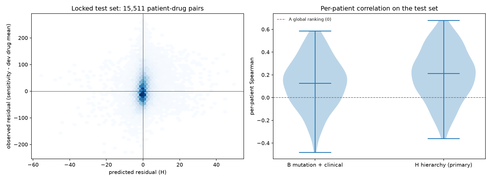
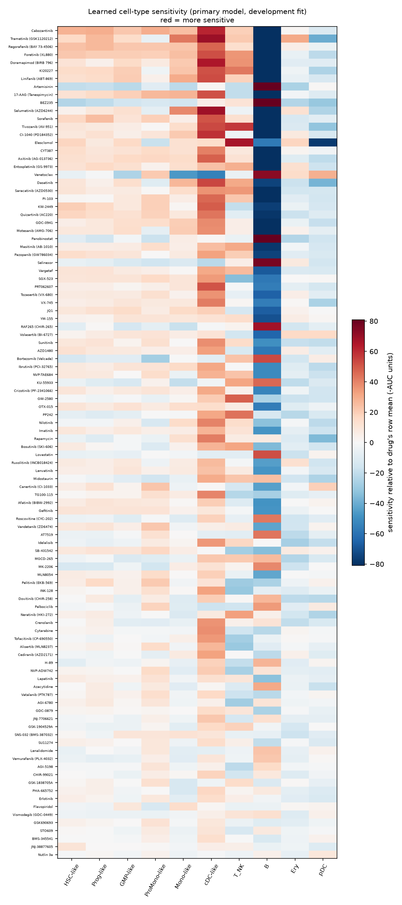

# Experiment 2, Step 4: locked test set results

Generated 2026-10-15 by the single test evaluation (`EXP2_CONFIRM_TEST=yes python -m pipeline.run --phase exp2-4`). Plan: [exp2_plan.md](exp2_plan.md), including Amendment 1. Development results: [exp2_step3_development.md](exp2_step3_development.md). Experiment 2 is a follow-up designed after the first pre-registered validation (Phase 4) found no patient-specific value.

## Primary result

- Test set: 178 samples from 169 patients (Beat AML waves 3+4 only), 104 drugs scored by the primary model.
- **Primary model H (hierarchy-weighted): mean per-patient Spearman 0.202, 95% CI 0.165 to 0.238.**
- **H vs A (global ranking), paired sign-flip permutation, one-sided: p = 0.0001.**
- **Decision (pre-registered rule: p < 0.05 and CI excluding 0): patient-specific value SUPPORTED.**
- Robustness, within-patient drug-label permutation (2,000 permutations): p = 0.0005.
- Relative to the Step 1 ceiling: 30% of the pre-specified estimate (0.67) and 26% of the bias-corrected estimate (0.77).

## All models on the test set

|                                       |   primary_mean |   ci_lo |   ci_hi |   n_patients |   n_samples |   pooled_pearson |   top5_hit_rate |    alpha |
|:--------------------------------------|---------------:|--------:|--------:|-------------:|------------:|-----------------:|----------------:|---------:|
| A global ranking                      |          0.000 |   0.000 |   0.000 |      151.000 |     159.000 |            0.000 |           0.200 |  nan     |
| B mutation + clinical                 |          0.129 |   0.095 |   0.165 |      151.000 |     159.000 |            0.175 |           0.330 | 1000.000 |
| H hierarchy (PRIMARY)                 |          0.202 |   0.165 |   0.238 |      151.000 |     159.000 |            0.140 |           0.403 | 1000.000 |
| HR hierarchy + reversion              |          0.213 |   0.177 |   0.249 |      151.000 |     159.000 |            0.157 |           0.424 | 1000.000 |
| HM hierarchy + myeloid-line reversion |          0.226 |   0.188 |   0.263 |      151.000 |     159.000 |            0.164 |           0.411 | 1000.000 |

`primary_mean`: mean over patients of per-sample Spearman (samples with at least 20 drugs), patient-level bootstrap CI (10,000). `top5_hit_rate`: share of the 5 highest-predicted drugs in the observed top 20% (chance 0.20).

## Secondary comparisons (two-sided paired sign-flip tests over patients)

|                            |   mean_diff |      p |   H_on_subset |
|:---------------------------|------------:|-------:|--------------:|
| H vs B                     |      0.0725 | 0.0038 |      nan      |
| HR vs H                    |      0.0111 | 0.0314 |      nan      |
| HM vs H (same drug subset) |      0.0132 | 0.0219 |        0.2124 |

HM covers only drugs with AML/monocytic-line signatures, so it is compared with H restricted to the same drugs.

## Amendment 1 analyses

**Low-signal samples excluded** (15 test samples removed; development fitting also without them):

|                                       |   primary_mean |   ci_lo |   ci_hi |   n_patients |   n_samples |   pooled_pearson |   top5_hit_rate |   p_vs_A |
|:--------------------------------------|---------------:|--------:|--------:|-------------:|------------:|-----------------:|----------------:|---------:|
| B mutation + clinical                 |         0.1280 |  0.0918 |  0.1651 |     139.0000 |    147.0000 |           0.1747 |          0.3149 | nan      |
| H hierarchy (PRIMARY)                 |         0.2089 |  0.1701 |  0.2466 |     139.0000 |    147.0000 |           0.1447 |          0.4038 |   0.0001 |
| HR hierarchy + reversion              |         0.2175 |  0.1786 |  0.2551 |     139.0000 |    147.0000 |           0.1623 |          0.4235 | nan      |
| HM hierarchy + myeloid-line reversion |         0.2292 |  0.1891 |  0.2683 |     139.0000 |    147.0000 |           0.1684 |          0.4197 | nan      |

**Phase 4 raw reversion score (descriptive, no fitting):** mean per-patient Spearman 0.002 (95% CI -0.016 to 0.020), top-5 hit rate 0.181.

## Learned cell-type sensitivities and the venetoclax check

Sensitivity(k, d) = development drug mean + the primary model's prediction for a sample made only of cell type k, in sensitivity units (minus AUC; higher = more sensitive). Fitted on development data only, so this does not depend on the test set.

Venetoclax: GMP-like -160.8, Prog-like -137.3, ProMono-like -114.7, HSC-like -142.4, cDC-like -190.6, Mono-like -182.3, Ery -121.3, T_NK -141.2, B -62.9, pDC -107.6.

Stem/progenitor-like (mean of HSC-like and Prog-like) -139.9 vs Mono-like -182.3: higher sensitivity in stem/progenitor-like cells, as expected from Pei et al. 2020.

## Interpretation (written after the single test evaluation)

- **The pre-registered criterion is met.** The hierarchy-weighted model ranks drugs within a patient better than the global drug ranking on patients it never saw (Beat AML waves 3+4): mean per-patient Spearman 0.202 (95% CI 0.165 to 0.238), p = 0.0001. Its top-5 predictions hit a patient's observed top 20% of drugs 40% of the time, versus 20% by chance.
- **The effect is modest.** It reaches 30% of the pre-specified ceiling (0.67) and 26% of the bias-corrected one (0.77). Most of the reproducible patient-specific signal in the ex vivo data is still unexplained.
- **It held up out of sample.** H scored 0.192 in development cross-validation and 0.202 on the test set. The mutation model fell from 0.195 to 0.129, and H beat it on the test set by 0.072 (p = 0.0038). Cell-type composition generalizes across data waves better than mutation and clinical features.
- **Reversion scores add a little.** Adding them raised the score by 0.011 (p = 0.031); the myeloid-line version by 0.013 on its drug subset (p = 0.022). These are three secondary tests; neither gain survives a Bonferroni correction (0.05/3 = 0.017), so treat them as suggestive. The raw reversion score on its own still carries no patient-specific signal (0.002), consistent with Phase 4.
- **Low-signal samples do not drive the result.** Excluding them gives 0.209 (p = 0.0001).
- **Coverage.** 151.0 of 169 test patients (159.0 of 178 samples) had at least 20 of the 104 drugs and were scored; the rest were tested on smaller panels.
- **The learned sensitivities match known biology.** Venetoclax has the largest stem/progenitor-over-monocyte preference of all 104 drugs (+42.5 AUC units), as expected from Pei et al. 2020. MEK inhibitors lean the other way (selumetinib -32.4, trametinib -21.2), consistent with reports of MAPK dependence in monocytic AML. The cDC-like and B columns show the most extreme values, but these populations are small in most samples, so their pure-type sensitivities are extrapolations and the least reliable part of the map.
- **What this does and does not show.** The model predicts relative ex vivo viability response from cell-type composition. It does not show that any drug induces differentiation, and it is not a treatment recommendation. Predicted residuals are strongly shrunk (heavy ridge penalty), so they are useful for ranking, not as calibrated AUC values.
