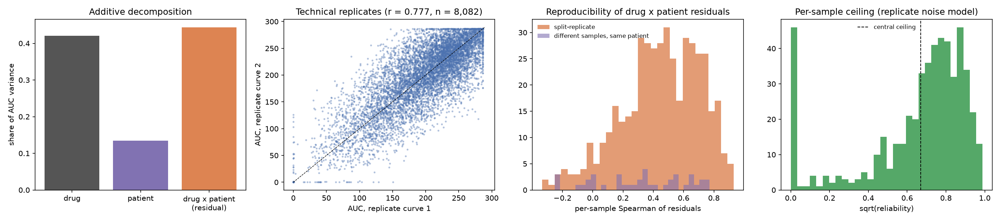

# Experiment 2, Step 1: ceiling analysis

Generated 2026-10-15 by `python -m pipeline.run --phase exp2-1`. Experiment 2 is a follow-up designed after the pre-registered Phase 4 analysis found no patient-specific value. Phase 4 results are unchanged.

## Verdict: **enough signal to proceed**

Central ceiling estimate (best achievable per-sample correlation between a perfect predictor and observed drug x patient residuals): **0.67** (bias-corrected 0.77). Range across noise estimates: 0.56 (test-retest, pessimistic) to 0.79 (replicate variance model, optimistic). Residual signal is 27.4% of total AUC variance.

Rule, fixed before running: proceed if the central ceiling is >= 0.5 and the residual signal is >= 10% of total variance; borderline if the ceiling is 0.3 to 0.5; otherwise not enough. The central estimate is the split-replicate one, because it measures exactly the quantity the metric uses (rank agreement of residuals within a sample) with real repeated measurements.

## 1. Data

Same matrix as Phase 4: 520 samples x 123 drugs, 46,764 observed AUCs (probit-fit AUC, lower = more sensitive). Why only the residual matters: the Experiment 2 metric is a Spearman correlation across drugs within each sample, which is unchanged by adding a constant to a sample. So a sample's overall sensitivity (patient effect) cannot help; the usable signal is the drug x patient interaction.

## 2. Variance decomposition

AUC = grand mean + drug effect + patient effect + residual, fitted by alternating least squares on observed entries.

| component                         |   share |
|:----------------------------------|--------:|
| drug                              |   0.421 |
| patient (sample)                  |   0.135 |
| residual (drug x patient + noise) |   0.444 |
| cross terms (unbalanced design)   |   0.001 |

## 3. Measurement noise

The open raw dose-response file has 8,496 sample-drug pairs measured as two or more separate replicate curves (542 samples). Each replicate curve was refitted with the published probit-AUC definition; our pooled refits reproduce the published AUCs (Pearson 0.9995 on a 1,500-curve check, median absolute difference 0.0).

- Two replicate curves of the same sample and drug agree at Pearson **0.777** in AUC.
- Noise variance of one curve: 775.3 AUC units squared (estimated per drug for 33 drugs, pooled for the rest), divided by the number of curves behind each published AUC.
- Residual variance: 1839.5; mean noise variance in the matrix: 702.1; reliability R = 0.618; ceiling sqrt(R) = 0.786.
- Per-sample ceiling under this model: mean 0.656 (10th to 90th percentile 0.156 to 0.905).

Caveat: replicate curves are run on the same day from the same sample preparation, so they miss day-to-day and handling variation. This estimate is optimistic.

## 4. Direct reproducibility of residuals

- **Split-replicate:** for 450 samples with at least 10 drugs measured twice (median 16.5 drugs), the residuals from curve 1 and curve 2 agree at mean per-sample Spearman **0.449** (median 0.470). A perfect predictor of the true residual would correlate with one noisy measurement at about sqrt of this, **0.67**.
- **Test-retest, different samples of the same patient:** 40 sample pairs from 34 patients, mean Spearman 0.313 (median 0.342); implied ceiling 0.56. These samples were taken at different times (for example diagnosis and relapse), so real biological change lowers this number; it is a pessimistic bound.
- **Bias check:** the split-replicate residuals above subtract drug and sample effects fitted on AUCs that already include these curves, which removes part of the shared signal. Refitting the effects with the replicated pairs masked raises the agreement to 0.587, ceiling **0.77**. The verdict uses the pre-specified, more conservative 0.67; Step 4 reports results against both.
- 74 samples have a total residual variance below single-curve noise (the spike at 0 in the last panel): their responses are nearly uniform after removing drug and sample effects, so they carry almost no rankable patient-specific signal.

The split-replicate drugs are the ones the panel repeats, which may not be representative of all 123 drugs; the variance-model estimate in section 3 covers all drugs.

## 5. What this means for Experiment 2

- No method can be expected to exceed a per-sample correlation of roughly 0.67 on observed residuals. For reference, Phase 4's combined model reached a drug-centred Spearman of 0.247, i.e. 37% of this ceiling (Phase 4 centred residuals by training-fold drug mean and SD, close to but not identical to the Experiment 2 target).
- Results in Step 4 will be reported as a fraction of this ceiling.

## Figure

## Appendix: single-curve noise variance by drug (largest and smallest)

| inhibitor                |   noise_var |
|:-------------------------|------------:|
| Palbociclib              |    1352.384 |
| Venetoclax               |    1251.678 |
| GDC-0941                 |    1244.554 |
| Ibrutinib (PCI-32765)    |    1153.721 |
| Ponatinib (AP24534)      |    1149.919 |
| Ruxolitinib (INCB018424) |    1070.717 |
| Idelalisib               |    1060.236 |
| Crizotinib (PF-2341066)  |     956.226 |
| Dasatinib                |     599.594 |
| Axitinib (AG-013736)     |     596.067 |
| Rapamycin                |     586.119 |
| Imatinib                 |     554.397 |
| Midostaurin              |     498.622 |
| Gefitinib                |     491.870 |
| Nutlin 3a                |     390.578 |
| Cytarabine               |     336.545 |
