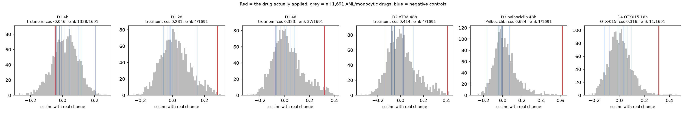
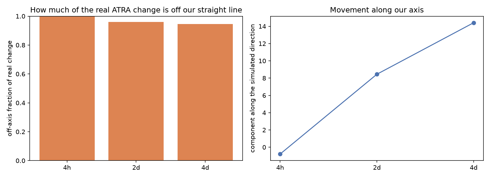

# Experiment 3, F1: does the linear simulation predict real drug-induced change?

Generated 2026-10-15 by `python -m pipeline.run --phase exp3-f1`. Plan: [exp3_f1_plan.md](exp3_f1_plan.md), committed before this analysis ran. Data: [exp3_step0_data.md](exp3_step0_data.md).

## Headline limitation

**This is a cell-line-only validation.** No open patient before/after transcriptome dataset exists for any drug in our LINCS set (Step F0), so whether the simulation transfers to patient cells is **untested and remains unknown**.

**The primary tests are deliberately favourable.** Our tretinoin signature is built from HL60, SKM1, THP1 and U937, and both ATRA datasets are HL-60 cells. D1 and D2 therefore measure the best case: same drug, same cell line. D4 (OTX015 in MOLM13, scored from a non-myeloid signature) is the unfavourable transfer case and should be read as the more realistic one.

## Result: 5 of 6 comparisons pass the pre-registered direction test

| id                 | drug        | role                    |   n_genes |   cosine |   spearman |   rank_in_null |   p_rank |   perm_p | passes   |
|:-------------------|:------------|:------------------------|----------:|---------:|-----------:|---------------:|---------:|---------:|:---------|
| D1 4h              | tretinoin   | primary, favourable     |      1270 |  -0.0464 |    -0.0998 |           1338 |   0.7912 |   0.9980 | False    |
| D1 2d              | tretinoin   | primary, favourable     |      1257 |   0.2807 |     0.2965 |              4 |   0.0024 |   0.0010 | True     |
| D1 4d              | tretinoin   | primary, favourable     |      1261 |   0.3226 |     0.3620 |             37 |   0.0219 |   0.0010 | True     |
| D2 ATRA 48h        | tretinoin   | primary, favourable     |      1284 |   0.4136 |     0.4304 |              4 |   0.0024 |   0.0010 | True     |
| D3 palbociclib 48h | Palbociclib | primary, other class    |      1267 |   0.6238 |     0.4609 |              1 |   0.0006 |   0.0010 | True     |
| D4 OTX015 16h      | OTX-015     | secondary, unfavourable |      1287 |   0.3158 |     0.3658 |             11 |   0.0065 |   0.0010 | True     |

The simulated change vector covers **1345 genes** (the landscape mapper's variable genes that also have a reliable L1000 measurement). Genes outside this set are not moved by the simulation at all and are excluded. `rank_in_null` is the drug's rank among all 1691 compounds with an AML/monocytic signature, scored identically; `p_rank` is that rank as a fraction. The pre-registered rule is cosine > 0 and rank in the top 5%.

### Negative controls

|                    |   ciprofloxacin |   famotidine |   loratadine |   paracetamol |   lisinopril |   furosemide |   glipizide |   lidocaine |
|:-------------------|----------------:|-------------:|-------------:|--------------:|-------------:|-------------:|------------:|------------:|
| D1 4h              |          0.0436 |      -0.0396 |       0.0139 |        0.1008 |      -0.0094 |       0.2054 |     -0.0202 |      0.1192 |
| D1 2d              |         -0.0023 |      -0.0323 |      -0.0569 |        0.041  |      -0.0204 |       0.154  |      0.0282 |     -0.011  |
| D1 4d              |         -0.0329 |      -0.0073 |      -0.0746 |        0.0115 |      -0.0049 |       0.0772 |      0.0486 |     -0.0679 |
| D2 ATRA 48h        |         -0.0525 |      -0.0548 |      -0.0806 |        0.0186 |      -0.1373 |       0.1096 |      0.0235 |     -0.0756 |
| D3 palbociclib 48h |         -0.0131 |       0.0717 |      -0.0503 |       -0.0426 |      -0.0195 |      -0.0315 |     -0.0029 |     -0.165  |
| D4 OTX015 16h      |         -0.08   |      -0.1154 |      -0.0094 |        0.0629 |       0.0369 |       0.0389 |     -0.001  |      0.0944 |

These eight compounds have no established myeloid differentiation mechanism and were fixed in the plan before running.

## Maturity test

| id                 | drug        |   real_shift |   sim_shift | same_direction   |   magnitude_ratio |
|:-------------------|:------------|-------------:|------------:|:-----------------|------------------:|
| D1 4h              | tretinoin   |      -0.4705 |      0.4862 | False            |           -1.0332 |
| D1 2d              | tretinoin   |       0.7137 |      0.4940 | True             |            0.6922 |
| D1 4d              | tretinoin   |       1.5452 |      0.5010 | True             |            0.3243 |
| D2 ATRA 48h        | tretinoin   |       1.5646 |      0.5214 | True             |            0.3333 |
| D3 palbociclib 48h | Palbociclib |       0.4685 |      0.0930 | True             |            0.1986 |
| D4 OTX015 16h      | OTX-015     |      -0.2496 |     -0.1222 | True             |            0.4896 |

`real_shift` and `sim_shift` are the maturation-signature direction (mean change of up-with-maturation genes minus down genes), in log2 units. **Magnitude is not a meaningful test:** the simulation's step length was chosen in Phase 5 purely so the animation stays on the manifold, so `magnitude_ratio` reflects that arbitrary constant, not biology. Only the sign is informative.

Landscape score (Phase 1 mapper applied to bulk profiles; the mapper was trained on single-cell data, so this is a platform transfer and is reported with that caveat):

| id                 | drug        |   ls_control |   ls_treated |   ls_real_delta |   ls_simulated |   ls_sim_delta |
|:-------------------|:------------|-------------:|-------------:|----------------:|---------------:|---------------:|
| D1 4h              | tretinoin   |       0.3449 |       0.3177 |         -0.0272 |         0.6148 |         0.2698 |
| D1 2d              | tretinoin   |       0.3449 |       0.4168 |          0.0719 |         0.6148 |         0.2698 |
| D1 4d              | tretinoin   |       0.3449 |       0.6287 |          0.2838 |         0.6148 |         0.2698 |
| D2 ATRA 48h        | tretinoin   |       0.2655 |       0.3771 |          0.1115 |         0.3497 |         0.0841 |
| D3 palbociclib 48h | Palbociclib |       0.2655 |       0.1517 |         -0.1138 |         0.1993 |        -0.0663 |
| D4 OTX015 16h      | OTX-015     |       0.2282 |       0.1957 |         -0.0325 |         0.2165 |        -0.0118 |

## Trajectory test (exploratory, ATRA time course)

| timepoint   |   n_genes |   parallel |   residual_norm |   total_norm |   off_axis_fraction |   cosine | monotone_parallel   |
|:------------|----------:|-----------:|----------------:|-------------:|--------------------:|---------:|:--------------------|
| 4h          |      1270 |    -0.7898 |         16.9990 |      17.0173 |              0.9989 |  -0.0464 | True                |
| 2d          |      1257 |     8.4476 |         28.8862 |      30.0961 |              0.9598 |   0.2807 | True                |
| 4d          |      1261 |    14.4090 |         42.2830 |      44.6707 |              0.9465 |   0.3226 | True                |

Real timepoints are 4 h, 2 d and 4 d, not the days 1, 3 and 6 assumed in the brief. `off_axis_fraction` is the share of the real change that is perpendicular to our straight-line direction: 0 would mean the cells move exactly along our axis, 1 that our axis captures none of it.

## Interpretation

**The direction test passes for 5 of 6 comparisons, but the simulation still captures only a small part of what really happens.** Both statements are true, and the second matters more.

**1. Direction is detectable above chance.** For every comparison from 16 h onward, the real change vector is closer to the applied drug's simulated direction than to almost all of 1,691 other drugs scored the same way (ranks 1, 4, 4, 11 and 37). The eight pre-specified negative controls sit near zero throughout. The LINCS signature does carry real information about which way these cells move.

**2. But the straight line misses most of the movement.** Cosine values are 0.28 to 0.62, so the share of the real change lying along our axis (cosine squared) is only 8% (D1 2d), 10% (D1 4d), 17% (D2 ATRA 48h), 39% (D3 palbociclib 48h), 10% (D4 OTX015 16h). The trajectory test says the same thing directly: 95% to 100% of the real ATRA response is perpendicular to our simulated direction. The cells move somewhere our straight line does not point.

**3. The simulation is wrong at early times.** At 4 h the real change is large (vector norm 17, about 40% of the 4 d response) but points elsewhere entirely: cosine -0.046, rank 1338 of 1691, and the maturation-signature shift is **negative** (-0.47) while the simulation predicts positive. The early ATRA response is not a small version of the late one; it points a different way. Our model has no time axis, so its predicted shift is identical at 4 h, 2 d and 4 d.

**4. Maturity direction is right where it matters.** For ATRA at 2 d, 4 d and 48 h, the real and simulated maturation-signature shifts are both positive, and the landscape score rises in the real data (+0.07 at 2 d, +0.28 at 4 d). When ATRA does drive HL-60 cells toward maturity, our score sees it.

**5. The unfavourable case held up.** D4 (OTX015 in MOLM13, scored from a non-myeloid-tier signature, in a different cell line from the signature) still ranked 11 of 1,691. That is the most encouraging result for transfer, though it is a single comparison.

### What we may and may not claim

- **Supported:** the linear model predicts the *direction* of drug-induced expression change better than chance, in AML cell lines, at 16 h to 4 d.
- **Supported:** our maturation score moves the right way when a differentiation agent works.
- **Not supported:** that the simulation reproduces the real trajectory. Most of the real movement is off-axis and the early response is mispredicted.
- **Not supported, and untestable here:** anything about patient cells. No open data allows that test.
- Wording such as 'simulates cell reversion' is not justified. 'Predicts the direction of drug-induced expression change in cell lines' is.

This is the motivation for F2: a model with a time axis and a curved path has clear room to beat the straight line, and F1 now gives it a number to beat.

## Figures

