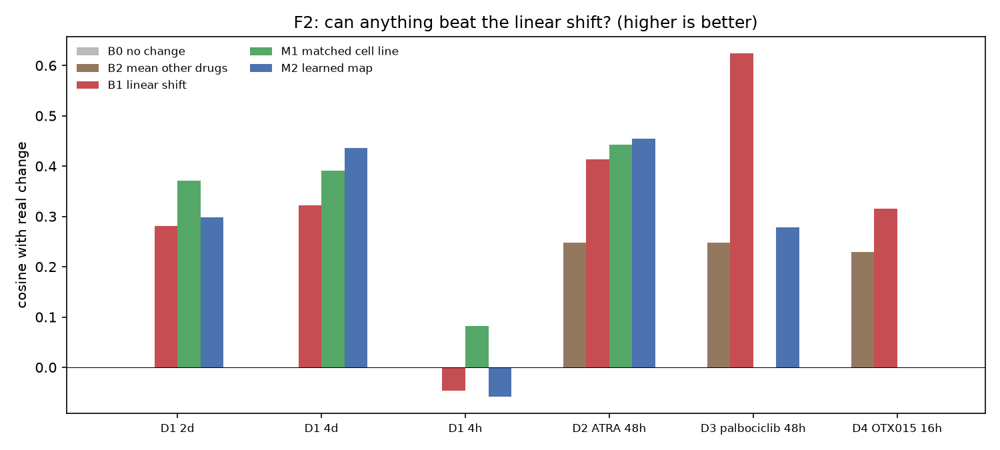

# Experiment 3, F2: can a learned model beat the linear shift?

Generated 2026-10-15 by `python -m pipeline.run --phase exp3-f2`. Plan: [exp3_f2_plan.md](exp3_f2_plan.md), committed before any model was fitted. Follows [exp3_f1_results.md](exp3_f1_results.md).

## Result

**M1 matched cell line beats the linear shift** under the pre-registered rule (wins on a majority of conditions and mean cosine improvement above 0.05).

Cosine with the real change, by condition and model (higher is better):

| id                 |   B0 no change |   B1 linear shift |   B2 mean other drugs |   M1 matched cell line |   M2 learned map |
|:-------------------|---------------:|------------------:|----------------------:|-----------------------:|-----------------:|
| D1 2d              |              0 |            0.2807 |              nan      |                 0.3711 |           0.2981 |
| D1 4d              |              0 |            0.3226 |              nan      |                 0.3907 |           0.4362 |
| D1 4h              |              0 |           -0.0464 |              nan      |                 0.0821 |          -0.0579 |
| D2 ATRA 48h        |              0 |            0.4136 |                0.2481 |                 0.4432 |           0.4541 |
| D3 palbociclib 48h |              0 |            0.6238 |                0.2481 |               nan      |           0.2788 |
| D4 OTX015 16h      |              0 |            0.3158 |                0.2288 |               nan      |         nan      |

### Pre-registered comparison against B1

|                      |   n_conditions |   n_wins |   mean_improvement | beats_linear   |
|:---------------------|---------------:|---------:|-------------------:|:---------------|
| M1 matched cell line |              4 |        4 |          0.0791902 | True           |
| M2 learned map       |              5 |        3 |         -0.036985  | False          |

Per-condition differences against the linear shift:

|                    |   M1 matched cell line |   M2 learned map |
|:-------------------|-----------------------:|-----------------:|
| D1 2d              |                 0.0905 |           0.0175 |
| D1 4d              |                 0.0682 |           0.1136 |
| D1 4h              |                 0.1285 |          -0.0115 |
| D2 ATRA 48h        |                 0.0296 |           0.0405 |
| D3 palbociclib 48h |               nan      |          -0.3451 |

The learned map (M2) was trained on **46 LINCS drugs** that have both an HL-60 signature and a signature in another myeloid line, with the evaluated drug removed from training every time, and its rank and penalty chosen by leave-one-drug-out inside that training set. M1 and M2 apply only to HL-60 conditions; M1 further needs a matched signature to exist, which among our drugs is true only for tretinoin.

Selected hyper-parameters and how well the raw consensus already matched the HL-60 signature in training:

|                    |   rank |   alpha |   cv_cosine |   raw_consensus_cosine |
|:-------------------|-------:|--------:|------------:|-----------------------:|
| D1 4h              |     10 |     100 |      0.3682 |                 0.2034 |
| D1 2d              |     10 |     100 |      0.3682 |                 0.2034 |
| D1 4d              |     10 |     100 |      0.3682 |                 0.2034 |
| D2 ATRA 48h        |     10 |     100 |      0.3682 |                 0.2034 |
| D3 palbociclib 48h |     10 |     100 |      0.3735 |                 0.2125 |

## Does a time axis help? (separate question)

|                       |   cosine |   spearman |   sim_shift |   n_genes |
|:----------------------|---------:|-----------:|------------:|----------:|
| M3 time interpolation |   0.9303 |     0.8922 |      0.7323 | 1253.0000 |
| B1 linear shift       |   0.2811 |     0.2973 |      0.5039 | 1253.0000 |
| B0 no change          |   0.0000 |   nan      |    nan      | 1253.0000 |

M3 uses real measurements of the same drug at 4 h and 4 d; B1 uses none. Not a fair comparison, reported as a separate question. Interpolating between the real 4 h and 4 d responses predicts the held-out 2 d response far better than our static prediction does, which says the real path is smooth in time and that a model with a time axis has real room to improve. What it does not show is that such a model could be built from drug signatures alone, which is the harder problem and the one the data cannot currently answer.

## What this means

- **Using the drug's signature from the matching cell line beats the consensus** on all 4 conditions where it can be tested, by 0.079 cosine on average. **But all 4 conditions are the same drug** (tretinoin), because it is the only drug in our external data with a matched HL-60 signature. So this is one drug measured four ways, not four independent tests, and it should be read as a promising lead rather than an established gain. It does point at a concrete fix: prefer a cell-line-matched signature over the consensus wherever one exists.
- **The learned map does not beat the linear shift** (mean change -0.037). It helps modestly on the ATRA conditions but is much worse on palbociclib, so a map trained on 46 drugs does not generalize reliably to a new drug. With 46 training drugs and 1,345 genes this is the expected outcome, and it is the honest answer: the simple model stands.
- **No neural ODE or flow-matching model was fitted**, as pre-registered: three conditionable drugs and nine external conditions cannot support one, and a number produced from them would not mean anything. This is a limit of the open data, not a judgement that such models would fail.
- The time-interpolation result is the clearest signal that dynamics matter: our static prediction is the weakest part of the model, and the real path is smooth enough that knowing the time would help a lot.
- Taken with F1, the picture is consistent: the linear shift has real but limited skill, the largest identified gaps are **no time axis** and **wrong cell context**, and neither can be closed properly until a much larger open perturbation dataset exists.

## Figure

