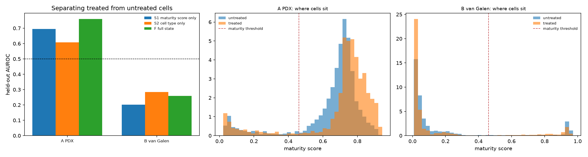

# Experiment 3, F3: can we predict which cells stay stuck?

Generated 2026-10-15 by `python -m pipeline.run --phase exp3-f3`. Plan: [exp3_f3_plan.md](exp3_f3_plan.md), committed before any model was fitted. Constraints: [exp3_f3_feasibility.md](exp3_f3_feasibility.md).

## Read this first

**1. The question as posed cannot be answered.** Single-cell sequencing destroys the cell it measures, so no cell is observed both before and after treatment. Whether a *given* cell resists is not measurable in any open dataset. We substitute a state-level question: which untreated cell states are over-represented after treatment. Everything below is about states, not cells, and the whole of F3 is exploratory.

**2. Treatment and batch are confounded.** Each arm compares separate sequencing runs, so a classifier that separates treated from untreated cells is partly detecting batch. The AUROC numbers below therefore **do not support a biological claim on their own**. The maturity-direction result further down is the more trustworthy readout, because it is a prediction about one specific axis rather than about separability.

**3. The data is thin:** 4522 and 2236 cells from **one PDX and one drug**, plus **three patients** on chemotherapy.

## Classifier results

| arm                         | split                                              | model                  |   auroc |   auroc_per_fold_mean |   n_cells |
|:----------------------------|:---------------------------------------------------|:-----------------------|--------:|----------------------:|----------:|
| A PDX, menin inhibitor 16 h | cells (5-fold); 1 PDX, no held-out sample possible | S1 maturity score only |  0.6943 |                0.6949 |      6758 |
| A PDX, menin inhibitor 16 h | cells (5-fold); 1 PDX, no held-out sample possible | S2 cell type only      |  0.6074 |                0.6180 |      6758 |
| A PDX, menin inhibitor 16 h | cells (5-fold); 1 PDX, no held-out sample possible | F full state           |  0.7594 |                0.7595 |      6758 |
| B van Galen, chemotherapy   | leave-one-patient-out (3 patients)                 | S1 maturity score only |  0.2022 |                0.4463 |      4130 |
| B van Galen, chemotherapy   | leave-one-patient-out (3 patients)                 | S2 cell type only      |  0.2847 |                0.5830 |      4130 |
| B van Galen, chemotherapy   | leave-one-patient-out (3 patients)                 | F full state           |  0.2583 |                0.3573 |      4130 |

### Against the pre-registered bar

|                             |   full |   over_S1 |   over_S2 | beats_baselines   |
|:----------------------------|-------:|----------:|----------:|:------------------|
| A PDX, menin inhibitor 16 h | 0.7594 |    0.0651 |    0.1521 | True              |
| B van Galen, chemotherapy   | 0.2583 |    0.0561 |   -0.0264 | False             |

Pre-registered rule: the full state model must beat **both** baselines by more than 0.02 AUROC in **both** arms. **Result: not met.**

## Maturity direction (the more trustworthy readout)

|                             |   n_untreated |   n_treated |   mean_score_untreated |   mean_score_treated |   delta_mean_score |   stuck_frac_untreated |   stuck_frac_treated |   delta_stuck_frac |
|:----------------------------|--------------:|------------:|-----------------------:|---------------------:|-------------------:|-----------------------:|---------------------:|-------------------:|
| A PDX, menin inhibitor 16 h |     4522.0000 |   2236.0000 |                 0.6495 |               0.7006 |             0.0511 |                 0.1134 |               0.1181 |             0.0046 |
| B van Galen, chemotherapy   |     2316.0000 |   1814.0000 |                 0.1757 |               0.1609 |            -0.0148 |                 0.8674 |               0.8583 |            -0.0091 |

`stuck_frac` is the share of cells below the Phase 2 maturity threshold (0.461), which was fixed on normal marrow long before Experiment 3. A differentiation agent should lower it. A rise means the cells that persist are the less mature ones, which is the resistance pattern this project predicts.

## What marks the persisting cells

**A PDX, menin inhibitor 16 h** (drop in held-out AUROC when each feature is shuffled):

|           |   auroc_drop |
|:----------|-------------:|
| PROM1     |       0.0275 |
| LYZ       |       0.0170 |
| y         |       0.0141 |
| ELANE     |       0.0071 |
| CSF1R     |       0.0069 |
| x         |       0.0052 |
| CD14      |       0.0044 |
| knn_dist  |       0.0042 |
| MPO       |       0.0037 |
| score     |       0.0032 |
| cell type |       0.0030 |
| CD34      |       0.0000 |

**B van Galen, chemotherapy** (drop in held-out AUROC when each feature is shuffled):

|           |   auroc_drop |
|:----------|-------------:|
| MPO       |       0.0641 |
| CD34      |       0.0009 |
| score     |      -0.0032 |
| CD14      |      -0.0034 |
| CSF1R     |      -0.0039 |
| PROM1     |      -0.0055 |
| y         |      -0.0143 |
| cell type |      -0.0304 |
| LYZ       |      -0.0305 |
| knn_dist  |      -0.0365 |
| x         |      -0.0562 |
| ELANE     |      -0.0751 |

## Link to our own simulation

|         |   simulated_resistant_fraction |   measured_stuck_fraction_after |
|:--------|-------------------------------:|--------------------------------:|
| AML328  |                          0.574 |                           0.906 |
| AML329  |                          0.775 |                           0.604 |
| AML707B |                          0.948 |                           0.862 |

Phase 5 simulates differentiation agents; these patients received chemotherapy, so no relationship is expected. With 3 patients no correlation is computable; the numbers are shown for transparency only.

## Interpretation

**The pre-registered bar was not met.** Full cell state beat both baselines in the PDX arm (0.759, +0.065 over maturity alone and +0.152 over cell type alone) but not in the patient arm.

**1. Nothing transfers between patients.** Every van Galen model scores *below* chance when predictions are pooled across patients (0.20, 0.28 and 0.26), which means a rule learned on two patients is actively misleading on the third. Scoring each held-out patient separately gives a different picture (0.45, 0.58 and 0.36), and cell type is the clearest case: 0.58 within patients against 0.28 pooled. The gap is the signature of an effect whose direction differs from patient to patient, so the pooled ranking is scrambled. With three patients we cannot say whether that is real heterogeneity or noise; either way nothing transfers.

**2. The PDX result cannot be read as biology.** AUROC 0.759 looks strong, but control and treated cells are separate sequencing runs from one animal, so batch and treatment are perfectly confounded. A classifier that good is exactly what a batch effect would produce. This number is reported for completeness and should not be cited as evidence that resistant states are predictable.

**3. The one encouraging result is the maturity shift.** Under the menin inhibitor, mean maturity rises by +0.051 , the direction a differentiation-inducing drug should produce, on an axis fixed long before this experiment. It is small, and the batch confound applies here too, but a pure batch effect has no reason to favour this particular direction. The share of cells below the maturity threshold barely moves (+0.005), so at 16 h the population shifts without many cells crossing over.

**4. Chemotherapy does not mature cells.** In the patient arm, mean maturity changes by -0.015 and the stuck fraction by -0.009, both negligible. The malignant cells that survive are not more mature, they are simply fewer. This matches what F0 predicted from the cell counts and confirms that these samples cannot stand in for differentiation therapy.

**5. Features.** In the PDX arm the strongest single feature is PROM1 (CD133), a stem/progenitor marker, followed by LYZ, a monocytic one, which is at least consistent with a stem-to-mature axis separating the two populations. In the patient arm almost every importance is negative: shuffling a feature *improves* held-out AUROC, which is what one expects when there is no transferable signal to destroy.

**Against published biology.** Resistance to menin inhibitors is well documented to involve MEN1 mutations at the drug-binding interface (PubMed lists dozens of reports). **We cannot test that here:** these data are expression only, with no genotyping of the treated cells, and 16 h is far too early for an outgrowth of resistant clones. Any claim that our features correspond to that mechanism would be unsupported, so we make none.

**Bottom line.** F3 does not demonstrate that resistant cell states are predictable. It establishes that the question cannot be asked properly of open data, that the one dataset able to address it is confounded, and that patient-level signal does not transfer across three patients. The single result worth carrying forward is the small, correctly directed maturity shift under a menin inhibitor.

## Figure

