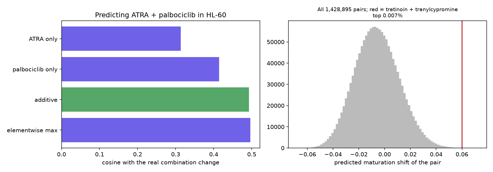

# Experiment 3, F4: can we predict drug combinations?

Generated 2026-10-15 by `python -m pipeline.run --phase exp3-f4`. Plan: [exp3_f4_plan.md](exp3_f4_plan.md), committed before this analysis ran.

## Two things the model cannot do

**Additive and sequential composition are identical here.** F2 found no learned model that beat the linear shift, and for a linear model applying drug A then drug B is exactly the sum of their shifts. The brief's additive-versus-sequential contrast therefore has no content in this project, and we did not introduce an untested nonlinear model to manufacture one.

**Synergy is outside the model by construction.** An additive prediction says two drugs together do what they do apart. Genuine synergy or antagonism cannot be expressed, which bounds what Test 2 below can mean.

## Test 0: is the real combination distinct from its single agents?

|                                      |   cosine |
|:-------------------------------------|---------:|
| real combination vs real ATRA        |   0.7713 |
| real combination vs real palbociclib |   0.5946 |
| real ATRA vs real palbociclib        |   0.2479 |

The measured ATRA + palbociclib response is closest to **ATRA** (cosine 0.771), while the two single agents resemble each other at 0.248. The combination is not simply one of its agents, so Test 1 is informative.

## Test 1: which composition rule predicts the real combination?

| prediction       |   cosine |   n_genes |
|:-----------------|---------:|----------:|
| elementwise max  |   0.4966 |      1287 |
| additive         |   0.4931 |      1287 |
| palbociclib only |   0.4142 |      1287 |
| ATRA only        |   0.3134 |      1287 |

**Additive composition beats both single-drug predictions** (0.493 against 0.313 for ATRA alone and 0.414 for palbociclib alone). Knowing both drugs therefore helps, which is the one positive finding here.

However, **elementwise max scores marginally higher** (0.4966 against 0.4931). A gap of 0.0035 on a single combination is well inside noise, so these two rules are not distinguishable here and we do not claim one is better.

**A caveat that matters more.** Scored against every one of the 1691 single AML/monocytic drugs, the additive prediction ranks only **3**: ingenol-mebutate, a drug not in this experiment, predicts the combination better (cosine 0.544). Beating the two constituent drugs is a low bar when unrelated compounds clear it too.

## Test 2: the published positive control

**tretinoin + tranylcypromine** scores 0.0600, ranking **102 of 1,428,895** pairs (top 0.007%). Individual maturation shifts: tretinoin +0.3466, tranylcypromine +0.6174.

The evidence for this pair is real: Schenk et al. 2012 (*Nature Medicine* 18:605-611, doi:10.1038/nm.2661) showed LSD1 inhibition with tranylcypromine unlocks an ATRA differentiation response in non-APL AML. **But this test does not validate combination prediction.** Our score is a normalized sum, so a pair ranks high exactly when both drugs already point toward maturity, and tranylcypromine was already the second-highest single compound in the Phase 3 screen. The rank is carried by that one drug, not by anything we know about the pair.

The list below makes the same point: nearly every top pair contains tranylcypromine or bosutinib, alongside partners with no plausible differentiation mechanism (desmopressin, estrone, methoxsalen). These are rankings of single-drug scores, not predictions about interactions.

Highest-scoring pairs (exploratory, untested):

| drug A               | drug B               |   score |
|:---------------------|:---------------------|--------:|
| BRD-K98404142        | Bosutinib (SKI-606)  |  0.0723 |
| Bosutinib (SKI-606)  | tranylcypromine      |  0.0714 |
| Bosutinib (SKI-606)  | desmopressin-acetate |  0.0709 |
| methoxsalen          | tranylcypromine      |  0.0702 |
| R-428                | tranylcypromine      |  0.0698 |
| estrone              | tranylcypromine      |  0.0697 |
| desmopressin-acetate | tranylcypromine      |  0.0695 |
| BRD-K98404142        | tranylcypromine      |  0.0694 |
| Bosutinib (SKI-606)  | MK-0812              |  0.0691 |
| MK-0812              | tranylcypromine      |  0.0691 |

## Test 3: the combination we cannot predict

|                                   |   cosine |
|:----------------------------------|---------:|
| real combination vs real VTP50469 |   0.45   |
| real combination vs real OTX015   |   0.8322 |
| real VTP50469 vs real OTX015      |   0.2286 |

VTP50469 has no LINCS signature, so this MOLM13 combination cannot be predicted at all. The measured values are shown only to document that the combination again sits close to one of its agents.

## Conclusion

- **Beat AML contributes nothing here.** Verified: its 'Combination' panel holds 3 single agents across 21 samples, and all 63,395 probit fits are single-agent. There are no combination arms in the open files.
- Combination prediction rests on **one combination, in one cell line, at one timepoint**. Additive composition came out ahead of both single agents there, which is a single data point either way and does not establish that the approach works in general.
- The ranked pairs above are **untested hypotheses**. No open dataset measures them, and our model cannot represent the synergy that makes combinations interesting in the first place.

## Figure

