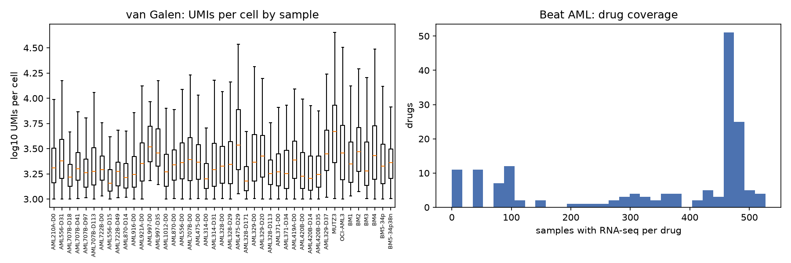
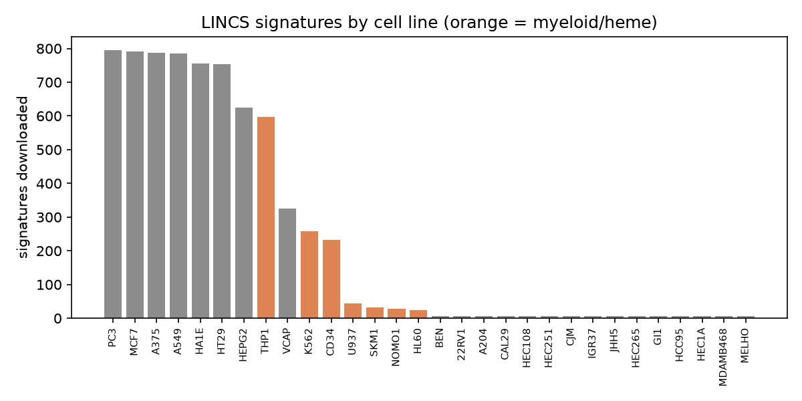

# Phase 0 data report

Generated 2026-10-14 by `python -m pipeline.run --phase 0`. All numbers below are computed from the downloaded files.

## Headline numbers

- **van Galen (GSE116256):** 41,090 cells x 27,814 genes from 43 samples (35 AML samples from 16 patients, 6 healthy bone marrow samples from 5 donors, 2 cell lines).
- **Normal myeloid cells for the landscape (Phase 1):** 7,956 cells labelled normal HSC/Prog/GMP/ProMono/Mono/cDC (4,430 from healthy BM, 3,526 normal cells inside AML samples).
- **Malignant cells at diagnosis (day 0):** 11,641 cells across 12 patients.
- **Beat AML:** 707 RNA-seq samples x 20,146 genes (36 healthy controls); 166 single-agent drugs, 63,395 sample-drug AUCs; **520 AML RNA-seq samples have drug data, 478 of these also have mutation calls.**
- **LINCS (CMap LINCS 2020 release):** 720,216 compound signatures, 33,609 compounds, 230 cell lines. Downloaded 6,973 signatures x 12,328 genes for 146 drugs.
- **Drug overlap Beat AML x LINCS: 140 of 166 Beat AML drugs** (137 exact, 3 approximate). 105 have a signature in a myeloid/heme line, 105 in an AML/monocytic line (THP1, HL60, SKM1, NOMO1, U937). **Usable for validation (>= 50 Beat AML RNA-seq samples and >= 1 downloaded signature): 123 drugs, 93 of them with a myeloid/heme signature.** This is far above the ~15-drug threshold, so power is not limited by drug overlap.
- **Gene overlap (HGNC):** all three datasets share 10,532 genes; 9,456 of them are L1000 landmark or best-inferred genes, 971 are landmark genes.

## 1. Sources and files

| source   | file                                                     |     MB |
|:---------|:---------------------------------------------------------|-------:|
| vangalen | vangalen/GSE116256_RAW.tar                               |  73.25 |
| beataml  | beataml/beataml2_manuscript_vg_cts.xlsx                  |   0.06 |
| beataml  | beataml/beataml_drug_families.xlsx                       |   0.06 |
| beataml  | beataml/beataml_probit_curve_fits_v4_dbgap.txt           |  19.05 |
| beataml  | beataml/beataml_waves1to4_norm_exp_dbgap.txt             | 281.34 |
| beataml  | beataml/beataml_waves1to4_sample_mapping.xlsx            |   0.07 |
| beataml  | beataml/beataml_wes_wv1to4_mutations_dbgap.txt           |   3.67 |
| beataml  | beataml/beataml_wv1to4_clinical.xlsx                     |   0.49 |
| lincs    | lincs/GSE70138_Broad_LINCS_cell_info_2017-04-28.txt.gz   |   0    |
| lincs    | lincs/GSE70138_Broad_LINCS_gene_info_2017-03-06.txt.gz   |   0.22 |
| lincs    | lincs/GSE70138_Broad_LINCS_pert_info_2017-03-06.txt.gz   |   0.08 |
| lincs    | lincs/GSE70138_Broad_LINCS_sig_info_2017-03-06.txt.gz    |   1.94 |
| lincs    | lincs/GSE70138_Broad_LINCS_sig_metrics_2017-03-06.txt.gz |   3.14 |
| lincs    | lincs/GSE92742_Broad_LINCS_cell_info.txt.gz              |   0    |
| lincs    | lincs/GSE92742_Broad_LINCS_gene_info.txt.gz              |   0.22 |
| lincs    | lincs/GSE92742_Broad_LINCS_pert_info.txt.gz              |   1.14 |
| lincs    | lincs/GSE92742_Broad_LINCS_pert_metrics.txt.gz           |   0.93 |
| lincs    | lincs/GSE92742_Broad_LINCS_sig_info.txt.gz               |  11.12 |
| lincs    | lincs/GSE92742_Broad_LINCS_sig_metrics.txt.gz            |  12.52 |
| lincs    | lincs/lincs2020/cellinfo_beta.txt                        |   0.04 |
| lincs    | lincs/lincs2020/compoundinfo_beta.txt                    |   4.63 |
| lincs    | lincs/lincs2020/geneinfo_beta.txt                        |   1.14 |
| lincs    | lincs/lincs2020/siginfo_beta.txt                         | 465.24 |
| hgnc     | hgnc/hgnc_complete_set.txt                               |  16.98 |

The van Galen tar was extracted into 89 per-sample text files in `data/raw/vangalen/`. LINCS signature values were not downloaded as a file: they were read by HTTP range requests from the public 35.5 GB `level5_beta_trt_cp_n720216x12328.gctx` (see section 4).

Licences and access: Beat AML processed data are CC-BY-4.0 and openly downloadable from the authors' GitHub (biodev/beataml2.0_data, linked from https://biodev.github.io/BeatAML2/). No dbGaP / controlled-access data were used; the `dbgap` in file names refers only to the sample identifiers. GEO and CMap LINCS data are public.

## 2. van Galen et al. 2019 (single-cell)

Each sample has a dense gene x cell UMI table (`*.dem.txt.gz`) and a per-cell annotation table (`*.anno.txt.gz`). Annotation columns used later: `PredictionRefined` (malignant / normal / unclear), `CellType` (e.g. HSC, HSC-like, GMP-like), per-cell type scores `Score_*`, and the sample name, which encodes patient and day (D0 = diagnosis, later days = during treatment). Every annotated cell was found in its count table. All 43 samples share the same 27,899-gene list.

Gene symbols to HGNC: 24,571 already approved, 1,312 mapped from previous symbols, 52 from unambiguous aliases, 1,964 unmapped (kept under their original name; mostly lncRNAs/clone IDs). 85 symbols collapsed onto an existing gene (UMIs summed).

### Samples

| sample       | patient   | day   | sample_type   |   n_cells_annotated |   malignant |   normal |   unclear |   nan |   median_umis |   median_genes |
|:-------------|:----------|:------|:--------------|--------------------:|------------:|---------:|----------:|------:|--------------:|---------------:|
| AML1012-D0   | AML1012   | 0     | AML           |                1136 |         856 |      280 |         0 |     0 |        1853   |          831   |
| AML210A-D0   | AML210A   | 0     | AML           |                 748 |         464 |      284 |         0 |     0 |        2040   |          846   |
| AML314-D0    | AML314    | 0     | AML           |                 162 |           0 |       96 |        66 |     0 |        1585.5 |          692.5 |
| AML314-D31   | AML314    | 31    | AML           |                 346 |           0 |      262 |        84 |     0 |        1954.5 |          840   |
| AML328-D0    | AML328    | 0     | AML           |                1094 |         693 |      401 |         0 |     0 |        2113.5 |          991   |
| AML328-D113  | AML328    | 113   | AML           |                2029 |         153 |     1876 |         0 |     0 |        1792   |          748   |
| AML328-D171  | AML328    | 171   | AML           |                1402 |         161 |     1241 |         0 |     0 |        1510.5 |          706   |
| AML328-D29   | AML328    | 29    | AML           |                1880 |        1145 |      735 |         0 |     0 |        2215   |         1129   |
| AML329-D0    | AML329    | 0     | AML           |                 525 |         253 |      272 |         0 |     0 |        2309   |          893   |
| AML329-D20   | AML329    | 20    | AML           |                 953 |         259 |      694 |         0 |     0 |        2658   |         1039   |
| AML329-D37   | AML329    | 37    | AML           |                 224 |          16 |      208 |         0 |     0 |        2818   |          943   |
| AML371-D0    | AML371    | 0     | AML           |                 756 |           0 |       56 |       700 |     0 |        1860   |          851   |
| AML371-D34   | AML371    | 34    | AML           |                 204 |           0 |       83 |       121 |     0 |        1784.5 |          827   |
| AML419A-D0   | AML419A   | 0     | AML           |                1189 |        1068 |      121 |         0 |     0 |        2438   |         1060   |
| AML420B-D0   | AML420B   | 0     | AML           |                 485 |         100 |      385 |         0 |     0 |        1679   |          760   |
| AML420B-D14  | AML420B   | 14    | AML           |                1282 |           1 |     1281 |         0 |     0 |        1595   |          760.5 |
| AML420B-D35  | AML420B   | 35    | AML           |                 743 |          10 |      733 |         0 |     0 |        1747   |          860   |
| AML475-D0    | AML475    | 0     | AML           |                 423 |         308 |      115 |         0 |     0 |        2315   |          852   |
| AML475-D29   | AML475    | 29    | AML           |                 102 |           1 |      101 |         0 |     0 |        3425.5 |          998.5 |
| AML556-D0    | AML556    | 0     | AML           |                2328 |        2062 |      266 |         0 |     0 |        2297   |          985.5 |
| AML556-D15   | AML556    | 15    | AML           |                1203 |           0 |     1203 |         0 |     0 |        1432   |          663   |
| AML556-D31   | AML556    | 31    | AML           |                1451 |          15 |     1436 |         0 |     0 |        2378   |          924   |
| AML707B-D0   | AML707B   | 0     | AML           |                1586 |        1370 |      216 |         0 |     0 |        2455.5 |         1048   |
| AML707B-D113 | AML707B   | 113   | AML           |                 708 |           5 |      703 |         0 |     0 |        1879   |          795.5 |
| AML707B-D18  | AML707B   | 18    | AML           |                1673 |          61 |     1612 |         0 |     0 |        1643   |          704   |
| AML707B-D41  | AML707B   | 41    | AML           |                 387 |          13 |      374 |         0 |     0 |        1989   |          871   |
| AML707B-D97  | AML707B   | 97    | AML           |                  84 |           1 |       83 |         0 |     0 |        1819   |          756.5 |
| AML722B-D0   | AML722B   | 0     | AML           |                  79 |           0 |       10 |        69 |     0 |        1955   |          726   |
| AML722B-D49  | AML722B   | 49    | AML           |                  73 |           0 |       69 |         4 |     0 |        1883   |          762   |
| AML870-D0    | AML870    | 0     | AML           |                 345 |         314 |       31 |         0 |     0 |        2174   |          880   |
| AML870-D14   | AML870    | 14    | AML           |                  96 |           7 |       89 |         0 |     0 |        1639.5 |          634   |
| AML916-D0    | AML916    | 0     | AML           |                 933 |         775 |      158 |         0 |     0 |        1754   |          897   |
| AML921A-D0   | AML921A   | 0     | AML           |                3813 |        3378 |      435 |         0 |     0 |        2240   |         1029   |
| AML997-D0    | AML997    | 0     | AML           |                  83 |           0 |       11 |        72 |     0 |        3288   |          823   |
| AML997-D35   | AML997    | 35    | AML           |                 187 |           0 |      170 |        17 |     0 |        2864   |          691   |
| BM1          | BM1       | <NA>  | healthy_BM    |                 108 |           0 |      108 |         0 |     0 |        2223.5 |          838.5 |
| BM2          | BM2       | <NA>  | healthy_BM    |                 188 |           0 |      188 |         0 |     0 |        2934.5 |          963.5 |
| BM3          | BM3       | <NA>  | healthy_BM    |                 643 |           0 |      643 |         0 |     0 |        1894   |          798   |
| BM4          | BM4       | <NA>  | healthy_BM    |                3738 |           0 |     3738 |         0 |     0 |        2696.5 |         1079   |
| BM5-34p      | BM5       | <NA>  | healthy_BM    |                1431 |           0 |     1431 |         0 |     0 |        2126   |          899   |
| BM5-34p38n   | BM5       | <NA>  | healthy_BM    |                1590 |           0 |      807 |         0 |   783 |        2299.5 |          908   |
| MUTZ3        | MUTZ3     | <NA>  | cell_line     |                1502 |        1502 |        0 |         0 |     0 |        4697   |         1730.5 |
| OCI-AML3     | OCI-AML3  | <NA>  | cell_line     |                1178 |        1178 |        0 |         0 |     0 |        2867   |         1451   |

783 cells, all from BM5-34p38n, are listed in the annotation file but have no annotation at all (783 have empty `CellType`, `PredictionRefined` and `Score_*`). They are probably cells the authors did not classify; we exclude them from all analyses.

### Cell types (excluding cell lines)

| CellType     |   AML |   healthy_BM |
|:-------------|------:|-------------:|
| B            |   407 |          113 |
| CTL          |  1077 |          261 |
| GMP          |   386 |          532 |
| GMP-like     |  1823 |            0 |
| HSC          |   439 |         1270 |
| HSC-like     |  1936 |            0 |
| Mono         |  2191 |          567 |
| Mono-like    |  2550 |            0 |
| NK           |  1812 |          157 |
| Plasma       |  1077 |           69 |
| ProB         |   105 |          193 |
| ProMono      |   522 |          624 |
| ProMono-like |  1416 |            0 |
| Prog         |   553 |         1156 |
| Prog-like    |  3696 |            0 |
| T            |  6385 |          720 |
| cDC          |   568 |          281 |
| cDC-like     |  2068 |            0 |
| earlyEry     |   500 |          619 |
| lateEry      |  1067 |          262 |
| pDC          |   134 |           91 |

### Normal myeloid cells available for the Phase 1 landscape

| CellType   |   AML |   healthy_BM |
|:-----------|------:|-------------:|
| HSC        |   320 |         1270 |
| Prog       |   355 |         1156 |
| GMP        |   238 |          532 |
| ProMono    |   366 |          624 |
| Mono       |  1773 |          567 |
| cDC        |   474 |          281 |

### Malignant cells per patient at day 0 (CellType)

| patient   |   HSC-like |   Prog-like |   GMP-like |   ProMono-like |   Mono-like |   cDC-like |   total |
|:----------|-----------:|------------:|-----------:|---------------:|------------:|-----------:|--------:|
| AML210A   |         35 |          79 |         23 |             51 |         182 |         94 |     464 |
| AML328    |        143 |         281 |          2 |              1 |         214 |         52 |     693 |
| AML329    |          9 |          67 |        134 |              7 |          11 |         25 |     253 |
| AML419A   |         52 |         360 |         16 |              9 |         572 |         59 |    1068 |
| AML420B   |         33 |          34 |         30 |              0 |           2 |          1 |     100 |
| AML475    |         18 |          26 |         15 |              0 |          51 |        198 |     308 |
| AML556    |          1 |           1 |         15 |           1064 |         973 |          8 |    2062 |
| AML707B   |        152 |         347 |        857 |             12 |           0 |          2 |    1370 |
| AML870    |         96 |         144 |         56 |             11 |           5 |          2 |     314 |
| AML916    |        343 |         384 |         11 |              1 |           0 |         36 |     775 |
| AML921A   |        507 |         817 |        392 |             75 |         241 |       1346 |    3378 |
| AML1012   |         51 |         183 |        190 |            158 |         152 |        122 |     856 |

Some patients have very few malignant cells at diagnosis (see `total`), which will limit per-patient distributions in Phase 2.

## 3. Beat AML 2.0 (bulk RNA-seq, mutations, ex vivo drug response)

- **Expression** (`beataml_waves1to4_norm_exp_dbgap.txt`): 707 samples x 22,843 Ensembl genes (GRCh37). Mapped to HGNC through Ensembl IDs ({'ensembl': 19781, 'symbol_approved': 272, 'symbol_previous': 85, 'symbol_alias': 8}); 2,630 genes without an HGNC symbol dropped, 67 duplicate symbols resolved by keeping the most expressed Ensembl ID, leaving 20,146 genes. Values range -9.38 to 14.50 (normalized, log-scale as provided; we use them as is).
- **Healthy controls with RNA-seq:** {'Healthy Individual BM MNC': 19, 'Healthy pooled CD34+': 16, 'Healthy Individual CD34+': 1}.
- **Drug response** (`beataml_probit_curve_fits_v4_dbgap.txt`): 63,395 rows, 166 drugs, 542 RNA-seq samples, 569 patients. All rows are single-agent probit fits with `paper_inclusion = True`. Split flag in the file: {'train/test': 51010, 'combined': 9363, 'exploratory': 3022}. AUC median 207.5 (range 0.0-286.3); lower AUC = more sensitive. Samples per drug (with RNA-seq): median 462, range 2-527.
- **Linkage:** 520 non-control RNA-seq samples have drug data; 478 of those also have a DNA sample with mutation calls. Disease stage of the 520: {'Initial Diagnosis': 346, 'Residual': 105, 'Relapse': 32, 'Unknown': 16, 'Remission': 13}.
- **Mutations** (`beataml_wes_wv1to4_mutations_dbgap.txt`): 11,721 calls in 871 DNA samples. Assay: {'NexteraV1.2': 607, 'Nimblegen Custom Capture': 264}. The Nimblegen assay is a targeted panel, so for those samples an absent call outside the panel is not a true negative; Phase 4 must restrict mutation features to genes covered by both assays (or model assay type).
- Among the 478 RNA+drug+DNA samples: IDH1 R132 hotspot 38, IDH2 R140/R172 hotspot 56, FLT3-ITD (clinical) 116, NPM1 (clinical) 141.
- **Published van Galen deconvolution** (`beataml2_manuscript_vg_cts.xlsx`): 560 samples x 6 malignant cell types (GMP-like, HSC-like, Monocyte-like, Progenitor-like, Promono-like, cDC-like). These are signed scores (range -10.7 to 8.6), not fractions, so Phase 2 will compare our fractions to them by rank correlation.
- **Differentiation agents in the Beat AML panel:** no ATRA, enasidenib or ivosidenib. The panel has the tool IDH inhibitors AGI-5198 (IDH1) and AGI-6780 (IDH2): {'AGI-5198': 312, 'AGI-6780': 310} RNA-seq samples. These are the drugs for the Phase 4 IDH subgroup check.

## 4. LINCS L1000 drug signatures

**Options evaluated.**

1. GEO GSE92742 + GSE70138 Level 5: 20 GB + 5 GB gzipped gctx (no partial reads possible), measured download ~2.7 MB/s from NCBI. Compound coverage: {'GSE92742': {'n_sigs': 205034, 'n_compounds': 19811, 'n_cells': 71}, 'GSE70138': {'n_sigs': 107404, 'n_compounds': 1768, 'n_cells': 30}}. HL60 has only 40 compounds and enasidenib/ivosidenib are absent.
2. SigCom LINCS (Ma'ayan Lab) metadata API with per-signature TSVs on S3. Small queries worked, but filtered queries returned HTTP 504 (gateway timeout) repeatedly during this session, so it is not a reliable pipeline dependency.
3. **Chosen: CMap LINCS 2020 release** (the data behind SigCom). Metadata tables are public on S3, and the Level 5 compound matrix is an uncompressed, contiguous HDF5 matrix, so single signature rows (12,328 float32 values) can be read with HTTP range requests. Fetched rows are checked byte-for-byte against h5py reads of the same rows. Values are MODZ z-scores (CMap Level 5).

**Hematopoietic cell lines in LINCS 2020** (compound signatures):

| cell_iname   |   n_sigs |   n_compounds |   n_hiq |
|:-------------|---------:|--------------:|--------:|
| HL60         |      511 |            63 |      85 |
| THP1         |    15814 |          1630 |    2056 |
| SKM1         |      364 |           356 |     196 |
| U937         |      698 |           392 |     267 |
| NOMO1        |      668 |           361 |     168 |
| CD34         |     1371 |           208 |     408 |
| K562         |     1512 |           136 |     390 |
| JURKAT       |    14079 |          1424 |     847 |
| OCILY3       |     1505 |           136 |     271 |
| OCILY10      |     1488 |           136 |     205 |
| OCILY19      |     1490 |           136 |     518 |

MOLM13, MV411, OCIAML2/3, KG1 and NB4 have no compound signatures. CMap annotates U937 as 'b-cell lymphoma'; it is a histiocytic lymphoma line with monocytic features and is commonly used as a myeloid model, so we keep it in the myeloid group. K562 is CML (erythroid-leaning) and CD34 is primary normal CD34+ cells; both are kept but ranked after the AML lines. Note that LINCS signatures here are mostly 6 h or 24 h exposures.

**Selection rule** (fixed before any scoring): for every matched Beat AML drug and positive control, up to 6 signatures per (drug, cell line), for the myeloid lines ['HL60', 'THP1', 'SKM1', 'U937', 'NOMO1', 'MOLM13', 'MV411', 'OCIAML2', 'OCIAML3', 'KG1', 'NB4', 'CD34', 'K562'] and the core lines ['MCF7', 'PC3', 'A549', 'A375', 'HT29', 'HA1E', 'VCAP', 'HEPG2'], ranked by CMap `is_hiq`, then `is_exemplar_sig`, then TAS. Positive controls profiled only in other lines take signatures from whatever lines exist.

Downloaded: 6,973 signatures, 1,215 from myeloid/heme lines. Exposure times: {'24 h': 5708, '6 h': 975, '48 h': 157, '4 h': 80, '3 h': 46, '2 h': 7}.

Genes: 12,328 features, {'best inferred': 9196, 'inferred': 2154, 'landmark': 978}. Only the 978 landmark genes are measured; the others are computationally inferred, and the 'inferred' (not 'best inferred') group is the least reliable. HGNC mapping: {'n_input': 12328, 'n_approved': 12043, 'n_previous': 271, 'n_unmapped': 14, 'n_unique_hgnc': 12313, 'n_collapsed': 1}.

**Positive controls (differentiation agents)**

| drug         |   n_sigs | cells                                                                                                                                          |   n_hiq |
|:-------------|---------:|:-----------------------------------------------------------------------------------------------------------------------------------------------|--------:|
| AGI-5198     |       42 | A375,A549,HA1E,HT29,MCF7,PC3,THP1                                                                                                              |      16 |
| AGI-6780     |       42 | A375,A549,HA1E,HT29,MCF7,PC3,THP1                                                                                                              |       2 |
| Azacytidine  |       60 | A375,A549,CD34,HA1E,HEPG2,HT29,MCF7,PC3,THP1,VCAP                                                                                              |      46 |
| alitretinoin |       32 | A375,A549,HA1E,HEPG2,HT29,MCF7,PC3,VCAP                                                                                                        |      20 |
| calcitriol   |       65 | A375,A549,CD34,HA1E,HEPG2,HL60,HT29,MCF7,NOMO1,PC3,SKM1,THP1,U937,VCAP                                                                         |      50 |
| decitabine   |       56 | A375,A549,CD34,HA1E,HEPG2,HT29,MCF7,PC3,THP1,VCAP                                                                                              |      48 |
| enasidenib   |       69 | 22RV1,A204,BEN,CAL29,CJM,GI1,HCC95,HEC108,HEC1A,HEC251,HEC265,IGR37,JHH5,MDAMB468,MELHO,NCIH1573,NCIH2110,NCIH838,OVTOKO,SH4,SKES1,SNU407,T47D |       0 |
| ivosidenib   |       69 | 22RV1,A204,BEN,CAL29,CJM,GI1,HCC95,HEC108,HEC1A,HEC251,HEC265,IGR37,JHH5,MDAMB468,MELHO,NCIH1573,NCIH2110,NCIH838,OVTOKO,SH4,SKES1,SNU407,T47D |       0 |
| tamibarotene |       39 | A375,A549,HA1E,HEPG2,HT29,MCF7,PC3,VCAP                                                                                                        |      23 |
| tretinoin    |       68 | A375,A549,CD34,HA1E,HEPG2,HL60,HT29,MCF7,PC3,SKM1,THP1,U937,VCAP                                                                               |      66 |

Missing from LINCS entirely: none. Enasidenib and ivosidenib exist only as 24 h signatures in 23 non-hematopoietic lines, none passing CMap's high-quality flag. Those lines are presumably IDH wild-type, where these drugs are not expected to change transcription, so a weak or null control result for them would be the expected outcome, not a pipeline failure. Tretinoin (ATRA) has signatures in HL60, U937, THP1, SKM1 and CD34, which makes it the best positive control.

## 5. Overlaps

**Genes (HGNC symbols):**

| set                                 |     n |
|:------------------------------------|------:|
| van Galen                           | 27814 |
| Beat AML                            | 20146 |
| LINCS (all 12,328)                  | 12328 |
| van Galen & Beat AML                | 16543 |
| van Galen & LINCS                   | 12325 |
| Beat AML & LINCS                    | 10533 |
| all three                           | 10532 |
| all three, landmark + best inferred |  9456 |
| all three, landmark only            |   971 |

**Drugs (Beat AML panel x LINCS 2020):**

{'name': 125, 'none': 23, 'curated': 11, 'alias': 4, 'excluded': 3}

| beat_name                 | lincs_names         | match_how   | match_quality   |   beat_rna_samples |   n_sigs |   n_cells | myeloid_cells                       |   n_hiq |
|:--------------------------|:--------------------|:------------|:----------------|-------------------:|---------:|----------:|:------------------------------------|--------:|
| 17-AAG (Tanespimycin)     | 17-AAG|tanespimycin | name        | exact           |                467 |       72 |        15 | CD34,HL60,K562,NOMO1,SKM1,THP1,U937 |      58 |
| ABT-737                   | ABT-737             | name        | exact           |                245 |       59 |        13 | CD34,NOMO1,SKM1,THP1,U937           |      44 |
| AGI-5198                  | AGI-5198            | name        | exact           |                312 |       42 |         7 | THP1                                |      16 |
| AGI-6780                  | AGI-6780            | name        | exact           |                310 |       42 |         7 | THP1                                |       2 |
| AKT Inhibitor IV          | BRD-K28296557       | alias       | exact           |                 86 |       23 |        10 | NOMO1,THP1                          |      20 |
| AT-101                    | gossypol            | curated     | approximate     |                 85 |       47 |        13 | K562,NOMO1,SKM1,THP1,U937           |      25 |
| AT7519                    | AT-7519             | name        | exact           |                464 |       50 |         9 | THP1                                |      37 |
| AZD1480                   | AZD-1480            | name        | exact           |                473 |       60 |        10 | CD34,K562,THP1                      |      14 |
| Afatinib (BIBW-2992)      | afatinib            | name        | exact           |                477 |       56 |        10 | K562,THP1                           |      47 |
| Alisertib (MLN8237)       | alisertib           | name        | exact           |                477 |       48 |         8 | THP1                                |      48 |
| Artemisinin               | artemisinin         | name        | exact           |                204 |        5 |         3 |                                     |       2 |
| Axitinib (AG-013736)      | axitinib            | name        | exact           |                497 |       44 |         8 |                                     |      32 |
| Azacytidine               | azacitidine         | curated     | exact           |                382 |       60 |        10 | CD34,THP1                           |      46 |
| BEZ235                    | NVP-BEZ235          | curated     | exact           |                466 |       59 |        13 | K562,NOMO1,SKM1,THP1,U937           |      51 |
| BI-2536                   | BI-2536             | name        | exact           |                114 |       63 |        13 | CD34,NOMO1,SKM1,THP1,U937           |      48 |
| BMS-345541                | BMS-345541          | name        | exact           |                479 |       56 |        10 | K562,THP1                           |      32 |
| BMS-754807                | BMS-754807          | name        | exact           |                 41 |       48 |        12 | NOMO1,SKM1,THP1,U937                |      44 |
| Birinapant                | birinapant          | name        | exact           |                 86 |       42 |         7 | THP1                                |      35 |
| Bortezomib (Velcade)      | bortezomib          | name        | exact           |                481 |       59 |        13 | K562,NOMO1,SKM1,THP1,U937           |      52 |
| Bosutinib (SKI-606)       | bosutinib           | name        | exact           |                474 |       62 |        11 | CD34,K562,THP1                      |      40 |
| CHIR-99021                | CHIR-99021          | name        | exact           |                475 |       42 |         7 |                                     |      37 |
| CI-1040 (PD184352)        | CI-1040|PD-184352   | name        | exact           |                479 |       52 |         9 | THP1                                |      34 |
| CYT387                    | CYT-387             | name        | exact           |                473 |       48 |         8 | THP1                                |      39 |
| Cabozantinib              | cabozantinib        | name        | exact           |                468 |       60 |        10 | CD34,THP1                           |      37 |
| Canertinib (CI-1033)      | canertinib          | name        | exact           |                473 |       56 |        10 | K562,THP1                           |      38 |
| Cediranib (AZD2171)       | cediranib           | name        | exact           |                472 |       45 |         9 | THP1                                |      30 |
| Crenolanib                | crenolanib          | name        | exact           |                466 |        6 |         2 |                                     |       6 |
| Crizotinib (PF-2341066)   | crizotinib          | name        | exact           |                491 |       56 |        10 | K562,THP1                           |      47 |
| Cytarabine                | cytarabine          | name        | exact           |                341 |       52 |        11 | SKM1,THP1,U937                      |      42 |
| Dasatinib                 | dasatinib           | name        | exact           |                514 |       62 |        11 | CD34,K562,THP1                      |      60 |
| Doramapimod (BIRB 796)    | doramapimod         | name        | exact           |                472 |       54 |         9 | CD34,THP1                           |      43 |
| Dovitinib (CHIR-258)      | dovitinib           | name        | exact           |                473 |       56 |        10 | K562,THP1                           |      33 |
| Elesclomol                | elesclomol          | name        | exact           |                447 |       48 |        12 | NOMO1,SKM1,THP1,U937                |      33 |
| Entospletinib (GS-9973)   | GS-9973             | name        | exact           |                325 |       12 |         2 | K562,THP1                           |       3 |
| Erlotinib                 | erlotinib           | name        | exact           |                506 |       56 |        10 | K562,THP1                           |      41 |
| Etomoxir                  | etomoxir            | name        | exact           |                 44 |       48 |        12 | NOMO1,SKM1,THP1,U937                |      11 |
| Everolimus                | everolimus          | name        | exact           |                  0 |       61 |        11 | CD34,K562,THP1                      |      49 |
| Flavopiridol              | alvocidib           | curated     | exact           |                469 |       52 |         9 | THP1                                |      42 |
| Foretinib (XL880)         | foretinib           | name        | exact           |                471 |       47 |         8 | THP1                                |      39 |
| GDC-0879                  | GDC-0879            | name        | exact           |                474 |       56 |        10 | CD34,THP1                           |      47 |
| GDC-0941                  | GDC-0941            | name        | exact           |                438 |       58 |        10 | K562,THP1                           |      48 |
| GSK-1838705A              | GSK-1838705A        | name        | exact           |                471 |       16 |         3 | K562,THP1                           |       6 |
| GSK-1904529A              | GSK-1904529A        | name        | exact           |                470 |       44 |         8 |                                     |      14 |
| GSK690693                 | GSK-690693          | name        | exact           |                464 |       42 |         7 |                                     |      34 |
| GW-2580                   | GW-2580             | name        | exact           |                455 |        6 |         2 |                                     |       5 |
| Gefitinib                 | gefitinib           | name        | exact           |                487 |       58 |        10 | K562,THP1                           |      39 |
| Go6976                    | GO-6976             | name        | exact           |                 88 |       42 |         7 |                                     |      41 |
| H-89                      | H-89                | name        | exact           |                431 |       18 |         8 |                                     |       7 |
| INK-128                   | MLN-0128            | curated     | exact           |                476 |       54 |         9 | CD34,THP1                           |      47 |
| Ibrutinib (PCI-32765)     | ibrutinib           | name        | exact           |                456 |       60 |        10 | CD34,K562,THP1                      |      56 |
| Idelalisib                | idelalisib          | name        | exact           |                462 |       66 |        11 | CD34,K562,THP1                      |      39 |
| Imatinib                  | imatinib            | name        | exact           |                527 |       58 |        10 | K562,THP1                           |      43 |
| Indisulam                 | indisulam           | name        | exact           |                117 |        0 |       nan | nan                                 |     nan |
| JNJ-38877605              | JNJ-38877605        | name        | exact           |                472 |       56 |        10 | CD34,THP1                           |       4 |
| JNJ-7706621               | JNJ-7706621         | name        | exact           |                475 |       28 |         8 |                                     |      20 |
| JQ1                       | BRD-K54606188       | alias       | exact           |                362 |       66 |        11 | CD34,K562,THP1                      |      61 |
| KI20227                   | KI-20227            | name        | exact           |                423 |       54 |         9 | CD34,THP1                           |      10 |
| KN93                      | KN-93               | name        | exact           |                 89 |       17 |         8 |                                     |       6 |
| KU-55933                  | KU-55933            | name        | exact           |                471 |       58 |        10 | CD34,THP1                           |      30 |
| KW-2449                   | KW-2449             | name        | exact           |                466 |       54 |         9 | CD34,THP1                           |      24 |
| LY294002                  | LY-294002           | name        | exact           |                 89 |       38 |         7 |                                     |      36 |
| Lapatinib                 | lapatinib           | name        | exact           |                484 |       58 |        10 | K562,THP1                           |      32 |
| Lenalidomide              | lenalidomide        | name        | exact           |                274 |       57 |        13 | K562,NOMO1,SKM1,THP1,U937           |      17 |
| Lenvatinib                | lenvatinib          | name        | exact           |                355 |       42 |         7 | THP1                                |       3 |
| Lestaurtinib (CEP-701)    | lestaurtinib        | name        | exact           |                 87 |       39 |         8 |                                     |      32 |
| Linifanib (ABT-869)       | linifanib           | name        | exact           |                470 |       56 |        10 | K562,THP1                           |      46 |
| Lovastatin                | lovastatin          | name        | exact           |                143 |       49 |        12 | NOMO1,SKM1,THP1,U937                |      23 |
| MEK1/2 Inhibitor          | BRD-K12244279       | alias       | exact           |                  4 |       44 |         8 |                                     |      34 |
| MGCD-265                  | MGCD-265            | name        | exact           |                466 |       54 |         9 | CD34,THP1                           |      11 |
| MK-2206                   | MK-2206             | name        | exact           |                465 |       59 |        13 | K562,NOMO1,SKM1,THP1,U937           |      52 |
| MLN8054                   | MLN-8054            | name        | exact           |                470 |       56 |        10 | CD34,THP1                           |      39 |
| Masitinib (AB-1010)       | masitinib           | name        | exact           |                465 |       62 |        11 | CD34,K562,THP1                      |      42 |
| Metformin                 | metformin           | name        | exact           |                 43 |       50 |         9 | THP1                                |      16 |
| Midostaurin               | midostaurin         | name        | exact           |                479 |       56 |        10 | K562,THP1                           |      47 |
| Motesanib (AMG-706)       | motesanib           | name        | exact           |                468 |       58 |        10 | CD34,THP1                           |      24 |
| NVP-ADW742                | NVP-ADW742          | name        | exact           |                462 |        5 |         2 |                                     |       5 |
| NVP-AEW541                | NVP-AEW541          | name        | exact           |                 44 |       41 |         7 |                                     |      19 |
| NVP-TAE684                | NVP-TAE684          | name        | exact           |                469 |       60 |        10 | K562,THP1                           |      44 |
| Neratinib (HKI-272)       | neratinib           | name        | exact           |                471 |       53 |        12 | NOMO1,SKM1,THP1,U937                |      46 |
| Nilotinib                 | nilotinib           | name        | exact           |                494 |       60 |        10 | K562,THP1                           |      51 |
| Nutlin 3a                 | nutlin-3            | curated     | approximate     |                335 |       53 |        12 | NOMO1,SKM1,THP1,U937                |      38 |
| OTX-015                   | OTX-015             | name        | exact           |                303 |       43 |         8 |                                     |      32 |
| Olaparib                  | olaparib            | name        | exact           |                148 |       63 |        13 | CD34,NOMO1,SKM1,THP1,U937           |      52 |
| PD153035                  | PD-153035           | name        | exact           |                  4 |       36 |         6 |                                     |       8 |
| PD98059                   | PD-98059            | name        | exact           |                  4 |       50 |        12 | NOMO1,SKM1,THP1,U937                |      26 |
| PH-797804                 | PH-797804           | name        | exact           |                 45 |       42 |         7 | THP1                                |      19 |
| PHA-665752                | PHA-665752          | name        | exact           |                470 |       44 |         8 |                                     |      18 |
| PI-103                    | PI-103              | name        | exact           |                469 |       48 |        12 | NOMO1,SKM1,THP1,U937                |      36 |
| PLX-4720                  | PLX-4720            | name        | exact           |                 91 |       46 |         8 |                                     |      34 |
| PP2                       | PP-2                | name        | exact           |                 88 |       13 |         8 |                                     |      10 |
| PP242                     | PP-242              | name        | exact           |                475 |        6 |         1 |                                     |       4 |
| PRT062070                 | PRT-062070          | name        | exact           |                  2 |       24 |         4 | K562,THP1                           |      13 |
| PRT062607                 | PRT-062607          | name        | exact           |                465 |       18 |         4 | K562,THP1                           |      10 |
| Palbociclib               | palbociclib         | name        | exact           |                305 |       50 |         9 | THP1                                |      41 |
| Panobinostat              | panobinostat        | name        | exact           |                296 |       48 |         8 |                                     |      48 |
| Pazopanib (GW786034)      | pazopanib           | name        | exact           |                487 |       62 |        11 | CD34,K562,THP1                      |      51 |
| Pelitinib (EKB-569)       | pelitinib           | name        | exact           |                470 |       42 |         7 |                                     |      29 |
| Perhexiline maleate       | perhexiline         | curated     | exact           |                 37 |       42 |        11 | SKM1,THP1,U937                      |      30 |
| Ponatinib (AP24534)       | ponatinib           | name        | exact           |                322 |       51 |         9 | CD34,THP1                           |      22 |
| Quizartinib (AC220)       | quizartinib         | name        | exact           |                482 |       56 |        10 | CD34,THP1                           |      40 |
| R406                      | fostamatinib        | curated     | approximate     |                  4 |       59 |        13 | K562,NOMO1,SKM1,THP1,U937           |      41 |
| R547                      | R-547               | name        | exact           |                  4 |       42 |         7 | THP1                                |      40 |
| RAF265 (CHIR-265)         | RAF-265             | name        | exact           |                467 |       54 |         9 | CD34,THP1                           |      35 |
| Ralimetinib (LY2228820)   | LY-2228820          | name        | exact           |                 42 |       42 |         7 | THP1                                |      25 |
| Ranolazine                | ranolazine          | name        | exact           |                 45 |       47 |         9 | THP1                                |      14 |
| Rapamycin                 | sirolimus           | curated     | exact           |                484 |       75 |        15 | CD34,HL60,K562,NOMO1,SKM1,THP1,U937 |      71 |
| Regorafenib (BAY 73-4506) | regorafenib         | name        | exact           |                468 |       54 |         9 | CD34,THP1                           |      42 |
| Roscovitine (CYC-202)     | roscovitine         | name        | exact           |                480 |       50 |         9 | THP1                                |      33 |
| Ruxolitinib (INCB018424)  | ruxolitinib         | name        | exact           |                470 |       58 |        10 | K562,THP1                           |      30 |
| SB-202190                 | SB-202190           | name        | exact           |                 88 |       44 |         8 |                                     |      31 |
| SB-203580                 | SB-203580           | name        | exact           |                 88 |       58 |        10 | CD34,THP1                           |      39 |
| SB-431542                 | SB-431542           | name        | exact           |                477 |       24 |         8 |                                     |       9 |
| SGX-523                   | SGX-523             | name        | exact           |                471 |       54 |         9 | CD34,THP1                           |       9 |
| SNS-032 (BMS-387032)      | BMS-387032          | name        | exact           |                476 |       42 |         7 |                                     |      39 |
| STO609                    | STO-609             | name        | exact           |                433 |       19 |         8 |                                     |      12 |
| SU11274                   | SU-11274            | name        | exact           |                420 |       44 |         8 |                                     |      23 |
| SYK Inhibitor             | SYK-inhibitor       | name        | exact           |                  4 |       14 |         8 |                                     |       5 |
| Saracatinib (AZD0530)     | saracatinib         | name        | exact           |                468 |       65 |        11 | CD34,K562,THP1                      |      58 |
| Selinexor                 | KPT-330             | alias       | exact           |                249 |       36 |         6 |                                     |      18 |
| Selumetinib (AZD6244)     | selumetinib         | name        | exact           |                473 |       63 |        13 | K562,NOMO1,SKM1,THP1,U937           |      55 |
| Sorafenib                 | sorafenib           | name        | exact           |                516 |       46 |         8 |                                     |      36 |
| Staurosporine             | staurosporine       | name        | exact           |                 92 |       41 |         8 |                                     |      34 |
| Sunitinib                 | sunitinib           | name        | exact           |                510 |       56 |        10 | CD34,THP1                           |      40 |
| TG100-115                 | TG-100115           | name        | exact           |                469 |       45 |         9 | THP1                                |      10 |
| TG101348                  | TG-101348           | name        | exact           |                 88 |       63 |        13 | K562,NOMO1,SKM1,THP1,U937           |      55 |
| Tandutinib (MLN518)       | tandutinib          | name        | exact           |                 86 |       50 |         9 | THP1                                |      24 |
| Tivozanib (AV-951)        | tivozanib           | name        | exact           |                466 |       59 |        13 | CD34,NOMO1,SKM1,THP1,U937           |      46 |
| Tofacitinib (CP-690550)   | tofacitinib         | name        | exact           |                476 |       51 |        10 | K562,THP1                           |      22 |
| Tozasertib (VX-680)       | tozasertib          | name        | exact           |                476 |       63 |        13 | K562,NOMO1,SKM1,THP1,U937           |      58 |
| Trametinib (GSK1120212)   | trametinib          | name        | exact           |                503 |       54 |         9 | K562,THP1                           |      47 |
| VX-745                    | VX-745              | name        | exact           |                475 |       56 |        10 | CD34,THP1                           |      12 |
| Vandetanib (ZD6474)       | vandetanib          | name        | exact           |                500 |       54 |         9 | CD34,THP1                           |      35 |
| Vargetef                  | nintedanib          | curated     | exact           |                470 |       48 |         8 | THP1                                |      28 |
| Vatalanib (PTK787)        | vatalanib           | name        | exact           |                470 |        4 |         2 |                                     |       0 |
| Vemurafenib (PLX-4032)    | vemurafenib         | name        | exact           |                372 |       55 |        12 | NOMO1,SKM1,THP1,U937                |      47 |
| Venetoclax                | GDC-0199            | curated     | exact           |                382 |       48 |         8 | K562,THP1                           |      31 |
| Vismodegib (GDC-0449)     | vismodegib          | name        | exact           |                475 |       48 |         8 | THP1                                |      11 |
| Volasertib (BI-6727)      | volasertib          | name        | exact           |                363 |       48 |         8 | THP1                                |      43 |
| XAV-939                   | XAV-939             | name        | exact           |                286 |       33 |        12 | NOMO1,SKM1,THP1,U937                |      20 |
| YM-155                    | YM-155              | name        | exact           |                477 |       54 |        12 | NOMO1,SKM1,THP1,U937                |      46 |

Matches that are approximate or need a note:

| beat_name           | lincs_names   | match_how   | match_quality   | note                                                                                |
|:--------------------|:--------------|:------------|:----------------|:------------------------------------------------------------------------------------|
| AMPK Inhibitor      | nan           | excluded    | nan             | likely Compound C (dorsomorphin) but not confirmed in Beat AML metadata             |
| AT-101              | gossypol      | curated     | approximate     | AT-101 is R-(-)-gossypol; LINCS entry may be racemic                                |
| Azacytidine         | azacitidine   | curated     | exact           | spelling variant                                                                    |
| BEZ235              | NVP-BEZ235    | curated     | exact           | same compound (dactolisib)                                                          |
| Baiclein            | nan           | excluded    | nan             | LINCS has baicalin (glycoside), not baicalein                                       |
| Bay 11-7085         | nan           | excluded    | nan             | LINCS has BAY-11-7082, a different compound                                         |
| Flavopiridol        | alvocidib     | curated     | exact           | INN of flavopiridol                                                                 |
| INK-128             | MLN-0128      | curated     | exact           | INK-128 = MLN0128 = sapanisertib                                                    |
| JQ1                 | BRD-K54606188 | alias       | exact           | JQ-1-R is (-)-JQ1, the inactive enantiomer; Beat AML JQ1 is the active (+) form     |
| Nutlin 3a           | nutlin-3      | curated     | approximate     | LINCS nutlin-3 pools two pert_ids (one aliased NUTLIN-3A); enantiomer not confirmed |
| Perhexiline maleate | perhexiline   | curated     | exact           | salt form                                                                           |
| R406                | fostamatinib  | curated     | approximate     | fostamatinib is the prodrug of R406                                                 |
| Rapamycin           | sirolimus     | curated     | exact           | INN of rapamycin                                                                    |
| Vargetef            | nintedanib    | curated     | exact           | Vargatef is the trade name of nintedanib                                            |
| Venetoclax          | GDC-0199      | curated     | exact           | GDC-0199 = ABT-199 = venetoclax                                                     |

Not in LINCS 2020 (23): A-674563, AKT Inhibitor X, AST-487, AZD1152-HQPA (AZD2811), BLZ945, DBZ, Entrectinib, GSK-2879552, Gilteritinib, JAK Inhibitor I, JNJ-28312141, JNK Inhibitor II, KN92, LY-333531, MLN120B, NF-kB Activation Inhibitor, PD173955, PHT-427, S31-201, SR9011, SU14813, XMD 8-87, p38 MAP Kinase Inhibitor.

## 6. Blockers, caveats and deviations

- **No hard blockers.** All three sources are downloaded and parsed.
- **Python 3.12 instead of 3.11** (3.11 is not installed on this machine; 3.12 is supported by scanpy). Recorded here as a deviation.
- **No clinical differentiation agents in the Beat AML ex vivo panel** (no ATRA, enasidenib, ivosidenib). Validation against ex vivo response therefore tests mostly kinase inhibitors and cytotoxics, where viability, not maturation, is the readout. The IDH subgroup check has to use the tool compounds AGI-5198 / AGI-6780.
- **IDH inhibitor signatures are weak:** enasidenib/ivosidenib only in non-heme lines without high-quality flags; AGI-5198/AGI-6780 have THP1 signatures, but THP1 is not known to carry an IDH mutation, so no strong on-target transcriptional effect is expected.
- **Cell-line mismatch:** most matched drugs have signatures in THP1, but only a handful in HL60/SKM1/NOMO1/U937, and short exposures (mostly 6-24 h).
- **Inferred genes:** only 978 genes are measured by L1000; reversion scores should be checked on landmark-only genes as a robustness analysis.
- **Mutation assay heterogeneity** (exome vs targeted panel), see section 3.
- **Beat AML deconvolution reference values are scores, not fractions.**
- **SigCom LINCS API** timed out (HTTP 504); we read the same LINCS 2020 data directly from CMap's public S3 instead.
- Some van Galen patients have fewer than 100 malignant cells at diagnosis; per-patient statistics for them will be noisy.

## 7. Design decisions and justifications

Every choice below was fixed before any drug scoring or validation, so none of them can be tuned to the results.

**Data sources**

| Choice                                                                            | Justification                                                                                                                                                                                                                                                                |
|:----------------------------------------------------------------------------------|:-----------------------------------------------------------------------------------------------------------------------------------------------------------------------------------------------------------------------------------------------------------------------------|
| Use GEO GSE116256 supplementary files for van Galen.                              | They are the authors' own per-cell counts and annotations (malignant vs normal, cell type). Re-deriving these labels ourselves would need the genotyping the authors did, which we cannot reproduce.                                                                         |
| Use the Beat AML 2.0 harmonized files from the authors' GitHub, not dbGaP or GDC. | They are the processed data behind the 2022 paper, openly licensed (CC-BY-4.0), and already harmonized across all four waves. The project rules forbid controlled-access data.                                                                                               |
| Use the CMap LINCS 2020 release instead of GEO GSE92742/GSE70138.                 | LINCS 2020 has the compounds we need that GEO lacks (enasidenib, ivosidenib) and far more myeloid coverage (THP1: 1,630 compounds vs 371 in GEO). It also avoids a 25 GB download that cannot be read partially.                                                             |
| Read LINCS rows with HTTP range requests instead of downloading the 35.5 GB file. | The matrix is stored uncompressed and contiguous, so each signature is one fixed-size block. We fetch about 340 MB instead of 35.5 GB. To rule out offset errors, random fetched rows are compared with h5py's own read of the same rows, and the run fails on any mismatch. |
| Do not depend on the SigCom LINCS API.                                            | Its filtered queries returned HTTP 504 repeatedly. A pipeline that must rerun from one command cannot depend on a service that times out.                                                                                                                                    |
| Use Level 5 MODZ z-scores.                                                        | Level 5 is CMap's standard consensus signature: replicate-collapsed and compared against plate controls. These are the values the published connectivity methods were designed for.                                                                                          |

**Gene identifiers**

| Choice                                                                                                 | Justification                                                                                                                                                                                                    |
|:-------------------------------------------------------------------------------------------------------|:-----------------------------------------------------------------------------------------------------------------------------------------------------------------------------------------------------------------|
| Harmonize everything to current HGNC approved symbols.                                                 | The three datasets use different annotation vintages (hg19-era symbols, GRCh37 Ensembl, CMap's 2020 symbols). Without one reference, the same gene can appear under two names and silently drop out of overlaps. |
| Map in the order approved, then previous symbol, then alias, and only when the mapping is unambiguous. | Approved symbols are definitive. Previous symbols are usually renames. Aliases are often shared between genes, so an ambiguous alias is left unmapped rather than guessed.                                       |
| Map Beat AML through Ensembl IDs first.                                                                | Ensembl IDs are stable identifiers, while the symbols in the file can be outdated.                                                                                                                               |
| Keep unmapped van Galen genes under their original names.                                              | Dropping them would change per-cell UMI totals used in Phase 1 normalization. They mostly drop out of the overlaps anyway.                                                                                       |
| When two van Galen symbols map to one HGNC gene, sum their UMIs.                                       | UMIs are counts of the same molecule, so summing is the correct way to merge them.                                                                                                                               |
| When two Beat AML Ensembl IDs map to one symbol, keep the most expressed.                              | The values are log-scale normalized expression, which cannot be summed meaningfully. The most expressed ID is usually the canonical gene.                                                                        |
| Report gene overlap separately for landmark and best-inferred LINCS genes.                             | Only the 978 landmark genes are measured; the rest are inferred. Later phases will check robustness on landmark-only genes.                                                                                      |

**Cells and samples**

| Choice                                                                                                              | Justification                                                                                                                                                                                                   |
|:--------------------------------------------------------------------------------------------------------------------|:----------------------------------------------------------------------------------------------------------------------------------------------------------------------------------------------------------------|
| Keep only van Galen cells that appear in the annotation tables, and fail loudly if an annotated cell has no counts. | The annotation tables define the authors' QC-passed cells. Any mismatch would mean a parsing error.                                                                                                             |
| Exclude the 783 BM5-34p38n cells with no annotation.                                                                | They have no cell type and no normal/malignant call, so they cannot be placed in the lineage or used as references. Labelling them ourselves would mean making up data.                                         |
| Include normal cells from AML samples in the landscape (proposed for Phase 1).                                      | The authors classified them as normal, and they add about 3,500 myeloid cells to the 4,430 from healthy donors. Phase 1 will check that they occupy the same positions as healthy cells before relying on them. |
| Exclude the 36 Beat AML healthy-control RNA-seq samples from patient linkage.                                       | They have no drug data and are not AML. They stay in the expression file as a possible reference.                                                                                                               |
| Exclude the MUTZ3 and OCI-AML3 cell lines from patient analyses.                                                    | They are lines, not patients. They stay in the AnnData object for possible sanity checks.                                                                                                                       |

**Drug response and mutations**

| Choice                                                                                                  | Justification                                                                                                                                                                                                                            |
|:--------------------------------------------------------------------------------------------------------|:-----------------------------------------------------------------------------------------------------------------------------------------------------------------------------------------------------------------------------------------|
| Use the probit-fit AUC as the sensitivity measure.                                                      | It is the measure the Beat AML papers use, it exists for every drug-sample pair, and it summarizes the whole dose-response curve. IC50 is often capped at the tested concentration range.                                                |
| Keep all rows (all have paper_inclusion = True) and keep the file's train/test flag only for reference. | Phase 4 will define its own patient-level split before seeing any results.                                                                                                                                                               |
| Use clinical consensus calls for FLT3-ITD and NPM1.                                                     | Exome variant callers often miss FLT3 internal tandem duplications, and the Beat AML FAQ says these clinical calls are consensus calls.                                                                                                  |
| Define IDH1 R132 and IDH2 R140/R172 hotspot flags.                                                      | These are the variants that produce 2-hydroxyglutarate and that IDH inhibitors target. Other IDH variants are of unknown significance.                                                                                                   |
| Record each sample's capture assay next to the mutation matrix.                                         | The targeted panel covers fewer genes, so a 0 there can mean 'not tested'. Keeping the assay label lets Phase 4 handle this correctly.                                                                                                   |
| Require at least 50 RNA-seq samples per drug for validation.                                            | A per-drug correlation or model needs enough patients to be stable. In this panel, matched drugs below 50 have 0 to 45 samples and the next drug up has 85 (median 466), so any cutoff between 46 and 85 selects exactly the same drugs. |

**Drug name matching**

| Choice                                                                                           | Justification                                                                                                                                                                     |
|:-------------------------------------------------------------------------------------------------|:----------------------------------------------------------------------------------------------------------------------------------------------------------------------------------|
| Match normalized names (lowercase, letters and digits only), including each parenthetical alias. | Beat AML names such as 'Quizartinib (AC220)' carry two names and the two catalogues format them differently (AC220 vs AC-220).                                                    |
| Check curated synonyms first, and list each one with a reason in `drug_names.py`.                | Some drugs appear under a different name in LINCS (rapamycin as sirolimus, flavopiridol as alvocidib). Every curated pair was checked against names that actually exist in LINCS. |
| Label prodrug, enantiomer and racemate matches as approximate.                                   | Their expression effects may differ from the exact Beat AML compound. Phase 4 can rerun without them.                                                                             |
| Exclude look-alike pairs (baicalin vs baicalein, BAY-11-7082 vs 7085) and drop JQ-1-R.           | These are different molecules. JQ-1-R is the inactive enantiomer of JQ1, so including it would dilute the real signature.                                                         |
| Do not match the generic 'AMPK Inhibitor'.                                                       | It is probably Compound C (dorsomorphin), but nothing in the Beat AML files confirms that.                                                                                        |

**Signature selection**

| Choice                                                                                                                                                          | Justification                                                                                                                                                                                                                                                                                                                                                                                                                                                                                                         |
|:----------------------------------------------------------------------------------------------------------------------------------------------------------------|:----------------------------------------------------------------------------------------------------------------------------------------------------------------------------------------------------------------------------------------------------------------------------------------------------------------------------------------------------------------------------------------------------------------------------------------------------------------------------------------------------------------------|
| Prefer myeloid and blood lines ['HL60', 'THP1', 'SKM1', 'U937', 'NOMO1', 'MOLM13', 'MV411', 'OCIAML2', 'OCIAML3', 'KG1', 'NB4', 'CD34', 'K562'].                | Drug effects on gene expression depend on cell type, so signatures from myeloid cells should transfer best to AML blasts. Lines in the list without LINCS data cost nothing and keep the rule general.                                                                                                                                                                                                                                                                                                                |
| Keep U937 in the myeloid group despite CMap's 'b-cell lymphoma' label.                                                                                          | U937 is a histiocytic lymphoma line with monocytic features and is widely used as a monocytic differentiation model.                                                                                                                                                                                                                                                                                                                                                                                                  |
| Keep K562 and CD34, flagged as non-AML.                                                                                                                         | K562 is a CML line and CD34 is primary normal progenitor cells. Both are hematopoietic and better than epithelial lines, but they are not AML, so Phase 3 can weight or exclude them.                                                                                                                                                                                                                                                                                                                                 |
| Also take the core lines ['MCF7', 'PC3', 'A549', 'A375', 'HT29', 'HA1E', 'VCAP', 'HEPG2'].                                                                      | These are the lines most compounds were profiled in. They let us score the roughly 30 drugs that lack a myeloid signature, and compare myeloid against non-myeloid signatures for the same drug.                                                                                                                                                                                                                                                                                                                      |
| At most 6 signatures per (drug, cell line).                                                                                                                     | Some drugs have thousands of signatures (bortezomib 8,500). Without a cap they would dominate any consensus, and 6 still covers several doses and times for most drugs.                                                                                                                                                                                                                                                                                                                                               |
| Rank within each group by `is_hiq`, then `is_exemplar_sig`, then TAS.                                                                                           | `is_hiq` is CMap's reproducibility flag, the exemplar flag is CMap's pick of the most representative signature, and TAS measures how strong and reproducible the response is.                                                                                                                                                                                                                                                                                                                                         |
| Positive controls ['tretinoin', 'enasidenib', 'ivosidenib', 'AGI-5198', 'AGI-6780', 'tamibarotene', 'alitretinoin', 'calcitriol', 'decitabine', 'azacitidine']. | ATRA, tamibarotene and alitretinoin are retinoids (ATRA is the clinical differentiation therapy). Enasidenib and ivosidenib are clinical IDH inhibitors, and AGI-5198/AGI-6780 are their tool compounds. Calcitriol (vitamin D) induces monocytic differentiation of HL60 cells. Decitabine and azacitidine are hypomethylating agents with reported differentiating effects. Controls profiled only in other lines are taken from whatever lines exist, so a missing control is visible rather than silently absent. |

## Figures

## Cached outputs (`data/processed/`)

| file                               |    MB |
|:-----------------------------------|------:|
| beataml_clinical.parquet           |   0.3 |
| beataml_drug_response.parquet      |   1   |
| beataml_expr.h5ad                  |  39.4 |
| beataml_mutations_long.parquet     |   0.9 |
| beataml_mutations_matrix.parquet   |   1.8 |
| beataml_vg_celltype_scores.parquet |   0   |
| drug_matching.csv                  |   0   |
| lincs2020_level5_ids.npz           | 159   |
| lincs_cell_census.csv              |   0   |
| lincs_signatures.h5ad              | 318.3 |
| lincs_summary.json                 |   0   |
| phase0.log                         |   0   |
| vangalen_raw.h5ad                  | 113.4 |
