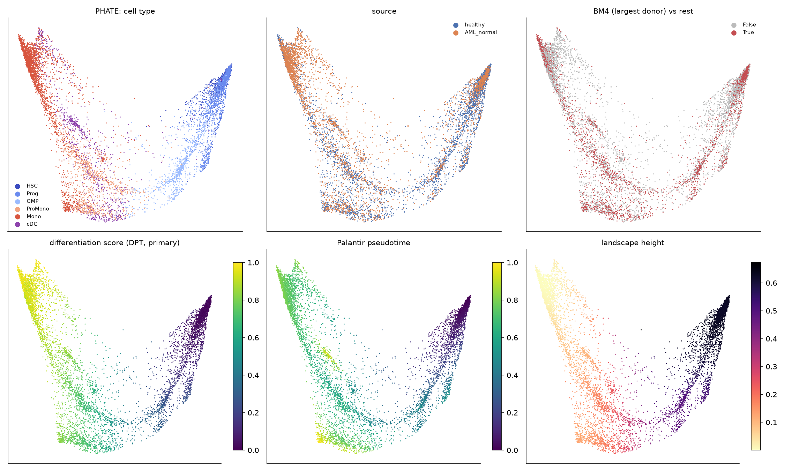
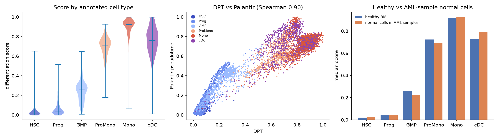
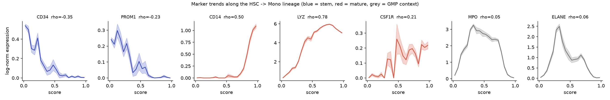
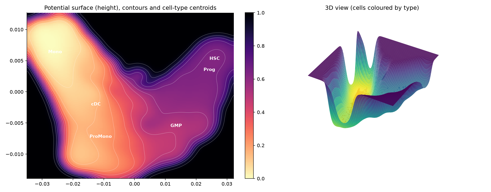
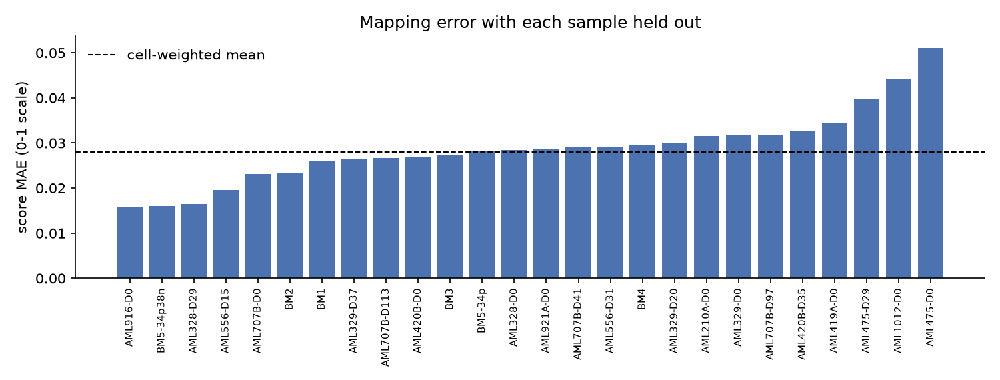

# Phase 1: normal myeloid differentiation landscape

Generated 2026-10-14 by `python -m pipeline.run --phase 1`. All numbers are computed by the pipeline.

## Summary

- Reference: **7,956 normal myeloid cells** (4,430 healthy BM, 3,526 normal cells from AML samples), 2000 highly variable genes, 30 PCs, Harmony by sample.
- Differentiation score (DPT, rooted in a healthy HSC) orders the annotated types HSC < Prog < GMP < ProMono < Mono with **Spearman 0.920**; Palantir gives 0.903. DPT and Palantir agree with **Spearman 0.900** (0.922 on the main lineage).
- Root choice barely matters: across 9 alternative HSC roots, the minimum Spearman with the primary score is 0.990.
- Embedding: PHATE. Landscape height vs score: Spearman -0.938 (stem-like cells high, mature cells low, as intended).
- Mapping (expression -> landscape): random 20% hold-out score MAE **0.025** (Spearman 0.969); with whole samples held out, cell-weighted MAE **0.028**. Position error is 5.4% (random) and 6.1% (held-out sample) of the embedding range.
- Marker sanity check **passed**: CD34 rho -0.35, PROM1 rho -0.23, CD14 rho +0.50, LYZ rho +0.78, CSF1R rho +0.21 (stem markers should be negative, mature markers positive).

## 1. Reference cells and QC

Cells: van Galen cells with `PredictionRefined = normal` and CellType in ['HSC', 'Prog', 'GMP', 'ProMono', 'Mono', 'cDC'], excluding cell lines. 7,956 selected, 7,956 after QC (>= 200 genes, < 20% mitochondrial UMIs). The authors' data were already filtered (minimum 1000 UMIs per cell, maximum mitochondrial fraction 20.0%), so our QC removes 0 cells. Genes detected in fewer than 10 cells were dropped (27,814 -> 15,803).

| CellType   |   AML_normal |   healthy |
|:-----------|-------------:|----------:|
| HSC        |          320 |      1270 |
| Prog       |          355 |      1156 |
| GMP        |          238 |       532 |
| ProMono    |          366 |       624 |
| Mono       |         1773 |       567 |
| cDC        |          474 |       281 |

Processing: library-size normalization to 10,000 UMIs and log1p; 2,000 HVGs ranked by normalized dispersion within each batch and combined across batches (scanpy `seurat` flavor; the `seurat_v3` loess fit failed numerically on several small sorted batches); PCA on centred log expression of HVGs (25.3% of HVG variance in 30 PCs); Harmony on the PCs. Batch = sample, except that samples with fewer than 50 reference cells (16 samples, 267 cells) are pooled into one batch, because a per-batch variance fit or correction cannot be estimated from a handful of cells.

**Batch structure** (fraction of each cell's 30 nearest neighbours sharing its label):

|                    |   sample |   source |   CellType |
|:-------------------|---------:|---------:|-----------:|
| uncorrected_pca    |    0.606 |    0.883 |      0.807 |
| harmony            |    0.254 |    0.669 |      0.724 |
| expected_if_random |    0.114 |    0.506 |      0.196 |

Without correction, cells cluster by sample far more than chance. Harmony cuts same-sample neighbours from 0.61 to 0.25 (random: 0.11). It costs some cell-type purity (0.81 -> 0.72, still far above the random 0.20), so batch is reduced, not removed. The landscape (pseudotime, embedding, surface) is built on the Harmony PCs so that donor-specific islands do not become fake valleys.

## 2. Pseudotime and differentiation score

- **Root:** the healthy-donor HSC with the highest `Score_HSC` (the authors' classifier score, computed independently of our pipeline): `BM5-34p38n_AACGATTCATAG` from BM5-34p38n.
- **Primary method: diffusion pseudotime (DPT)** on a 30-NN graph of the Harmony PCs. Every cell is connected to the root.
- **Second method: Palantir** (same PCs, same root, 1200 waypoints). Left to detect terminal states itself, it picked cells labelled ['Prog', 'ProMono'], which is biologically wrong (neither is an end state). We therefore fixed the terminal states from the authors' classifier scores, independently of our pseudotime: the Mono cell with the highest `Score_Mono` and the cDC cell with the highest `Score_cDC`. The pseudotime itself barely changes (Spearman 1.000 between the two runs; order agreement 0.903 with automatic states). All Palantir numbers below use the fixed states.
- **Uncorrected check:** DPT on uncorrected PCs agrees with the primary at Spearman 0.951, so the ordering is not an artefact of Harmony. It orders the annotated types slightly better (0.943 vs 0.920); we keep Harmony as primary for the batch reason in section 1, a choice made before computing either value.
- **Score:** DPT rescaled to [0, 1] between its 1st and 99th percentiles (0.007 -> 0, 0.956 -> 1) and clipped, so a few extreme cells do not compress everyone else.

|                 |   Spearman with HSC<Prog<GMP<ProMono<Mono |
|:----------------|------------------------------------------:|
| dpt             |                                     0.920 |
| palantir        |                                     0.903 |
| dpt_uncorrected |                                     0.943 |

Median score and Palantir pseudotime by cell type and source:

| CellType   |   ('score', 'AML_normal') |   ('score', 'healthy') |   ('palantir', 'AML_normal') |   ('palantir', 'healthy') |
|:-----------|--------------------------:|-----------------------:|-----------------------------:|--------------------------:|
| HSC        |                     0.026 |                  0.020 |                        0.032 |                     0.025 |
| Prog       |                     0.039 |                  0.041 |                        0.060 |                     0.067 |
| GMP        |                     0.226 |                  0.263 |                        0.355 |                     0.404 |
| ProMono    |                     0.693 |                  0.724 |                        0.607 |                     0.625 |
| Mono       |                     0.925 |                  0.921 |                        0.744 |                     0.777 |
| cDC        |                     0.791 |                  0.729 |                        0.740 |                     0.758 |

Within each cell type, healthy and AML-sample normal cells get similar scores, which supports pooling them.

Note on shape: DPT is not linear in biological stage. HSC and Prog are compressed near 0, and most of the range is spent between GMP and Mono. Phase 2 thresholds must therefore be chosen on this score's actual distribution, not assumed evenly spaced.

The cDC branch is not part of the HSC->Mono order; it receives high scores (median about 0.75), consistent with being a mature, separate fate.

Palantir fate probabilities (median per cell type):

| CellType   |   fate_Mono |   fate_cDC |
|:-----------|------------:|-----------:|
| HSC        |       0.502 |      0.498 |
| Prog       |       0.502 |      0.498 |
| GMP        |       0.510 |      0.490 |
| ProMono    |       0.535 |      0.465 |
| Mono       |       0.838 |      0.162 |
| cDC        |       0.569 |      0.431 |

Negative result: the fate probabilities separate the monocyte fate (Mono cells 0.84) but not the dendritic one: cDC cells get only 0.43 cDC probability. Early cells sit at about 0.5/0.5, as expected before commitment. Because the cDC fate is not resolved, fate probabilities are reported here but not used downstream.

## 3. Embedding and potential surface

- Embedding: PHATE on the Harmony PCs (the preferred method; no fallback needed).
- Surface: 160x160 grid with 8% margin. Cells are binned and Gaussian-smoothed (bandwidth 3.5% of the range) to get a local mean score and a density. Height = 0.75 x (1 - local score) + 0.25 x normalized(-log density), blended toward a high rim where there are no cells, lightly smoothed, then scaled to [0, 1].
- Reading the surface: stem-like cells sit on the high plateau; dense, mature populations form the deepest basins. The density term adds local dips where many cells sit, so each stable population looks like a basin, as in Waddington's picture.

Cell-type centroids (used for the floating labels in the web app):

|         |      x |      y |
|:--------|-------:|-------:|
| HSC     |  0.026 |  0.005 |
| Prog    |  0.024 |  0.003 |
| GMP     |  0.014 | -0.006 |
| ProMono | -0.011 | -0.007 |
| Mono    | -0.026 |  0.006 |
| cDC     | -0.013 | -0.002 |

## 4. Mapping new cells onto the landscape

Model: log-normalized expression of the 2000 HVGs -> centre with reference means -> fixed PCA projection -> distance-weighted kNN (k = 15) regression onto (score, x, y). It uses the uncorrected PCA deliberately: Harmony corrects a whole dataset at once and cannot be applied to a single new cell or to the drug-shifted vectors of Phase 5. Genes missing from a query are set to the reference mean.

|   n_test |   score_mae |   score_spearman |   xy_rmse_frac_of_range |
|---------:|------------:|-----------------:|------------------------:|
| 1592.000 |       0.025 |            0.969 |                   0.054 |

Leave-one-sample-out (each sample with >= 30 cells held out in turn):

| held_out_sample   |    n |   score_mae |   score_spearman |   score_sd_true |   xy_rmse_frac_of_range |
|:------------------|-----:|------------:|-----------------:|----------------:|------------------------:|
| AML1012-D0        |  214 |       0.044 |            0.971 |           0.354 |                   0.086 |
| AML210A-D0        |   58 |       0.032 |            0.976 |           0.276 |                   0.062 |
| AML328-D0         |  121 |       0.028 |            0.856 |           0.363 |                   0.056 |
| AML328-D29        |   88 |       0.016 |            0.757 |           0.234 |                   0.043 |
| AML329-D0         |   81 |       0.032 |            0.963 |           0.354 |                   0.073 |
| AML329-D20        |  505 |       0.030 |            0.785 |           0.241 |                   0.057 |
| AML329-D37        |  116 |       0.026 |            0.907 |           0.255 |                   0.062 |
| AML419A-D0        |   77 |       0.035 |            0.804 |           0.280 |                   0.067 |
| AML420B-D0        |   41 |       0.027 |            0.948 |           0.395 |                   0.059 |
| AML420B-D35       |  464 |       0.033 |            0.711 |           0.141 |                   0.091 |
| AML475-D0         |   62 |       0.051 |            0.866 |           0.367 |                   0.096 |
| AML475-D29        |   34 |       0.040 |            0.885 |           0.214 |                   0.067 |
| AML556-D15        |   83 |       0.020 |            0.935 |           0.081 |                   0.036 |
| AML556-D31        |  774 |       0.029 |            0.970 |           0.260 |                   0.053 |
| AML707B-D0        |  129 |       0.023 |            0.867 |           0.193 |                   0.074 |
| AML707B-D113      |  154 |       0.027 |            0.975 |           0.243 |                   0.050 |
| AML707B-D41       |  213 |       0.029 |            0.804 |           0.285 |                   0.058 |
| AML707B-D97       |   34 |       0.032 |            0.928 |           0.237 |                   0.060 |
| AML916-D0         |   58 |       0.016 |            0.786 |           0.067 |                   0.032 |
| AML921A-D0        |   62 |       0.029 |            0.972 |           0.348 |                   0.048 |
| BM1               |   51 |       0.026 |            0.949 |           0.295 |                   0.040 |
| BM2               |  115 |       0.023 |            0.964 |           0.309 |                   0.044 |
| BM3               |  311 |       0.027 |            0.988 |           0.308 |                   0.052 |
| BM4               | 1906 |       0.030 |            0.990 |           0.344 |                   0.050 |
| BM5-34p           | 1241 |       0.028 |            0.822 |           0.103 |                   0.084 |
| BM5-34p38n        |  806 |       0.016 |            0.331 |           0.049 |                   0.053 |

Spearman is low for some held-out samples because their true scores barely vary (see `score_sd_true`, e.g. the CD34+CD38- sorted BM5 sample is almost all HSC). MAE is the relevant number there. Caveat: the PCA basis and the target pseudotime were computed with all cells, so this tests how well the fixed map generalizes across samples, not a full re-derivation of the landscape without them.

## 5. Maturation signature

Spearman correlation of each gene (detected in >= 1% of cells) with the score, on the HSC->Mono lineage only (cDC excluded). 10,909 genes tested. The signature is the top 200 positively and top 200 negatively correlated genes. All genes, before any exclusion:

| up gene   |   rho up | down gene   |   rho down |
|:----------|---------:|:------------|-----------:|
| S100A9    |    0.845 | RPS12       |     -0.733 |
| S100A8    |    0.829 | RPS6        |     -0.720 |
| VCAN      |    0.809 | RPS3A       |     -0.720 |
| LYZ       |    0.781 | RPS18       |     -0.704 |
| MNDA      |    0.771 | RPS23       |     -0.703 |
| FCN1      |    0.762 | RPL31       |     -0.687 |
| TMSB4X    |    0.738 | RPL5        |     -0.670 |
| CYBB      |    0.714 | RPL9        |     -0.666 |
| S100A6    |    0.707 | RPS27A      |     -0.665 |
| CTSS      |    0.707 | RPL35A      |     -0.658 |
| PSAP      |    0.701 | RPS15A      |     -0.651 |
| FTL       |    0.694 | GAS5        |     -0.643 |
| TYROBP    |    0.678 | RPL34       |     -0.636 |
| ACTB      |    0.669 | NPM1        |     -0.630 |
| TMSB10    |    0.669 | RPL30       |     -0.628 |

Ribosomal-protein and mitochondrial genes (regex `^(RPL|RPS|MRPL|MRPS|MT-)`, 218 genes) dominate the down-regulated end: they make up 38% of the 200 most negatively correlated genes (and 2% of the positive end). Their decline is real biology (progenitors build more ribosomes), but it reflects growth more than lineage maturation, and drugs that simply slow growth lower them too. Left in, they would let Phase 3 reward any antiproliferative drug as 'differentiating'. The **primary signature excludes them**. The full signature is saved as `maturation_signature_full.csv` for a sensitivity analysis (318 of 400 genes shared). This rule was set before any drug was scored.

Weakest gene kept in the primary signature: |rho| = 0.174. Top genes of the primary signature:

| up gene   |   rho up | down gene   |   rho down |
|:----------|---------:|:------------|-----------:|
| S100A9    |    0.845 | GAS5        |     -0.643 |
| S100A8    |    0.829 | NPM1        |     -0.630 |
| VCAN      |    0.809 | CDK6        |     -0.620 |
| LYZ       |    0.781 | HSP90AB1    |     -0.586 |
| MNDA      |    0.771 | SPINK2      |     -0.585 |
| FCN1      |    0.762 | EEF1B2      |     -0.570 |
| TMSB4X    |    0.738 | ZFAS1       |     -0.538 |
| CYBB      |    0.714 | EEF1A1      |     -0.535 |
| S100A6    |    0.707 | MSI2        |     -0.523 |
| CTSS      |    0.707 | SNHG29      |     -0.519 |
| PSAP      |    0.701 | HINT1       |     -0.508 |
| FTL       |    0.694 | NRIP1       |     -0.501 |
| TYROBP    |    0.678 | NPR3        |     -0.487 |
| ACTB      |    0.669 | TPT1        |     -0.463 |
| TMSB10    |    0.669 | FAM30A      |     -0.440 |

## 6. Sanity checks

| gene   | expected   |   spearman | pass   |
|:-------|:-----------|-----------:|:-------|
| CD34   | falls      |     -0.355 | True   |
| PROM1  | falls      |     -0.230 | True   |
| CD14   | rises      |      0.499 | True   |
| LYZ    | rises      |      0.781 | True   |
| CSF1R  | rises      |      0.212 | True   |

## 7. Choices and justifications

| Choice                                                                                 | Justification                                                                                                                                                                                                                                                |
|:---------------------------------------------------------------------------------------|:-------------------------------------------------------------------------------------------------------------------------------------------------------------------------------------------------------------------------------------------------------------|
| Use cells the authors called normal, from healthy donors and from AML samples.         | The authors' calls use genotyping plus expression, which we cannot redo. Normal cells from AML marrow add about 3,500 cells, and section 2 shows they get the same scores as healthy cells of the same type.                                                 |
| Keep cDC in the reference but out of the ordered lineage.                              | cDCs are a real mature fate and AML blasts can be cDC-like, so the landscape must contain them. They are not on the HSC->monocyte path, so ordering checks and the signature exclude them.                                                                   |
| HVGs chosen within each batch, then combined.                                          | Picking variable genes across all cells at once would favour genes that differ between donors rather than between cell states.                                                                                                                               |
| No gene scaling before PCA.                                                            | Scaling inflates noisy low-expression genes. Leaving genes in log units also keeps Phase 5 drug shifts, which are added in log space, consistent with the projection.                                                                                        |
| Harmony for the reference structure.                                                   | Section 1 shows strong sample clustering. Harmony is a standard, well-tested correction that works on PCs.                                                                                                                                                   |
| harmonypy 0.0.10.                                                                      | The current release needs a C++ compiler to install. 0.0.10 is the pure-Python implementation of the same algorithm.                                                                                                                                         |
| DPT as the primary pseudotime, Palantir as the second method.                          | DPT was named first in the plan and is deterministic given the graph. Palantir is an independent algorithm (waypoints and shortest paths) that also returns fate probabilities, so agreement between the two is informative.                                 |
| Root = the healthy HSC with the highest authors' HSC score; sensitivity over 10 roots. | This avoids picking the root by looking at our own pseudotime, and the sensitivity check shows the result does not depend on that one cell.                                                                                                                  |
| Score = DPT clipped at the 1st/99th percentiles.                                       | Min-max scaling would let a handful of outlying cells set the scale.                                                                                                                                                                                         |
| PHATE for the 2D embedding.                                                            | PHATE is designed to preserve continuous trajectories and branches, which suits a differentiation landscape better than UMAP's cluster-focused layout.                                                                                                       |
| Height weights 0.75 score / 0.25 density.                                              | The plan asks for pseudotime blended with -log density. Pseudotime dominates so the slope always runs from stem to mature; the smaller density term shapes basins without inverting the slope.                                                               |
| Fixed PCA + kNN for mapping, not Harmony-corrected coordinates.                        | The map must apply to single new cells and to synthetic shifted vectors (Phase 5). Leave-one-sample-out error measures the cost of not batch-correcting queries.                                                                                             |
| Distance-weighted kNN with k = 15.                                                     | A local average of 15 reference cells is smooth enough to be stable but local enough to keep branch structure. It also gives an interpretable placement: a query lands among the reference cells it most resembles.                                          |
| Signature on the HSC->Mono lineage, top 200 genes each way.                            | Most AML blasts in this cohort are on the monocytic/granulocytic path. Two hundred genes per direction is large enough for robust connectivity scoring and is in the range commonly used for CMap queries.                                                   |
| Exclude ribosomal and mitochondrial genes from the primary signature.                  | They track growth rather than lineage identity, and drug-induced growth arrest lowers them in any cell line, so they would confound 'pushes toward maturity' with 'slows proliferation'. The full signature is kept as a pre-specified sensitivity analysis. |
| Fix Palantir terminal states from the authors' Mono and cDC scores.                    | Automatic detection picked Prog and ProMono cells, which are not end states. Using the authors' classifier keeps the choice independent of our own pseudotime.                                                                                               |

## 8. Things to watch

- The score is compressed at the stem end (HSC and Prog both near 0), so it separates early states less well than late ones.
- Batch is reduced, not removed; the mapping of new cells is uncorrected and inherits some batch error (quantified in section 4).
- Weak marker correlations for PROM1 (-0.23) and CSF1R (+0.21) reflect low detection in 3-prime scRNA-seq; their binned trends (figure) still go the expected way.
- Malignant cells may sit off the normal manifold; kNN will still place them among their nearest normal neighbours. Phase 2 should report distance to the reference so off-manifold cells are visible.
- The landscape is a 2D projection; distances on it are qualitative.

## Figures

## Outputs (`data/processed/`)

`landscape_reference.h5ad` (reference cells with scores and coordinates), `landscape_grid.npz` (height surface), `landscape_mapper.joblib` (expression -> landscape map), `maturation_correlations.csv`, `maturation_signature.csv`, `landscape_centroids.csv`, `phase1_stats.json`.
