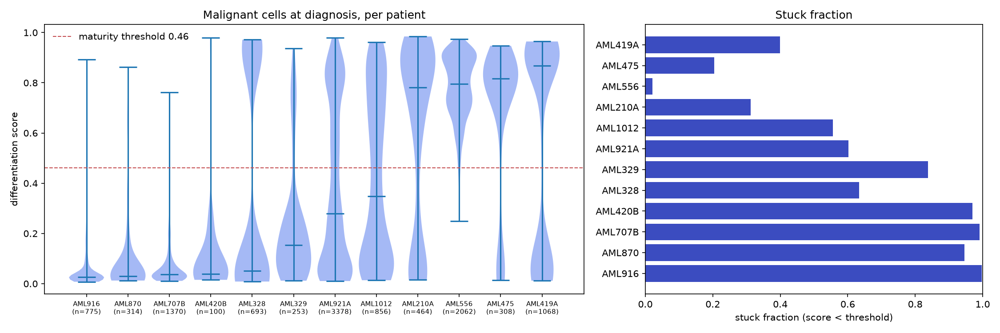
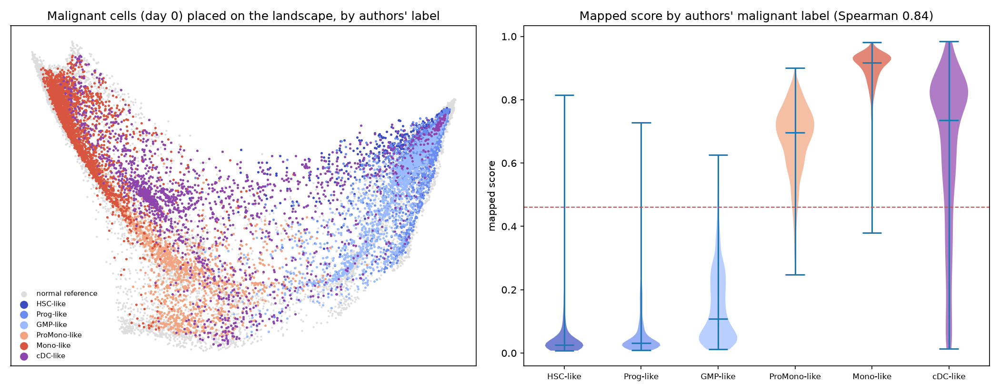
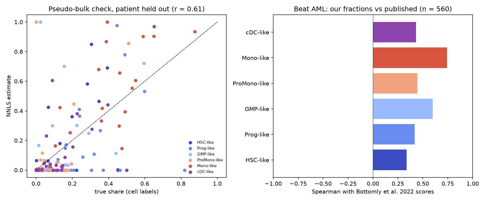
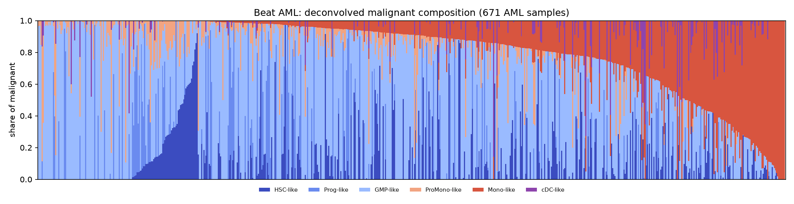

# Phase 2: patient placement

Generated 2026-10-14 by `python -m pipeline.run --phase 2`.

## Summary

- **Maturity threshold** (fixed on normal reference cells, before any drug analysis): score **0.461**, the cut that best separates HSC/Prog/GMP from ProMono/Mono/cDC (balanced accuracy 0.987; 99% of immature and 98% of mature normal cells correctly classified).
- **Mapping check against independent labels:** the mapped score of malignant cells increases along the authors' HSC-like < Prog-like < GMP-like < ProMono-like < Mono-like labels with Spearman **0.840** (all days) and 0.863 (day 0). Those labels come from the authors' classifier and were not used to build the map.
- **12 patients** with malignant cells at diagnosis. Stuck fraction ranges from 0.02 to 1.00 (median 0.62).
- **Deconvolution check:** on pseudo-bulk samples built from van Galen cells with the patient held out of the reference, estimated vs true malignant composition r = **0.608**. On Beat AML, our fractions agree with the published Bottomly et al. scores at Spearman 0.34 to 0.74 across the six types.
- **Signature transfer to bulk:** for 395 maturation-signature genes, the direction of change with deconvolved mature share in Beat AML agrees with the single-cell direction for **95%** of genes (Spearman of slopes vs single-cell rho 0.78).

## 1. Maturity threshold

Chosen as the score that maximizes balanced accuracy between immature (HSC, Prog, GMP) and mature (ProMono, Mono, cDC) normal reference cells. It is a property of normal haematopoiesis only. It defines 'stuck' (Phase 2) and 'matured' (Phase 5) and is not changed afterwards.

## 2. Single-cell placement (van Galen malignant cells)

All 16,169 malignant cells with a like-type label (all days, plus the two cell lines) were mapped with the fixed Phase 1 map. 100% of model genes are present (same platform). A cell is flagged **off-manifold** when its mean distance to its 15 reference neighbours exceeds the 99th percentile of the same distance among reference cells (leave-one-out), 9.19. Off-manifold cells are still placed, but their position is less trustworthy.

Mapped score by the authors' malignant label (all AML samples):

| CellType     |    count |   25% |   50% |   75% |   off_manifold_frac |
|:-------------|---------:|------:|------:|------:|--------------------:|
| HSC-like     | 1936.000 | 0.019 | 0.025 | 0.043 |               0.012 |
| Prog-like    | 3696.000 | 0.022 | 0.031 | 0.067 |               0.006 |
| GMP-like     | 1823.000 | 0.047 | 0.109 | 0.226 |               0.012 |
| ProMono-like | 1416.000 | 0.615 | 0.696 | 0.751 |               0.068 |
| Mono-like    | 2550.000 | 0.877 | 0.916 | 0.936 |               0.049 |
| cDC-like     | 2068.000 | 0.495 | 0.735 | 0.830 |               0.015 |

Per patient, malignant cells at diagnosis:

| patient   |   n_malignant |   median_score |   q25 |   q75 |   stuck_fraction |   offmanifold_fraction | low_cell_count   |
|:----------|--------------:|---------------:|------:|------:|-----------------:|-----------------------:|:-----------------|
| AML916    |           775 |          0.026 | 0.019 | 0.046 |            0.997 |                  0.003 | False            |
| AML707B   |          1370 |          0.037 | 0.024 | 0.075 |            0.991 |                  0.012 | False            |
| AML420B   |           100 |          0.039 | 0.025 | 0.107 |            0.970 |                  0.010 | False            |
| AML870    |           314 |          0.030 | 0.023 | 0.073 |            0.946 |                  0.003 | False            |
| AML329    |           253 |          0.154 | 0.060 | 0.262 |            0.838 |                  0.008 | False            |
| AML328    |           693 |          0.051 | 0.023 | 0.936 |            0.633 |                  0.007 | False            |
| AML921A   |          3378 |          0.280 | 0.066 | 0.735 |            0.602 |                  0.015 | False            |
| AML1012   |           856 |          0.349 | 0.085 | 0.736 |            0.556 |                  0.002 | False            |
| AML419A   |          1068 |          0.869 | 0.061 | 0.925 |            0.400 |                  0.006 | False            |
| AML210A   |           464 |          0.781 | 0.151 | 0.927 |            0.312 |                  0.004 | False            |
| AML475    |           308 |          0.817 | 0.700 | 0.860 |            0.205 |                  0.006 | False            |
| AML556    |          2062 |          0.795 | 0.698 | 0.893 |            0.021 |                  0.106 | False            |

Patients flagged `low_cell_count` have fewer than 50 malignant cells; their numbers are shown but should be read with caution.

All samples, including follow-up days (treatment changes the malignant compartment, so later days are shown for context only):

| sample       | patient   |     day |    n |   median_score |   stuck_fraction |
|:-------------|:----------|--------:|-----:|---------------:|-----------------:|
| AML210A-D0   | AML210A   |   0.000 |  464 |          0.781 |            0.312 |
| AML328-D0    | AML328    |   0.000 |  693 |          0.051 |            0.633 |
| AML328-D29   | AML328    |  29.000 | 1145 |          0.024 |            0.977 |
| AML328-D113  | AML328    | 113.000 |  153 |          0.915 |            0.379 |
| AML328-D171  | AML328    | 171.000 |  161 |          0.024 |            0.901 |
| AML329-D0    | AML329    |   0.000 |  253 |          0.154 |            0.838 |
| AML329-D20   | AML329    |  20.000 |  259 |          0.203 |            0.610 |
| AML329-D37   | AML329    |  37.000 |   16 |          0.523 |            0.500 |
| AML419A-D0   | AML419A   |   0.000 | 1068 |          0.869 |            0.400 |
| AML420B-D0   | AML420B   |   0.000 |  100 |          0.039 |            0.970 |
| AML420B-D14  | AML420B   |  14.000 |    1 |          0.025 |            1.000 |
| AML420B-D35  | AML420B   |  35.000 |   10 |          0.958 |            0.000 |
| AML475-D0    | AML475    |   0.000 |  308 |          0.817 |            0.205 |
| AML475-D29   | AML475    |  29.000 |    1 |          0.826 |            0.000 |
| AML556-D0    | AML556    |   0.000 | 2062 |          0.795 |            0.021 |
| AML556-D31   | AML556    |  31.000 |   15 |          0.699 |            0.133 |
| AML707B-D0   | AML707B   |   0.000 | 1370 |          0.037 |            0.991 |
| AML707B-D18  | AML707B   |  18.000 |   61 |          0.040 |            0.984 |
| AML707B-D41  | AML707B   |  41.000 |   13 |          0.182 |            0.615 |
| AML707B-D97  | AML707B   |  97.000 |    1 |          0.490 |            0.000 |
| AML707B-D113 | AML707B   | 113.000 |    5 |          0.749 |            0.200 |
| AML870-D0    | AML870    |   0.000 |  314 |          0.030 |            0.946 |
| AML870-D14   | AML870    |  14.000 |    7 |          0.087 |            1.000 |
| AML916-D0    | AML916    |   0.000 |  775 |          0.026 |            0.997 |
| AML921A-D0   | AML921A   |   0.000 | 3378 |          0.280 |            0.602 |
| AML1012-D0   | AML1012   |   0.000 |  856 |          0.349 |            0.556 |

Cell lines (not patients), as a sanity check: MUTZ3 and OCI-AML3 are AML lines.

| sample   |        n |   median_score |   stuck_fraction |   off_manifold |
|:---------|---------:|---------------:|-----------------:|---------------:|
| MUTZ3    | 1502.000 |          0.215 |            0.813 |          0.009 |
| OCI-AML3 | 1178.000 |          0.255 |            0.944 |          0.020 |

**Stuck signatures (single-cell):** for each patient, mean log expression of day-0 malignant cells minus the mean of normal reference monocytes, over the 400 primary signature genes. The 'push' direction (minus stuck) correlates with the maturation direction (sign of each gene's rho) at Spearman 0.45 to 0.85 across patients, i.e. patients furthest from maturity need the largest push along the signature.

## 3. Bulk deconvolution (Beat AML)

Reference: mean CPM profiles of the six van Galen malignant like-types plus non-myeloid normal groups (T_NK, B, Ery, pDC), on the union of each group's top 50 marker genes (484 genes, 450 found in Beat AML). Non-negative least squares on gene-scaled values; fractions sum to 1, and malignant shares are renormalized within the six like-types. Normal myeloid cells are not separate references (they are nearly collinear with the like-types), so in bulk they count toward the matching like-type.

**Pseudo-bulk validation** (each AML sample with >= 200 cells summed into a pseudo-bulk; reference rebuilt without that patient):

| type         |   pearson |   mae |
|:-------------|----------:|------:|
| HSC-like     |     0.407 | 0.154 |
| Prog-like    |     0.460 | 0.171 |
| GMP-like     |     0.410 | 0.127 |
| ProMono-like |     0.461 | 0.109 |
| Mono-like    |     0.833 | 0.137 |
| cDC-like     |     0.669 | 0.106 |

The six fine types are only moderately resolved (adjacent stages such as HSC-like and Prog-like have similar profiles). The coarse quantity used downstream, the **mature share** (ProMono + Mono + cDC-like), is recovered much better: Pearson **0.895**, MAE 0.148 over 27 pseudo-bulk samples. We also tried 50/100/200 markers per type and two marker rules; overall r stayed between 0.61 and 0.64, so the pre-set configuration (50 markers, fold change vs mean of other types) was kept rather than tuned.

This is same-platform, so it is an upper bound on accuracy for real bulk RNA-seq.

**Comparison with Bottomly et al. 2022** (their published van Galen cell-type scores for the same samples):

| type         |   n |   spearman |
|:-------------|----:|-----------:|
| HSC-like     | 560 |      0.338 |
| Prog-like    | 560 |      0.417 |
| GMP-like     | 560 |      0.599 |
| ProMono-like | 560 |      0.445 |
| Mono-like    | 560 |      0.743 |
| cDC-like     | 560 |      0.431 |

The published values are signature scores, not fractions, so only rank agreement is meaningful. Their analysis already established that differentiation state shapes drug response in Beat AML, so this deconvolution is a building block here, not a novel result.

Per-sample fractions, malignant shares, mature share (ProMono + Mono + cDC-like) and a bulk maturity index (shares weighted by each like-type's median single-cell score) are saved for 707 samples (671 AML).

## 4. Bulk stuck signatures

No mature reference exists on the bulk platform, and subtracting a single-cell monocyte profile from bulk RNA-seq would mix platforms. Instead, for each signature gene we regress Beat AML expression on the deconvolved mature share and take the predicted value at mature share = 1 as the expected mature expression. Stuck = patient - expected mature. Check: the bulk slopes agree in sign with the single-cell signature for 95% of genes, so the signature carries over to bulk.

## 5. Choices and justifications

| Choice                                                           | Justification                                                                                                                                                                       |
|:-----------------------------------------------------------------|:------------------------------------------------------------------------------------------------------------------------------------------------------------------------------------|
| Threshold by maximum balanced accuracy on normal cells.          | Uses only normal biology, so it cannot be tuned toward drug results; balanced accuracy is not biased by the much larger number of Mono cells.                                       |
| Immature = HSC, Prog, GMP; mature = ProMono, Mono, cDC.          | GMP cells are still proliferating progenitors, while promonocytes are committed to the monocytic fate; this is the standard boundary between progenitor and committed compartments. |
| Map malignant cells with the fixed Phase 1 map.                  | The same map is used later for drug-shifted cells, so placement and simulation are consistent.                                                                                      |
| Off-manifold flag at the 99th percentile of reference distances. | Malignant cells can be transcriptionally unlike any normal cell; flagging them makes that visible instead of hiding it in a nearest-neighbour average.                              |
| Validate placement against the authors' like-type labels.        | Those labels are independent of our map, so agreement is genuine evidence.                                                                                                          |
| Day-0 samples for patient summaries.                             | Diagnosis samples reflect untreated disease, which is what a differentiation therapy would face.                                                                                    |
| NNLS with marker genes and gene scaling.                         | Standard reference-based deconvolution; scaling stops a few highly expressed genes from dominating.                                                                                 |
| Include non-myeloid normal references.                           | Bulk marrow and blood contain lymphocytes and erythroid cells; without references they would be forced into malignant types.                                                        |
| Patient held out of the reference during pseudo-bulk checks.     | Otherwise the reference would contain the very cells being estimated.                                                                                                               |
| Bulk mature expectation by within-cohort regression.             | Keeps both sides of the subtraction on the same platform; the sign-agreement check shows it reproduces the single-cell direction.                                                   |

## 6. Things to watch

- Malignant cells are placed by similarity to normal cells; a malignant 'Mono-like' cell can look mature in expression yet keep leukaemic behaviour.
- The bulk mature expectation extrapolates to mature share = 1; patients far outside the cohort range get larger, less certain stuck values.
- Bulk samples include normal cells, and blood samples contain normal monocytes, which can inflate the Mono-like share.

## Figures

## Outputs (`data/processed/`)

`malignant_cells_mapped.parquet`, `stuck_signatures_vangalen.parquet`, `beataml_deconvolution.parquet`, `stuck_signatures_beataml.parquet`, `beataml_mature_expectation.csv`, `phase2_stats.json`.
