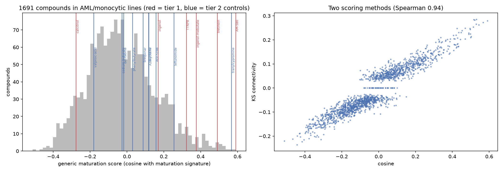
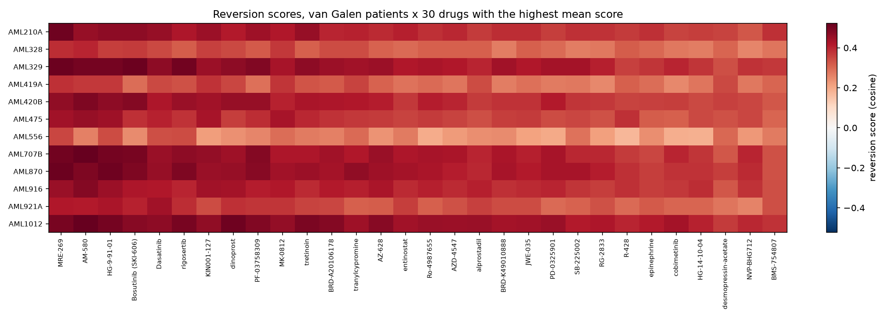
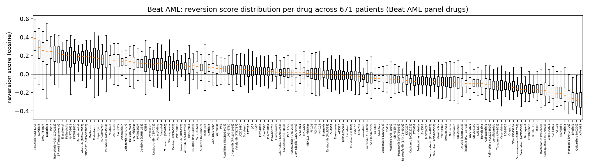

# Phase 3: drug ranking

Generated 2026-10-14 by `python -m pipeline.run --phase 3`.

## Summary

- **1,727 compounds** scored (12,414 LINCS signatures). Line tier used per compound: {'AML/monocytic': 1691, 'non-myeloid': 36}.
- **Positive controls, tier 1** (retinoids, vitamin D, PKC activators) vs all other compounds profiled in AML/monocytic lines: AUROC **0.810** (permutation p = 0.0029, 6 controls, 1691 compounds) with the cosine score; 0.815 (p = 0.0022) with connectivity.
- **Tier 2** (weaker evidence): AUROC 0.708 (p = 0.0105).
- Robustness of the generic score: cosine vs connectivity Spearman 0.94; primary genes vs landmark-only 0.65; primary vs full signature (with ribosomal genes) 0.72. Correlation with signature strength (TAS): 0.15.
- **Patient specificity:** rankings are dominated by drug-level effects. The average Spearman between two patients' drug rankings is 0.93 (van Galen) and 0.61 (Beat AML).

## 1. Drug signatures

Besides the Phase 0 set, we fetched every compound signature in AML/monocytic lines (THP1, HL60, U937, SKM1, NOMO1), up to 3 per compound and line (same quality ranking as Phase 0). Per compound, signatures are averaged within each cell line, then across lines of the best available tier: AML/monocytic lines first, then CD34/K562, then the core non-myeloid lines. The tier and lines used are reported for every drug. Values are Level 5 z-scores.

Scoring genes: the 400 primary maturation-signature genes that are L1000 landmark or best-inferred (314 genes; 39 landmark-only for the sensitivity check).

## 2. Scores

- **Generic maturation score** (one number per drug): cosine between the drug signature and the maturation direction (each gene weighted by its Spearman rho with the differentiation score). Positive = the drug raises maturation genes and lowers stem/progenitor genes.
- **Patient reversion score:** cosine between the drug signature and the patient's push vector (minus the stuck signature from Phase 2). Positive = the drug moves expression in the direction this patient needs to reach maturity.
- **Connectivity (second method):** CMap KS connectivity score (Lamb et al. 2006) with the top 100 genes the patient needs raised and lowered as query sets. Rank-based, so it ignores signature magnitude.

Method agreement on patient rankings (median per-patient Spearman, cosine vs connectivity): van Galen 0.87, Beat AML 0.92.

## 3. Positive controls

Evaluated before any patient-level validation. Background: all compounds whose consensus comes from AML/monocytic lines.

| tier   | drug             | line_tier     | cells                                   |   cosine |   connectivity |   percentile_in_myeloid_screen |   rank_in_myeloid_screen |
|:-------|:-----------------|:--------------|:----------------------------------------|---------:|---------------:|-------------------------------:|-------------------------:|
| tier1  | AM-580           | AML/monocytic | NOMO1,SKM1,THP1,U937                    |    0.591 |          0.280 |                         99.941 |                    1.000 |
| tier1  | TTNPB            | AML/monocytic | THP1                                    |    0.322 |          0.174 |                         95.860 |                   70.000 |
| tier1  | alitretinoin     | non-myeloid   | A375,A549,HA1E,HEPG2,HT29,MCF7,PC3,VCAP |   -0.077 |         -0.045 |                        nan     |                  nan     |
| tier1  | calcitriol       | AML/monocytic | HL60,NOMO1,SKM1,THP1,U937               |   -0.277 |         -0.142 |                          7.747 |                 1560.000 |
| tier1  | ingenol          | AML/monocytic | NOMO1,SKM1,THP1,U937                    |    0.169 |          0.109 |                         84.979 |                  254.000 |
| tier1  | ingenol-mebutate | AML/monocytic | THP1                                    |    0.376 |          0.175 |                         97.398 |                   44.000 |
| tier1  | isotretinoin     | absent        | nan                                     |  nan     |        nan     |                        nan     |                  nan     |
| tier1  | tamibarotene     | non-myeloid   | A375,A549,HA1E,HEPG2,HT29,MCF7,PC3,VCAP |    0.023 |          0.039 |                        nan     |                  nan     |
| tier1  | tretinoin        | AML/monocytic | HL60,SKM1,THP1,U937                     |    0.490 |          0.229 |                         99.172 |                   14.000 |
| tier2  | AGI-5198         | AML/monocytic | THP1                                    |    0.157 |          0.084 |                         83.797 |                  274.000 |
| tier2  | AGI-6780         | AML/monocytic | THP1                                    |    0.117 |          0.075 |                         79.775 |                  342.000 |
| tier2  | Azacytidine      | AML/monocytic | THP1                                    |    0.118 |          0.107 |                         79.834 |                  341.000 |
| tier2  | brequinar        | AML/monocytic | THP1                                    |    0.088 |          0.074 |                         75.163 |                  420.000 |
| tier2  | decitabine       | AML/monocytic | THP1                                    |   -0.018 |          0.040 |                         55.884 |                  746.000 |
| tier2  | enasidenib       | absent        | nan                                     |  nan     |        nan     |                        nan     |                  nan     |
| tier2  | ivosidenib       | absent        | nan                                     |  nan     |        nan     |                        nan     |                  nan     |
| tier2  | leflunomide      | AML/monocytic | THP1                                    |    0.255 |          0.098 |                         93.140 |                  116.000 |
| tier2  | phenylbutyrate   | AML/monocytic | THP1                                    |    0.030 |          0.060 |                         64.695 |                  597.000 |
| tier2  | sodium-butyrate  | AML/monocytic | HL60                                    |   -0.028 |         -0.047 |                         53.696 |                  783.000 |
| tier2  | tranylcypromine  | AML/monocytic | THP1                                    |    0.567 |          0.272 |                         99.882 |                    2.000 |
| tier2  | valproic-acid    | AML/monocytic | NOMO1,SKM1,THP1,U937                    |   -0.180 |         -0.075 |                         20.284 |                 1348.000 |

|                    |   n_controls |   n_background |   auroc |   perm_p |
|:-------------------|-------------:|---------------:|--------:|---------:|
| tier1_cosine       |        6.000 |       1691.000 |   0.810 |    0.003 |
| tier1_connectivity |        6.000 |       1691.000 |   0.815 |    0.002 |
| tier2_cosine       |       10.000 |       1691.000 |   0.708 |    0.010 |
| tier2_connectivity |       10.000 |       1691.000 |   0.731 |    0.005 |

AUROC is the probability that a random control scores above a random other compound (0.5 = chance). Controls without AML/monocytic-line signatures (for example enasidenib and ivosidenib, profiled only in non-haematopoietic lines) cannot be placed in this background and are listed as such.

**Top 25 compounds by generic maturation score** (AML/monocytic lines):

|                     |   cosine |   connectivity | cells                |   n_sigs |   mean_tas |   cosine_landmark |
|:--------------------|---------:|---------------:|:---------------------|---------:|-----------:|------------------:|
| AM-580              |    0.591 |          0.280 | NOMO1,SKM1,THP1,U937 |        4 |      0.154 |             0.277 |
| tranylcypromine     |    0.567 |          0.272 | THP1                 |        3 |      0.227 |             0.571 |
| MRE-269             |    0.543 |          0.263 | HL60,U937            |        6 |      0.457 |             0.505 |
| Bosutinib (SKI-606) |    0.530 |          0.286 | THP1                 |        6 |      0.417 |             0.452 |
| rigosertib          |    0.529 |          0.265 | THP1                 |        3 |      0.708 |             0.442 |
| dinoprost           |    0.522 |          0.282 | THP1                 |        3 |      0.518 |             0.511 |
| BRD-A20106178       |    0.517 |          0.285 | HL60                 |        3 |      0.506 |             0.513 |
| HG-9-91-01          |    0.513 |          0.253 | THP1                 |        3 |      0.440 |             0.456 |
| PD-0325901          |    0.502 |          0.214 | THP1                 |        3 |      0.717 |             0.460 |
| AZ-628              |    0.499 |          0.210 | THP1                 |        3 |      0.738 |             0.475 |
| MK-0812             |    0.498 |          0.225 | THP1                 |        3 |      0.069 |             0.135 |
| SB-225002           |    0.497 |          0.243 | NOMO1,SKM1,THP1,U937 |        4 |      0.272 |             0.387 |
| KIN001-127          |    0.495 |          0.247 | THP1                 |        3 |      0.220 |             0.504 |
| tretinoin           |    0.490 |          0.229 | HL60,SKM1,THP1,U937  |       14 |      0.303 |             0.305 |
| PF-03758309         |    0.489 |          0.224 | THP1                 |        3 |      0.763 |             0.514 |
| AZD-4547            |    0.470 |          0.249 | THP1                 |        3 |      0.333 |             0.476 |
| Ro-4987655          |    0.469 |          0.204 | THP1                 |        3 |      0.596 |             0.399 |
| methiazole          |    0.453 |          0.238 | SKM1,U937            |        4 |      0.361 |             0.300 |
| Dasatinib           |    0.447 |          0.231 | THP1                 |        6 |      0.475 |             0.368 |
| NVP-BHG712          |    0.444 |          0.202 | THP1                 |        3 |      0.442 |             0.535 |
| ABT-751             |    0.434 |          0.231 | NOMO1,SKM1,THP1,U937 |        4 |      0.309 |             0.189 |
| R-428               |    0.433 |          0.173 | THP1                 |        3 |      0.192 |             0.336 |
| BRD-K49010888       |    0.432 |          0.172 | NOMO1,THP1           |        6 |      0.565 |             0.319 |
| TAK-733             |    0.429 |          0.184 | THP1                 |        3 |      0.730 |             0.403 |
| alprostadil         |    0.428 |          0.208 | THP1                 |        3 |      0.323 |             0.477 |

**Bottom 10** (push away from maturity):

|               |   cosine |   connectivity | cells                |   n_sigs |
|:--------------|---------:|---------------:|:---------------------|---------:|
| PHA-767491    |   -0.512 |         -0.220 | THP1                 |        3 |
| BRD-K01815685 |   -0.466 |         -0.212 | THP1                 |        3 |
| guanethidine  |   -0.443 |         -0.236 | THP1                 |        3 |
| bms           |   -0.442 |         -0.199 | THP1                 |        3 |
| BRD-A04845303 |   -0.430 |         -0.189 | THP1                 |        3 |
| flutamide     |   -0.428 |         -0.188 | NOMO1,SKM1,THP1,U937 |        6 |
| FPL-64176     |   -0.425 |         -0.203 | NOMO1,SKM1,THP1,U937 |        4 |
| acetazolamide |   -0.416 |         -0.223 | THP1                 |        3 |
| ixazomib      |   -0.405 |         -0.215 | NOMO1,SKM1,THP1,U937 |        6 |
| altretamine   |   -0.399 |         -0.189 | THP1                 |        3 |

## 4. Per-patient rankings

**AML1012**

|   rank | drug          |   cosine |   connectivity | tier          | cells                | in_beataml_panel   |
|-------:|:--------------|---------:|---------------:|:--------------|:---------------------|:-------------------|
|      1 | AM-580        |    0.523 |          0.285 | AML/monocytic | NOMO1,SKM1,THP1,U937 | False              |
|      2 | dinoprost     |    0.510 |          0.348 | AML/monocytic | THP1                 | False              |
|      3 | HG-9-91-01    |    0.500 |          0.292 | AML/monocytic | THP1                 | False              |
|      4 | rigosertib    |    0.497 |          0.307 | AML/monocytic | THP1                 | False              |
|      5 | MRE-269       |    0.495 |          0.294 | AML/monocytic | HL60,U937            | False              |
|      6 | tretinoin     |    0.495 |          0.257 | AML/monocytic | HL60,SKM1,THP1,U937  | False              |
|      7 | PF-03758309   |    0.485 |          0.258 | AML/monocytic | THP1                 | False              |
|      8 | BRD-A20106178 |    0.481 |          0.319 | AML/monocytic | HL60                 | False              |

**AML210A**

|   rank | drug                |   cosine |   connectivity | tier          | cells                | in_beataml_panel   |
|-------:|:--------------------|---------:|---------------:|:--------------|:---------------------|:-------------------|
|      1 | MRE-269             |    0.507 |          0.333 | AML/monocytic | HL60,U937            | False              |
|      2 | HG-9-91-01          |    0.470 |          0.275 | AML/monocytic | THP1                 | False              |
|      3 | Bosutinib (SKI-606) |    0.467 |          0.313 | AML/monocytic | THP1                 | True               |
|      4 | tretinoin           |    0.458 |          0.271 | AML/monocytic | HL60,SKM1,THP1,U937  | False              |
|      5 | AM-580              |    0.456 |          0.288 | AML/monocytic | NOMO1,SKM1,THP1,U937 | False              |
|      6 | Dasatinib           |    0.455 |          0.287 | AML/monocytic | THP1                 | True               |
|      7 | KIN001-127          |    0.448 |          0.238 | AML/monocytic | THP1                 | False              |
|      8 | PF-03758309         |    0.443 |          0.261 | AML/monocytic | THP1                 | False              |

**AML328**

|   rank | drug                |   cosine |   connectivity | tier          | cells                | in_beataml_panel   |
|-------:|:--------------------|---------:|---------------:|:--------------|:---------------------|:-------------------|
|      1 | AM-580              |    0.398 |          0.287 | AML/monocytic | NOMO1,SKM1,THP1,U937 | False              |
|      2 | MRE-269             |    0.386 |          0.286 | AML/monocytic | HL60,U937            | False              |
|      3 | MK-0812             |    0.369 |          0.217 | AML/monocytic | THP1                 | False              |
|      4 | Bosutinib (SKI-606) |    0.367 |          0.289 | AML/monocytic | THP1                 | True               |
|      5 | HG-9-91-01          |    0.364 |          0.274 | AML/monocytic | THP1                 | False              |
|      6 | KIN001-127          |    0.358 |          0.236 | AML/monocytic | THP1                 | False              |
|      7 | dinoprost           |    0.346 |          0.280 | AML/monocytic | THP1                 | False              |
|      8 | Dasatinib           |    0.345 |          0.259 | AML/monocytic | THP1                 | True               |

**AML329**

|   rank | drug                |   cosine |   connectivity | tier          | cells                | in_beataml_panel   |
|-------:|:--------------------|---------:|---------------:|:--------------|:---------------------|:-------------------|
|      1 | Bosutinib (SKI-606) |    0.513 |          0.321 | AML/monocytic | THP1                 | True               |
|      2 | MRE-269             |    0.513 |          0.303 | AML/monocytic | HL60,U937            | False              |
|      3 | rigosertib          |    0.505 |          0.317 | AML/monocytic | THP1                 | False              |
|      4 | HG-9-91-01          |    0.503 |          0.308 | AML/monocytic | THP1                 | False              |
|      5 | AM-580              |    0.500 |          0.294 | AML/monocytic | NOMO1,SKM1,THP1,U937 | False              |
|      6 | PF-03758309         |    0.486 |          0.275 | AML/monocytic | THP1                 | False              |
|      7 | tretinoin           |    0.470 |          0.253 | AML/monocytic | HL60,SKM1,THP1,U937  | False              |
|      8 | dinoprost           |    0.469 |          0.323 | AML/monocytic | THP1                 | False              |

**AML419A**

|   rank | drug            |   cosine |   connectivity | tier          | cells                | in_beataml_panel   |
|-------:|:----------------|---------:|---------------:|:--------------|:---------------------|:-------------------|
|      1 | MRE-269         |    0.384 |          0.233 | AML/monocytic | HL60,U937            | False              |
|      2 | KIN001-127      |    0.379 |          0.210 | AML/monocytic | THP1                 | False              |
|      3 | MK-0812         |    0.374 |          0.208 | AML/monocytic | THP1                 | False              |
|      4 | AM-580          |    0.371 |          0.243 | AML/monocytic | NOMO1,SKM1,THP1,U937 | False              |
|      5 | HG-9-91-01      |    0.369 |          0.223 | AML/monocytic | THP1                 | False              |
|      6 | tranylcypromine |    0.352 |          0.252 | AML/monocytic | THP1                 | False              |
|      7 | dinoprost       |    0.348 |          0.243 | AML/monocytic | THP1                 | False              |
|      8 | Dasatinib       |    0.345 |          0.215 | AML/monocytic | THP1                 | True               |

**AML420B**

|   rank | drug                |   cosine |   connectivity | tier          | cells                | in_beataml_panel   |
|-------:|:--------------------|---------:|---------------:|:--------------|:---------------------|:-------------------|
|      1 | AM-580              |    0.489 |          0.291 | AML/monocytic | NOMO1,SKM1,THP1,U937 | False              |
|      2 | Bosutinib (SKI-606) |    0.482 |          0.303 | AML/monocytic | THP1                 | True               |
|      3 | HG-9-91-01          |    0.467 |          0.295 | AML/monocytic | THP1                 | False              |
|      4 | MRE-269             |    0.466 |          0.290 | AML/monocytic | HL60,U937            | False              |
|      5 | dinoprost           |    0.457 |          0.303 | AML/monocytic | THP1                 | False              |
|      6 | PF-03758309         |    0.456 |          0.266 | AML/monocytic | THP1                 | False              |
|      7 | rigosertib          |    0.452 |          0.306 | AML/monocytic | THP1                 | False              |
|      8 | KIN001-127          |    0.439 |          0.260 | AML/monocytic | THP1                 | False              |

**AML475**

|   rank | drug        |   cosine |   connectivity | tier          | cells                | in_beataml_panel   |
|-------:|:------------|---------:|---------------:|:--------------|:---------------------|:-------------------|
|      1 | AM-580      |    0.455 |          0.254 | AML/monocytic | NOMO1,SKM1,THP1,U937 | False              |
|      2 | HG-9-91-01  |    0.444 |          0.283 | AML/monocytic | THP1                 | False              |
|      3 | MRE-269     |    0.438 |          0.276 | AML/monocytic | HL60,U937            | False              |
|      4 | MK-0812     |    0.431 |          0.222 | AML/monocytic | THP1                 | False              |
|      5 | KIN001-127  |    0.430 |          0.246 | AML/monocytic | THP1                 | False              |
|      6 | Dasatinib   |    0.402 |          0.264 | AML/monocytic | THP1                 | True               |
|      7 | tretinoin   |    0.394 |          0.200 | AML/monocytic | HL60,SKM1,THP1,U937  | False              |
|      8 | PF-03758309 |    0.387 |          0.232 | AML/monocytic | THP1                 | False              |

**AML556**

|   rank | drug                 |   cosine |   connectivity | tier          | cells     | in_beataml_panel   |
|-------:|:---------------------|---------:|---------------:|:--------------|:----------|:-------------------|
|      1 | MRE-269              |    0.350 |          0.228 | AML/monocytic | HL60,U937 | False              |
|      2 | rigosertib           |    0.342 |          0.291 | AML/monocytic | THP1      | False              |
|      3 | HG-9-91-01           |    0.341 |          0.239 | AML/monocytic | THP1      | False              |
|      4 | Dasatinib            |    0.338 |          0.240 | AML/monocytic | THP1      | True               |
|      5 | desmopressin-acetate |    0.302 |          0.169 | AML/monocytic | THP1      | False              |
|      6 | tranylcypromine      |    0.296 |          0.243 | AML/monocytic | THP1      | False              |
|      7 | MK-0812              |    0.291 |          0.198 | AML/monocytic | THP1      | False              |
|      8 | clemizole            |    0.291 |          0.176 | AML/monocytic | THP1      | False              |

**AML707B**

|   rank | drug                |   cosine |   connectivity | tier          | cells                | in_beataml_panel   |
|-------:|:--------------------|---------:|---------------:|:--------------|:---------------------|:-------------------|
|      1 | AM-580              |    0.520 |          0.295 | AML/monocytic | NOMO1,SKM1,THP1,U937 | False              |
|      2 | MRE-269             |    0.505 |          0.318 | AML/monocytic | HL60,U937            | False              |
|      3 | HG-9-91-01          |    0.499 |          0.313 | AML/monocytic | THP1                 | False              |
|      4 | Bosutinib (SKI-606) |    0.499 |          0.303 | AML/monocytic | THP1                 | True               |
|      5 | PF-03758309         |    0.479 |          0.268 | AML/monocytic | THP1                 | False              |
|      6 | rigosertib          |    0.467 |          0.312 | AML/monocytic | THP1                 | False              |
|      7 | KIN001-127          |    0.458 |          0.262 | AML/monocytic | THP1                 | False              |
|      8 | AZ-628              |    0.454 |          0.256 | AML/monocytic | THP1                 | False              |

**AML870**

|   rank | drug                |   cosine |   connectivity | tier          | cells                | in_beataml_panel   |
|-------:|:--------------------|---------:|---------------:|:--------------|:---------------------|:-------------------|
|      1 | MRE-269             |    0.512 |          0.315 | AML/monocytic | HL60,U937            | False              |
|      2 | HG-9-91-01          |    0.510 |          0.309 | AML/monocytic | THP1                 | False              |
|      3 | AM-580              |    0.488 |          0.299 | AML/monocytic | NOMO1,SKM1,THP1,U937 | False              |
|      4 | rigosertib          |    0.488 |          0.305 | AML/monocytic | THP1                 | False              |
|      5 | Bosutinib (SKI-606) |    0.487 |          0.277 | AML/monocytic | THP1                 | True               |
|      6 | PF-03758309         |    0.475 |          0.252 | AML/monocytic | THP1                 | False              |
|      7 | tranylcypromine     |    0.465 |          0.298 | AML/monocytic | THP1                 | False              |
|      8 | dinoprost           |    0.456 |          0.309 | AML/monocytic | THP1                 | False              |

**AML916**

|   rank | drug                |   cosine |   connectivity | tier          | cells                | in_beataml_panel   |
|-------:|:--------------------|---------:|---------------:|:--------------|:---------------------|:-------------------|
|      1 | AM-580              |    0.482 |          0.294 | AML/monocytic | NOMO1,SKM1,THP1,U937 | False              |
|      2 | MRE-269             |    0.453 |          0.303 | AML/monocytic | HL60,U937            | False              |
|      3 | HG-9-91-01          |    0.447 |          0.277 | AML/monocytic | THP1                 | False              |
|      4 | KIN001-127          |    0.441 |          0.239 | AML/monocytic | THP1                 | False              |
|      5 | dinoprost           |    0.434 |          0.307 | AML/monocytic | THP1                 | False              |
|      6 | AZ-628              |    0.427 |          0.241 | AML/monocytic | THP1                 | False              |
|      7 | Bosutinib (SKI-606) |    0.423 |          0.284 | AML/monocytic | THP1                 | True               |
|      8 | MK-0812             |    0.420 |          0.220 | AML/monocytic | THP1                 | False              |

**AML921A**

|   rank | drug                |   cosine |   connectivity | tier          | cells                | in_beataml_panel   |
|-------:|:--------------------|---------:|---------------:|:--------------|:---------------------|:-------------------|
|      1 | Dasatinib           |    0.438 |          0.283 | AML/monocytic | THP1                 | True               |
|      2 | HG-9-91-01          |    0.429 |          0.280 | AML/monocytic | THP1                 | False              |
|      3 | MRE-269             |    0.419 |          0.257 | AML/monocytic | HL60,U937            | False              |
|      4 | AM-580              |    0.415 |          0.233 | AML/monocytic | NOMO1,SKM1,THP1,U937 | False              |
|      5 | Bosutinib (SKI-606) |    0.401 |          0.300 | AML/monocytic | THP1                 | True               |
|      6 | rigosertib          |    0.387 |          0.272 | AML/monocytic | THP1                 | False              |
|      7 | dinoprost           |    0.381 |          0.285 | AML/monocytic | THP1                 | False              |
|      8 | MK-0812             |    0.376 |          0.185 | AML/monocytic | THP1                 | False              |

Full rankings for all 1,727 compounds and 12 patients: `data/processed/drug_rankings_vangalen.parquet`. Beat AML patient scores (panel drugs only) are in `reversion_cosine_beataml.parquet` and `reversion_connectivity_beataml.parquet`.

## 5. Choices and justifications

| Choice                                                                             | Justification                                                                                                                                                                                     |
|:-----------------------------------------------------------------------------------|:--------------------------------------------------------------------------------------------------------------------------------------------------------------------------------------------------|
| Score every compound profiled in AML/monocytic lines, not just the Beat AML panel. | Positive controls are only meaningful against a large, realistic background, and the web app can show repurposing candidates outside the panel. Validation (Phase 4) still uses only panel drugs. |
| Average signatures within each line, then across lines.                            | Prevents a line with many replicates from dominating, and cancels some line-specific noise.                                                                                                       |
| Prefer AML/monocytic lines, then CD34/K562, then non-myeloid.                      | Drug effects on expression depend on cell context; the tier is recorded so results can be stratified.                                                                                             |
| Restrict to landmark + best-inferred genes.                                        | The 'inferred' L1000 genes are the least accurate; landmark-only is the sensitivity check.                                                                                                        |
| Cosine as primary score.                                                           | Uses the magnitude and sign of every gene and is simple to interpret; KS connectivity is the established rank-based alternative, used as the second method.                                       |
| Generic score weighted by Spearman rho.                                            | Genes most tightly linked to maturation count most.                                                                                                                                               |
| Positive-control tiers fixed in config before scoring.                             | Prevents choosing controls that happen to score well.                                                                                                                                             |
| AUROC with label-permutation p-value.                                              | Rank-based and needs no assumptions about score distributions.                                                                                                                                    |

## 6. Things to watch

- Drugs profiled in several lines get averaged, less noisy signatures, which can make their cosine larger in magnitude than single-line drugs.
- LINCS exposures are short (mostly 6-24 h); differentiation takes days, so early transcriptional changes are only a proxy.
- Patient rankings are highly correlated with each other: most of the signal is 'which drugs push toward maturity at all', not 'which drug for which patient'. Phase 4 tests whether the patient-specific part carries information.

## Figures

