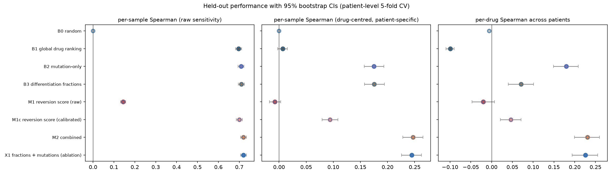
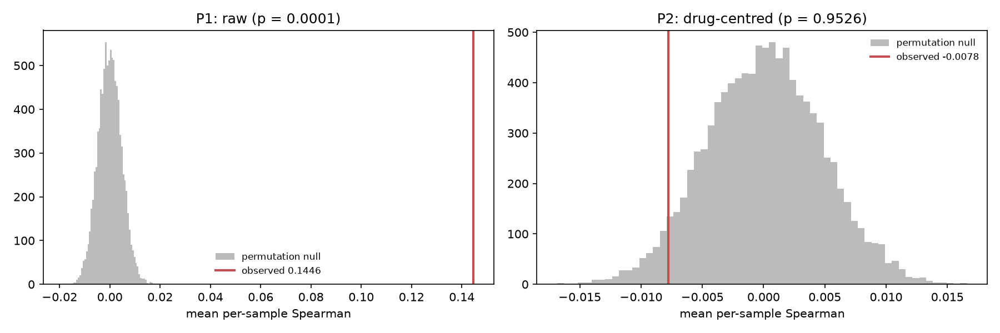
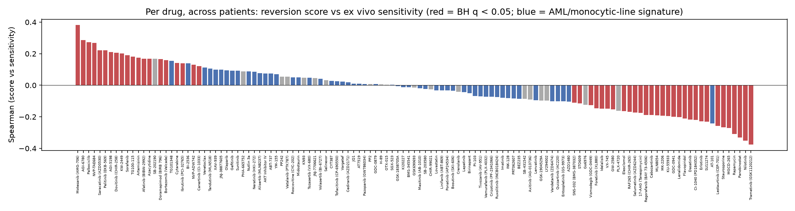
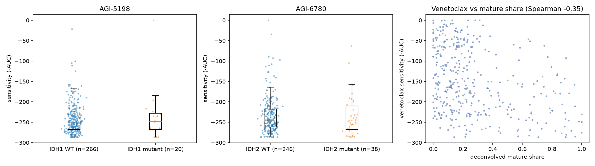
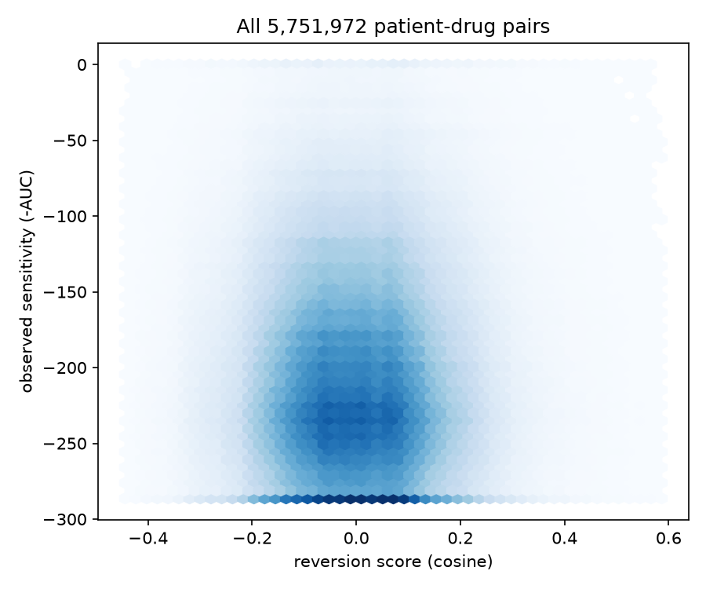

# Phase 4: validation against Beat AML ex vivo drug response

Generated 2026-10-14 by `python -m pipeline.run --phase 4`. Analysis plan: [phase4_plan.md](phase4_plan.md), committed to git before this code was written.

> **Caveat.** Beat AML ex vivo assays measure cell viability after about 3 days. Differentiation agents act through maturation, often over a longer time, so ex vivo sensitivity is only a proxy for what reversion scores target, and mismatch is expected. The panel also contains no clinical differentiation agents (no ATRA, enasidenib or ivosidenib).

## Summary

- Data: **520 samples from 479 patients, 123 drugs, 46,764 patient-drug pairs** (median 100 drugs per sample). 123 overlapping drugs is well above the 15-drug threshold.
- **P1** (reversion score vs sensitivity across drugs, within patient): mean Spearman **0.1446**, permutation p = **0.0001** (significant at 0.025).
- **P2** (same after removing each drug's average potency, i.e. patient-specific signal): mean Spearman **-0.0078**, p = **0.9526** (not significant).
- **Global drug ranking (B1) is the strong baseline:** raw per-sample Spearman 0.696 vs 0.145 for our raw score and 0.720 for the combined model.
- **Pre-registered claims:** information about response: **yes**; patient-specific value: **no**.

## 1. Model comparison (held-out folds)

| model                               |   raw_mean |   raw_lo |   raw_hi |   centred_mean |   centred_lo |   centred_hi |   per_drug_mean |   per_drug_lo |   per_drug_hi |   n_samples_scored |
|:------------------------------------|-----------:|---------:|---------:|---------------:|-------------:|-------------:|----------------:|--------------:|--------------:|-------------------:|
| B0 random                           |     0.0000 |   0.0000 |   0.0000 |         0.0000 |       0.0000 |       0.0000 |         -0.0057 |       -0.0067 |       -0.0048 |           468.0000 |
| B1 global drug ranking              |     0.6960 |   0.6814 |   0.7107 |         0.0068 |      -0.0024 |       0.0155 |         -0.0992 |       -0.1095 |       -0.0899 |           468.0000 |
| B2 mutation-only                    |     0.7085 |   0.6945 |   0.7226 |         0.1750 |       0.1569 |       0.1932 |          0.1798 |        0.1491 |        0.2085 |           468.0000 |
| B3 differentiation fractions        |     0.7100 |   0.6956 |   0.7244 |         0.1755 |       0.1577 |       0.1942 |          0.0707 |        0.0405 |        0.1010 |           468.0000 |
| M1 reversion score (raw)            |     0.1446 |   0.1320 |   0.1562 |        -0.0078 |      -0.0175 |       0.0030 |         -0.0198 |       -0.0468 |        0.0072 |           468.0000 |
| M1c reversion score (calibrated)    |     0.6998 |   0.6857 |   0.7145 |         0.0940 |       0.0792 |       0.1084 |          0.0467 |        0.0212 |        0.0709 |           468.0000 |
| M2 combined                         |     0.7204 |   0.7066 |   0.7348 |         0.2468 |       0.2283 |       0.2655 |          0.2310 |        0.1994 |        0.2598 |           468.0000 |
| X1 fractions + mutations (ablation) |     0.7198 |   0.7060 |   0.7344 |         0.2445 |       0.2259 |       0.2627 |          0.2260 |        0.1941 |        0.2552 |           468.0000 |

`raw`: per-sample Spearman across drugs with raw sensitivity. `centred`: per-sample Spearman after centring each drug with training-fold statistics (B1 is 0 by construction). `per_drug`: mean over drugs of the Spearman across held-out patients. Brackets are patient-level bootstrap 95% CIs.

Paired comparisons (Wilcoxon signed-rank on per-sample Spearman, one-sided):

|                                                      |   mean_diff |      p |
|:-----------------------------------------------------|------------:|-------:|
| M1 reversion score (raw) > B1 (raw)                  |     -0.5514 | 1.0000 |
| M1c reversion score (calibrated) > B1 (raw)          |      0.0038 | 0.0000 |
| M2 combined > B1 (raw)                               |      0.0244 | 0.0000 |
| B2 mutation-only > B1 (raw)                          |      0.0125 | 0.0000 |
| B3 differentiation fractions > B1 (raw)              |      0.0139 | 0.0000 |
| M2 combined > B2 mutation-only (centred)             |      0.0718 | 0.0000 |
| M2 combined > B3 differentiation fractions (centred) |      0.0714 | 0.0000 |
| M1 raw > B0 (centred)                                |     -0.0078 | 0.8868 |

## 2. Primary tests

|                 |   statistic |      p | significant   |
|:----------------|------------:|-------:|:--------------|
| P1 raw          |      0.1446 | 0.0001 | True          |
| P2 drug-centred |     -0.0078 | 0.9526 | False         |

## 3. Per-drug results (M1, all samples)

50 of 123 drugs have BH q < 0.05 (20 positive, 30 negative). Median per-drug Spearman -0.015. Ten most positive and ten most negative:

| drug                    |   n |   spearman |      q | tier          | cells                                   |
|:------------------------|----:|-----------:|-------:|:--------------|:----------------------------------------|
| Motesanib (AMG-706)     | 450 |     0.3811 | 0.0000 | AML/monocytic | THP1                                    |
| AGI-6780                | 297 |     0.2857 | 0.0000 | AML/monocytic | THP1                                    |
| Palbociclib             | 295 |     0.2731 | 0.0000 | AML/monocytic | THP1                                    |
| NVP-TAE684              | 451 |     0.2694 | 0.0000 | AML/monocytic | THP1                                    |
| Saracatinib (AZD0530)   | 450 |     0.2220 | 0.0000 | AML/monocytic | THP1                                    |
| Pelitinib (EKB-569)     | 452 |     0.2212 | 0.0000 | non-myeloid   | A375,A549,HA1E,HEPG2,HT29,MCF7,PC3      |
| AGI-5198                | 299 |     0.2111 | 0.0010 | AML/monocytic | THP1                                    |
| Dovitinib (CHIR-258)    | 455 |     0.2051 | 0.0001 | AML/monocytic | THP1                                    |
| KW-2449                 | 449 |     0.2008 | 0.0001 | AML/monocytic | THP1                                    |
| Sorafenib               | 494 |     0.1910 | 0.0001 | non-myeloid   | A375,A549,HA1E,HEPG2,HT29,MCF7,PC3,VCAP |
| Erlotinib               | 485 |    -0.2282 | 0.0000 | AML/monocytic | THP1                                    |
| SU11274                 | 402 |    -0.2305 | 0.0000 | non-myeloid   | A375,A549,HA1E,HEPG2,HT29,MCF7,PC3,VCAP |
| AT-101                  |  85 |    -0.2423 | 0.0614 | AML/monocytic | NOMO1,SKM1,THP1,U937                    |
| Lestaurtinib (CEP-701)  |  84 |    -0.2574 | 0.0463 | non-myeloid   | A375,A549,HA1E,HEPG2,HT29,MCF7,PC3,VCAP |
| Staurosporine           |  89 |    -0.2666 | 0.0309 | non-myeloid   | A375,A549,HA1E,HEPG2,HT29,MCF7,PC3,VCAP |
| MGCD-265                | 448 |    -0.2706 | 0.0000 | AML/monocytic | THP1                                    |
| Rapamycin               | 466 |    -0.3096 | 0.0000 | AML/monocytic | HL60,NOMO1,SKM1,THP1,U937               |
| Panobinostat            | 286 |    -0.3312 | 0.0000 | non-myeloid   | A375,A549,HA1E,HEPG2,HT29,MCF7,PC3,VCAP |
| Nilotinib               | 472 |    -0.3512 | 0.0000 | AML/monocytic | THP1                                    |
| Trametinib (GSK1120212) | 484 |    -0.3751 | 0.0000 | AML/monocytic | THP1                                    |

## 4. Secondary analyses

| variant                               |   n_drugs |   raw_mean_rho |   raw_p |   centred_mean_rho |   centred_p |
|:--------------------------------------|----------:|---------------:|--------:|-------------------:|------------:|
| landmark genes                        |       123 |         0.1118 |  0.0005 |            -0.0021 |      0.6732 |
| connectivity score                    |       123 |         0.1190 |  0.0005 |             0.0057 |      0.1159 |
| full signature (with ribosomal genes) |       123 |         0.1616 |  0.0005 |            -0.0102 |      0.9850 |
| AML/monocytic-line drugs only         |        93 |         0.1138 |  0.0005 |            -0.0120 |      0.9900 |

These use the same permutation scheme with 2,000 permutations; they are robustness checks, not claims.

## 5. IDH subgroup check

| drug     | mutation     |   n_mut |   n_wt |   median_sens_mut |   median_sens_wt |   p_mut_more_sensitive |   median_reversion_mut |   median_reversion_wt |   p_reversion_differs |
|:---------|:-------------|--------:|-------:|------------------:|-----------------:|-----------------------:|-----------------------:|----------------------:|----------------------:|
| AGI-5198 | IDH1 hotspot |      20 |    266 |         -248.2038 |        -249.7719 |                 0.6120 |                 0.1896 |                0.1380 |                0.0849 |
| AGI-6780 | IDH2 hotspot |      38 |    246 |         -246.6806 |        -244.7440 |                 0.7120 |                 0.0650 |                0.0485 |                0.3620 |

AGI-5198 and AGI-6780 are tool IDH inhibitors. Higher sensitivity in mutant samples would show the assay can see on-target IDH effects; the reversion columns show whether our scores differ between groups (they are computed from expression only).

**Venetoclax sanity check** (pre-registered): Spearman between deconvolved mature share and venetoclax sensitivity = -0.353 (p = 3.47e-12, n = 367). Expected negative (monocytic AML resists venetoclax, Pei et al. 2020).

## 6. Interpretation

- The global drug ranking captures most of the between-drug variance in sensitivity; any patient-level model has to beat it to show patient-specific value.
- The drug-centred metric isolates the patient-specific part. Its size, and whether it beats random, is the honest answer to 'does this tell us which drug for which patient'.
- Most panel drugs are kinase inhibitors and cytotoxics, whose ex vivo effect is killing, not maturation. A reversion score is not designed to predict killing, so weak or negative per-drug correlations are not surprising.

## 7. Exploratory analyses (not pre-registered)

Added after seeing the results above, to understand them. They do not change the pre-registered verdict.

|                                     |   mean_diff |      p |
|:------------------------------------|------------:|-------:|
| M2 combined > X1 ablation (raw)     |      0.0005 | 0.0128 |
| M2 combined > X1 ablation (centred) |      0.0024 | 0.0111 |
| M1c calibrated > B0 (centred)       |      0.0940 | 0.0000 |

- **Per-drug calibration recovers a patient-specific signal.** The raw score fails P2 because the direction of association differs between drugs (20 drugs significantly positive, 30 negative). Letting each drug learn its own slope (M1c) gives a drug-centred Spearman of 0.094 (95% CI 0.079 to 0.108). So the reversion score carries patient-level information, but whether a higher score means more or less sensitivity depends on the drug. This fits the viability readout: for many kinase inhibitors, more mature (monocytic) blasts are less sensitive, not more.
- **Contribution to the combined model.** Removing the reversion score from M2 (X1) gives raw 0.720 and centred 0.244, vs 0.720 and 0.247 for M2; the paired tests above show whether the difference is reliable.
- **B1 per-drug value is negative** by a known artefact: with fold-wise training means, a fold whose training mean is high tends to have lower test values (regression to the mean), which creates a small negative correlation across pooled folds. It does not affect the per-sample metrics.

## 8. Deviations from the plan

- The exploratory analyses in section 7 (and the X1 row in the model table) were added after seeing the results and are labelled as such.
- Otherwise none. Implementation note: the plan's alternative claim clause (M2 beats B1 and B2/B3) already implies M2 beats B1, so the claim rule was coded as P2 significant and (M1 or M2 beats B1).

## Figures

