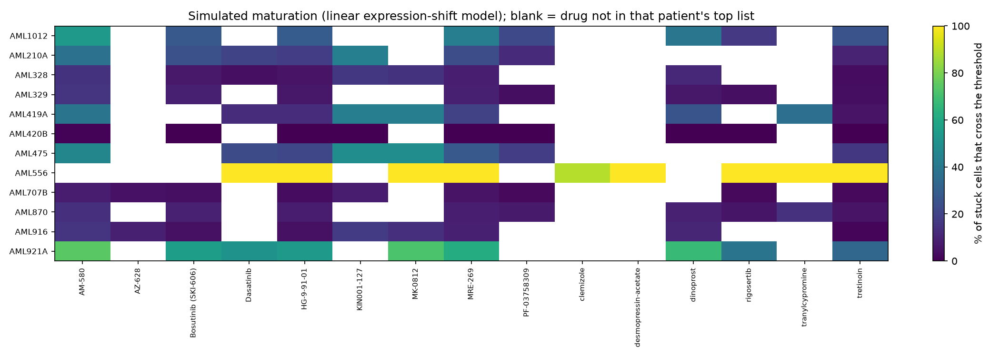

# Phase 5: simulation export

Generated 2026-10-15 by `python -m pipeline.run --phase 5`.

> **What the motion means.** Cells move because their log expression is shifted linearly along a drug's LINCS consensus signature: x' = x + alpha * v, where v is the drug's z-score per gene (landmark and best-inferred genes only) times the gene's SD in the normal reference, rescaled to a common length for every drug (see caveats), and alpha rises linearly from 0 to 1.0 over 30 frames. Each frame is placed with the fixed Phase 1 map. This is a visualization of a hypothesis. It is not a model of cell fate, dose, time, toxicity or resistance mechanisms.

## Setup

- Patients: the 12 van Galen patients with malignant cells at diagnosis; up to 300 cells each (random subsample with the fixed seed; all cells if fewer).
- Drugs per patient: the top 8 named compounds in that patient's Phase 3 ranking whose signature comes from AML/monocytic lines, plus tretinoin as a reference positive control.
- Maturity threshold: 0.461 (Phase 2). A cell that starts below it is **matured** if it ends above it, **resistant** if it never crosses it, and **transient** if it crosses and falls back.
- Export: `web/public/data/`, 6.5 MB in total. Trajectories are uint16-quantized (x, y, score) per frame per cell.

## Outcomes

| patient   | drug                 |   n |   already_mature |   stuck_start |   matured |   resistant |   transient |   pct_matured_of_stuck |   mean_score_start |   mean_score_end |
|:----------|:---------------------|----:|-----------------:|--------------:|----------:|------------:|------------:|-----------------------:|-------------------:|-----------------:|
| AML210A   | MRE-269              | 300 |              207 |            93 |        22 |          71 |           0 |                  23.66 |               0.60 |             0.70 |
| AML210A   | HG-9-91-01           | 300 |              207 |            93 |        17 |          76 |           0 |                  18.28 |               0.60 |             0.69 |
| AML210A   | Bosutinib (SKI-606)  | 300 |              207 |            93 |        23 |          70 |           0 |                  24.73 |               0.60 |             0.71 |
| AML210A   | tretinoin            | 300 |              207 |            93 |         9 |          84 |           0 |                   9.68 |               0.60 |             0.68 |
| AML210A   | AM-580               | 300 |              207 |            93 |        35 |          58 |           0 |                  37.63 |               0.60 |             0.73 |
| AML210A   | Dasatinib            | 300 |              207 |            93 |        19 |          74 |           0 |                  20.43 |               0.60 |             0.70 |
| AML210A   | KIN001-127           | 300 |              207 |            93 |        40 |          53 |           0 |                  43.01 |               0.60 |             0.75 |
| AML210A   | PF-03758309          | 300 |              207 |            93 |        11 |          82 |           0 |                  11.83 |               0.60 |             0.67 |
| AML328    | AM-580               | 300 |              110 |           190 |        28 |         162 |           0 |                  14.74 |               0.37 |             0.50 |
| AML328    | MRE-269              | 300 |              110 |           190 |        16 |         174 |           0 |                   8.42 |               0.37 |             0.45 |
| AML328    | MK-0812              | 300 |              110 |           190 |        28 |         162 |           0 |                  14.74 |               0.37 |             0.50 |
| AML328    | Bosutinib (SKI-606)  | 300 |              110 |           190 |        13 |         177 |           0 |                   6.84 |               0.37 |             0.44 |
| AML328    | HG-9-91-01           | 300 |              110 |           190 |        10 |         180 |           0 |                   5.26 |               0.37 |             0.43 |
| AML328    | KIN001-127           | 300 |              110 |           190 |        31 |         159 |           0 |                  16.32 |               0.37 |             0.49 |
| AML328    | dinoprost            | 300 |              110 |           190 |        21 |         169 |           0 |                  11.05 |               0.37 |             0.45 |
| AML328    | Dasatinib            | 300 |              110 |           190 |         8 |         182 |           0 |                   4.21 |               0.37 |             0.43 |
| AML328    | tretinoin            | 300 |              110 |           190 |         6 |         184 |           0 |                   3.16 |               0.37 |             0.42 |
| AML329    | Bosutinib (SKI-606)  | 253 |               41 |           212 |        19 |         193 |           0 |                   8.96 |               0.23 |             0.31 |
| AML329    | MRE-269              | 253 |               41 |           212 |        19 |         192 |           1 |                   8.96 |               0.23 |             0.33 |
| AML329    | rigosertib           | 253 |               41 |           212 |         9 |         202 |           1 |                   4.25 |               0.23 |             0.27 |
| AML329    | HG-9-91-01           | 253 |               41 |           212 |        14 |         197 |           1 |                   6.60 |               0.23 |             0.30 |
| AML329    | AM-580               | 253 |               41 |           212 |        33 |         179 |           0 |                  15.57 |               0.23 |             0.40 |
| AML329    | PF-03758309          | 253 |               41 |           212 |         8 |         204 |           0 |                   3.77 |               0.23 |             0.27 |
| AML329    | tretinoin            | 253 |               41 |           212 |         8 |         204 |           0 |                   3.77 |               0.23 |             0.28 |
| AML329    | dinoprost            | 253 |               41 |           212 |        14 |         197 |           1 |                   6.60 |               0.23 |             0.31 |
| AML419A   | MRE-269              | 300 |              188 |           112 |        22 |          90 |           0 |                  19.64 |               0.59 |             0.69 |
| AML419A   | KIN001-127           | 300 |              188 |           112 |        48 |          64 |           0 |                  42.86 |               0.59 |             0.74 |
| AML419A   | MK-0812              | 300 |              188 |           112 |        48 |          64 |           0 |                  42.86 |               0.59 |             0.74 |
| AML419A   | AM-580               | 300 |              188 |           112 |        43 |          69 |           0 |                  38.39 |               0.59 |             0.73 |
| AML419A   | HG-9-91-01           | 300 |              188 |           112 |        14 |          98 |           0 |                  12.50 |               0.59 |             0.67 |
| AML419A   | tranylcypromine      | 300 |              188 |           112 |        41 |          71 |           0 |                  36.61 |               0.59 |             0.73 |
| AML419A   | dinoprost            | 300 |              188 |           112 |        29 |          83 |           0 |                  25.89 |               0.59 |             0.69 |
| AML419A   | Dasatinib            | 300 |              188 |           112 |        14 |          98 |           0 |                  12.50 |               0.59 |             0.68 |
| AML419A   | tretinoin            | 300 |              188 |           112 |         6 |         106 |           0 |                   5.36 |               0.59 |             0.65 |
| AML420B   | AM-580               | 100 |                3 |            97 |         1 |          96 |           0 |                   1.03 |               0.10 |             0.14 |
| AML420B   | Bosutinib (SKI-606)  | 100 |                3 |            97 |         0 |          97 |           0 |                   0.00 |               0.10 |             0.10 |
| AML420B   | HG-9-91-01           | 100 |                3 |            97 |         0 |          97 |           0 |                   0.00 |               0.10 |             0.10 |
| AML420B   | MRE-269              | 100 |                3 |            97 |         0 |          97 |           0 |                   0.00 |               0.10 |             0.11 |
| AML420B   | dinoprost            | 100 |                3 |            97 |         0 |          97 |           0 |                   0.00 |               0.10 |             0.10 |
| AML420B   | PF-03758309          | 100 |                3 |            97 |         0 |          97 |           0 |                   0.00 |               0.10 |             0.08 |
| AML420B   | rigosertib           | 100 |                3 |            97 |         0 |          97 |           0 |                   0.00 |               0.10 |             0.09 |
| AML420B   | KIN001-127           | 100 |                3 |            97 |         0 |          97 |           0 |                   0.00 |               0.10 |             0.13 |
| AML420B   | tretinoin            | 100 |                3 |            97 |         0 |          97 |           0 |                   0.00 |               0.10 |             0.10 |
| AML475    | AM-580               | 300 |              239 |            61 |        28 |          33 |           0 |                  45.90 |               0.67 |             0.80 |
| AML475    | HG-9-91-01           | 300 |              239 |            61 |        13 |          48 |           0 |                  21.31 |               0.67 |             0.78 |
| AML475    | MRE-269              | 300 |              239 |            61 |        17 |          43 |           1 |                  27.87 |               0.67 |             0.78 |
| AML475    | MK-0812              | 300 |              239 |            61 |        30 |          31 |           0 |                  49.18 |               0.67 |             0.80 |
| AML475    | KIN001-127           | 300 |              239 |            61 |        30 |          31 |           0 |                  49.18 |               0.67 |             0.81 |
| AML475    | Dasatinib            | 300 |              239 |            61 |        14 |          47 |           0 |                  22.95 |               0.67 |             0.78 |
| AML475    | tretinoin            | 300 |              239 |            61 |        10 |          51 |           0 |                  16.39 |               0.67 |             0.76 |
| AML475    | PF-03758309          | 300 |              239 |            61 |        11 |          50 |           0 |                  18.03 |               0.67 |             0.76 |
| AML556    | MRE-269              | 300 |              291 |             9 |         9 |           0 |           0 |                 100.00 |               0.77 |             0.86 |
| AML556    | rigosertib           | 300 |              291 |             9 |         9 |           0 |           0 |                 100.00 |               0.77 |             0.86 |
| AML556    | HG-9-91-01           | 300 |              291 |             9 |         9 |           0 |           0 |                 100.00 |               0.77 |             0.87 |
| AML556    | Dasatinib            | 300 |              291 |             9 |         9 |           0 |           0 |                 100.00 |               0.77 |             0.87 |
| AML556    | desmopressin-acetate | 300 |              291 |             9 |         9 |           0 |           0 |                 100.00 |               0.77 |             0.84 |
| AML556    | tranylcypromine      | 300 |              291 |             9 |         9 |           0 |           0 |                 100.00 |               0.77 |             0.85 |
| AML556    | MK-0812              | 300 |              291 |             9 |         9 |           0 |           0 |                 100.00 |               0.77 |             0.85 |
| AML556    | clemizole            | 300 |              291 |             9 |         8 |           1 |           0 |                  88.89 |               0.77 |             0.83 |
| AML556    | tretinoin            | 300 |              291 |             9 |         9 |           0 |           0 |                 100.00 |               0.77 |             0.86 |
| AML707B   | AM-580               | 300 |                2 |           298 |        23 |         275 |           0 |                   7.72 |               0.06 |             0.19 |
| AML707B   | MRE-269              | 300 |                2 |           298 |        16 |         282 |           0 |                   5.37 |               0.06 |             0.14 |
| AML707B   | HG-9-91-01           | 300 |                2 |           298 |        10 |         288 |           0 |                   3.36 |               0.06 |             0.11 |
| AML707B   | Bosutinib (SKI-606)  | 300 |                2 |           298 |        12 |         286 |           0 |                   4.03 |               0.06 |             0.11 |
| AML707B   | PF-03758309          | 300 |                2 |           298 |         8 |         290 |           0 |                   2.68 |               0.06 |             0.08 |
| AML707B   | rigosertib           | 300 |                2 |           298 |         8 |         290 |           0 |                   2.68 |               0.06 |             0.09 |
| AML707B   | KIN001-127           | 300 |                2 |           298 |        24 |         274 |           0 |                   8.05 |               0.06 |             0.19 |
| AML707B   | AZ-628               | 300 |                2 |           298 |        14 |         284 |           0 |                   4.70 |               0.06 |             0.11 |
| AML707B   | tretinoin            | 300 |                2 |           298 |         7 |         291 |           0 |                   2.35 |               0.06 |             0.10 |
| AML870    | MRE-269              | 300 |               17 |           283 |        24 |         259 |           0 |                   8.48 |               0.10 |             0.16 |
| AML870    | HG-9-91-01           | 300 |               17 |           283 |        23 |         260 |           0 |                   8.13 |               0.10 |             0.15 |
| AML870    | AM-580               | 300 |               17 |           283 |        39 |         244 |           0 |                  13.78 |               0.10 |             0.21 |
| AML870    | rigosertib           | 300 |               17 |           283 |        16 |         267 |           0 |                   5.65 |               0.10 |             0.12 |
| AML870    | Bosutinib (SKI-606)  | 300 |               17 |           283 |        26 |         257 |           0 |                   9.19 |               0.10 |             0.15 |
| AML870    | PF-03758309          | 300 |               17 |           283 |        20 |         263 |           0 |                   7.07 |               0.10 |             0.14 |
| AML870    | tranylcypromine      | 300 |               17 |           283 |        40 |         243 |           0 |                  14.13 |               0.10 |             0.21 |
| AML870    | dinoprost            | 300 |               17 |           283 |        26 |         257 |           0 |                   9.19 |               0.10 |             0.15 |
| AML870    | tretinoin            | 300 |               17 |           283 |        15 |         268 |           0 |                   5.30 |               0.10 |             0.13 |
| AML916    | AM-580               | 300 |                1 |           299 |        46 |         252 |           1 |                  15.38 |               0.05 |             0.26 |
| AML916    | MRE-269              | 300 |                1 |           299 |        26 |         273 |           0 |                   8.70 |               0.05 |             0.19 |
| AML916    | HG-9-91-01           | 300 |                1 |           299 |        14 |         285 |           0 |                   4.68 |               0.05 |             0.13 |
| AML916    | KIN001-127           | 300 |                1 |           299 |        53 |         246 |           0 |                  17.73 |               0.05 |             0.25 |
| AML916    | dinoprost            | 300 |                1 |           299 |        32 |         267 |           0 |                  10.70 |               0.05 |             0.18 |
| AML916    | AZ-628               | 300 |                1 |           299 |        26 |         273 |           0 |                   8.70 |               0.05 |             0.16 |
| AML916    | Bosutinib (SKI-606)  | 300 |                1 |           299 |        13 |         286 |           0 |                   4.35 |               0.05 |             0.12 |
| AML916    | MK-0812              | 300 |                1 |           299 |        42 |         257 |           0 |                  14.05 |               0.05 |             0.26 |
| AML916    | tretinoin            | 300 |                1 |           299 |         4 |         295 |           0 |                   1.34 |               0.05 |             0.10 |
| AML921A   | Dasatinib            | 300 |              116 |           184 |        94 |          90 |           0 |                  51.09 |               0.37 |             0.61 |
| AML921A   | HG-9-91-01           | 300 |              116 |           184 |        99 |          85 |           0 |                  53.80 |               0.37 |             0.62 |
| AML921A   | MRE-269              | 300 |              116 |           184 |       114 |          70 |           0 |                  61.96 |               0.37 |             0.65 |
| AML921A   | AM-580               | 300 |              116 |           184 |       137 |          47 |           0 |                  74.46 |               0.37 |             0.70 |
| AML921A   | Bosutinib (SKI-606)  | 300 |              116 |           184 |       103 |          81 |           0 |                  55.98 |               0.37 |             0.64 |
| AML921A   | rigosertib           | 300 |              116 |           184 |        71 |         113 |           0 |                  38.59 |               0.37 |             0.56 |
| AML921A   | dinoprost            | 300 |              116 |           184 |       124 |          60 |           0 |                  67.39 |               0.37 |             0.68 |
| AML921A   | MK-0812              | 300 |              116 |           184 |       132 |          52 |           0 |                  71.74 |               0.37 |             0.69 |
| AML921A   | tretinoin            | 300 |              116 |           184 |        61 |         123 |           0 |                  33.15 |               0.37 |             0.55 |
| AML1012   | AM-580               | 300 |              132 |           168 |        91 |          76 |           1 |                  54.17 |               0.42 |             0.65 |
| AML1012   | dinoprost            | 300 |              132 |           168 |        66 |         102 |           0 |                  39.29 |               0.42 |             0.60 |
| AML1012   | HG-9-91-01           | 300 |              132 |           168 |        49 |         119 |           0 |                  29.17 |               0.42 |             0.57 |
| AML1012   | rigosertib           | 300 |              132 |           168 |        28 |         139 |           1 |                  16.67 |               0.42 |             0.53 |
| AML1012   | MRE-269              | 300 |              132 |           168 |        72 |          96 |           0 |                  42.86 |               0.42 |             0.60 |
| AML1012   | tretinoin            | 300 |              132 |           168 |        43 |         125 |           0 |                  25.60 |               0.42 |             0.56 |
| AML1012   | PF-03758309          | 300 |              132 |           168 |        37 |         130 |           1 |                  22.02 |               0.42 |             0.54 |
| AML1012   | Bosutinib (SKI-606)  | 300 |              132 |           168 |        47 |         121 |           0 |                  27.98 |               0.42 |             0.59 |

## Caveats specific to the motion

- **Common shift length.** Raw LINCS signatures differ hugely in magnitude; with raw signatures, 68% of final-frame cells ended up off the normal manifold and the animation mostly showed magnitude. Each drug's shift is therefore rescaled to the same length, so the motion reflects direction (what the ranking scores). The length was set by a fixed rule: the largest candidate keeping at most 20% of final-frame cells off-manifold on average. Scan (length: mean off-manifold share) = 2: 1.6%, 3: 1.8%, 4: 2.2%, 5: 2.8%, 6: 3.8%, 8: 7.7%, 10: 15.6%, 12: 29.7%; chosen length **10**.
- After rescaling, % matured and raw signature size correlate at Spearman -0.69 across drugs. Large raw signatures no longer win by size; the negative sign means drugs with the largest raw LINCS responses change many genes that are not on the maturation axis, so once length is equalized they move cells least.
- **Off-manifold endpoints.** At the last frame, on average 16% of cells are further from any normal reference cell than the Phase 2 off-manifold cut (vs 2% at the start). Those cells are drawn at their nearest normal neighbours, so their final position overstates how 'normal' the shifted expression is. The animation shows a direction of change, not a claim that cells become normal monocytes.

| drug                 |   pct_matured |   offmanifold_end |   raw_shift_norm |
|:---------------------|--------------:|------------------:|-----------------:|
| desmopressin-acetate |       100.000 |             0.107 |            9.197 |
| clemizole            |        88.889 |             0.157 |           14.709 |
| tranylcypromine      |        50.247 |             0.111 |           11.630 |
| MK-0812              |        48.760 |             0.219 |            8.275 |
| Dasatinib            |        35.196 |             0.201 |           22.564 |
| AM-580               |        28.979 |             0.109 |           10.440 |
| MRE-269              |        26.326 |             0.194 |           20.318 |
| KIN001-127           |        25.306 |             0.125 |           12.151 |
| rigosertib           |        23.977 |             0.174 |           48.908 |
| HG-9-91-01           |        21.925 |             0.175 |           23.410 |
| dinoprost            |        21.264 |             0.142 |           26.846 |
| tretinoin            |        17.175 |             0.136 |           13.909 |
| Bosutinib (SKI-606)  |        15.784 |             0.163 |           17.350 |
| PF-03758309          |         9.344 |             0.083 |           55.830 |
| AZ-628               |         6.697 |             0.298 |           42.905 |

## Choices and justifications

| Choice                                           | Justification                                                                                                                                                             |
|:-------------------------------------------------|:--------------------------------------------------------------------------------------------------------------------------------------------------------------------------|
| Shift in units of reference gene SD.             | LINCS z-scores are relative to plate controls; scaling by each gene's spread in the reference keeps shifts comparable across genes with very different expression levels. |
| Same alpha schedule for every drug.              | Differences between drugs then come only from their signatures, not from a per-drug tuning.                                                                               |
| Only landmark and best-inferred genes are moved. | The other inferred genes are least reliable; moving them would add noise.                                                                                                 |
| Clip expression at zero.                         | Log-normalized expression cannot be negative.                                                                                                                             |
| Always include tretinoin.                        | Lets every patient be compared with the clinically used differentiation agent.                                                                                            |
| Subsample to 300 cells.                          | Keeps the static site small and fast while showing each patient's distribution.                                                                                           |
